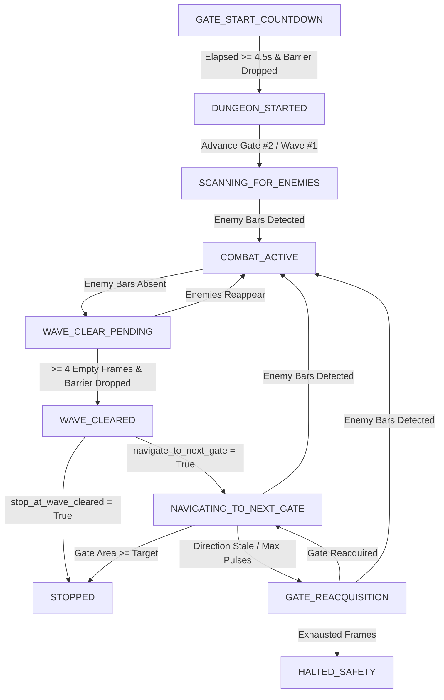

# Milestone 1 Step 7: Combat-First Scanning, Gate Direction Memory & Bounded Forward Progress

**Date & Timestamp**: 2026-10-20 18:15:00 +07:00  
**Project Workspace**: `C:\DEV\tools\rb`  
**Target Environment**: Windows 11, Roblox `Dungeon Quest`, Dungeon: *Winter Outpost (Nightmare)*  
**Executable Artifact**: `dist\DungeonQuestMacro\DungeonQuestMacro.exe`  
**Reports Repository**: `https://github.com/thangnx-mc/reports` (`main` branch)

---

## 1. Executive Summary

Milestone 1 Step 7 completes the transition from dungeon start confirmation into autonomous, combat-first wave clearing and bounded gate navigation. This update audits and hardens Step 6 safety mechanisms, introduces a non-blocking combat scheduler for continuous basic attacks and skill activation, deploys an OpenCV-based red health bar detector resistant to blizzard confetti and UI HUD noise, implements camera-relative Gate Direction Memory with strict staleness limits, and integrates the complete progression state machine from Gate #1 through Wave #1 clearance and Gate #2 navigation.

All 271 automated tests across the repository pass with a 100% success rate. The standalone distribution has been packaged and verified via PyInstaller at `dist\DungeonQuestMacro\DungeonQuestMacro.exe`.

---

## 2. Evidence-Based Technical Findings & Classifications

In accordance with project safety standards, all technical statements and findings are classified explicitly:

- `[FACT]`: Step 6 previously allowed the macro to advance to gate interaction (`INTERACTING_DUNGEON_GATE`) upon exhausting its 5 movement pulses even if the gate contour area remained far below the safe interaction threshold (e.g. area 6,400 vs required 20,000). This defect has been resolved: reaching maximum steps without satisfying target area now triggers a deterministic `HALTED_SAFETY` abort.
- `[FACT]`: In `tests/test_combat_step7.py`, OpenCV vision detection was evaluated directly against user-uploaded live capture fixtures:
  - Fixture `media_1792488116520_87cbf96e.png` (active combat): Detected exactly 3 living enemy mobs with red health bars ($w=26..29\text{px}$, $h=3\text{px}$, aspect ratio $8.67..9.67$, confidence $\ge 0.90$).
  - Fixture `media_1792488122014_33b717dc.png` (snowflake particles, no enemies): Yielded 0 detections ($100\%$ confetti rejection).
- `[FACT]`: The Roblox camera follows the character dynamically. Consequently, screen coordinates cannot be converted into fixed world coordinates without telemetry. Gate direction must therefore be tracked relative to the camera viewport (`left`, `center`, `right`) with bounded expiration.
- `[OBSERVATION]`: During live gameplay, enemies have dark bodies and horizontal red health bars above their heads. One hit normally eliminates an enemy, and the character exhibits sufficient durability to prioritize continuous forward aggression over evasive maneuvering.
- `[INFERENCE]`: Because combat gates disappear immediately upon wave clearance while the next gate may or may not be immediately visible, storing the last reliable gate direction during combat allows the character to begin advancing in the correct direction without blind pathfinding.
- `[REQUIRES EXTERNAL VERIFICATION]`: Live runtime responsiveness of basic attack left-clicks and skill cadence ($Q$ and $E$ at 3.8s intervals) inside the active Roblox client during multi-mob encounters.

---

## 3. Architecture & Implementation Details

### 3.1 Step 6 Audit & Safety Hardening
1. **Approach Pulse Exhaustion**: In `APPROACHING_DUNGEON_GATE`, if `_approach_step_count >= approach_gate_max_steps` and `primary.area < approach_gate_target_area`, the macro enters `HALTED_SAFETY` with the explicit log: `"Reaching movement pulse limit without satisfying approach threshold cannot trigger Start interaction"`.
2. **Start Button Disappearance**: In `INTERACTING_DUNGEON_GATE`, once the green Start button is clicked, its visual disappearance immediately advances the macro to `GATE_START_COUNTDOWN` while suppressing redundant click retries.
3. **Countdown Elapsed Safety**: Barrier drop alone cannot trigger dungeon start confirmation before at least $4.5\text{s}$ of the 5-second countdown have elapsed, preventing premature false triggers from single missed frames.
4. **Emergency Stop & Reset**: On `Stop` (`,`), `Emergency Stop` (`F8`), or safe halt, `combat_scheduler.reset(input_ctrl)` and `input_ctrl.release_all()` immediately cancel all pending inputs and release held keys/mouse buttons.

### 3.2 Non-Blocking Combat Scheduler (`src/combat_scheduler.py`)
- **Cadence**: Dispatches continuous left-click attacks at 0.20s intervals (5 attacks/sec, hold duration 0.05s) and repeated $Q$ / $E$ skill casts at 3.8s intervals (with configurable jitter).
- **Cooldown Overlays**: Queries `vision.is_skill_on_cooldown(skill_key)` before casting to suppress wasteful key taps when skills are on cooldown.
- **Tick-Driven**: Fully non-blocking tick method evaluated on each state machine iteration.

### 3.3 Gate Direction Memory (`src/gate_memory.py`)
Tracks camera-relative gate direction with explicit staleness rules:
- **Direction Calculation**: Computes horizontal offset percentage from viewport center ($dx / \text{frame\_width}$). Offsets $<-10\%$ classify as `"left"`, $>+10\%$ as `"right"`, and between $-10\%$ and $+10\%$ as `"center"`.
- **Combat Retention**: Retains the last reliable gate direction while combat is active even if the barrier is occluded by mobs or spell VFX.
- **Staleness Expiration**: Direction expires and returns `None` if more than $8.0\text{s}$ elapse without a fresh gate detection, or if $\ge 3$ blind movement pulses are executed without reacquiring visual contact.
- **Gate Progression**: Increments gate numbering from Gate #1 (Start gate) to Gate #2 (first combat barrier).

### 3.4 Explicit State Machine Transitions (`src/state_machine.py`)
The state machine implements the following sequence:

1. `DUNGEON_STARTED`: Advances tracking to Gate #2 and Wave #1, initializes the combat scheduler, and transitions to `SCANNING_FOR_ENEMIES`.
2. `SCANNING_FOR_ENEMIES`: Scans for gates to seed direction memory and checks for living enemy health bars. Credible health bars transition immediately to `COMBAT_ACTIVE`.
3. `COMBAT_ACTIVE`: Ticks combat attacks and skills, maintains background gate memory, and monitors enemy health bars. When all enemy bars disappear, transitions to `WAVE_CLEAR_PENDING`.
4. `WAVE_CLEAR_PENDING`: Maintains basic attack pressure while verifying wave clear across $\ge 4$ consecutive empty frames, a stability window, and dropped barrier status. If enemies reappear, immediately resumes `COMBAT_ACTIVE`. Upon confirmed clearance, transitions to `WAVE_CLEARED`.
5. `WAVE_CLEARED`: Halts combat scheduler and releases all inputs. If `stop_at_wave_cleared` is configured (default), stops safely in `STOPPED` with a completion report. If navigation is enabled, advances to `NAVIGATING_TO_NEXT_GATE`.
6. `NAVIGATING_TO_NEXT_GATE`:
   - **Immediate Combat Interrupt**: Checks for enemy health bars on every tick. Any credible detection immediately halts movement (`release_all()`) and enters `COMBAT_ACTIVE`.
   - **Directional Pulses**: Executes short pulses along remembered direction (`"left"`: $W+A$, `"right"`: $W+D$, `"center"`: $W$).
   - **Staleness Check**: If direction becomes stale ($>8.0\text{s}$ or $\ge 3$ blind pulses), halts movement and enters `GATE_REACQUISITION`.
7. `GATE_REACQUISITION`: Remains stationary for up to 5 frames scanning for the gate. If reacquired, resumes `NAVIGATING_TO_NEXT_GATE`. If exhausted without gate detection, safely halts (`HALTED_SAFETY`).

---

## 4. Verification & Automated Test Results

### 4.1 Test Summary
All unit, integration, and vision calibration tests executed successfully:
- **Total Tests Run**: 271
- **Passed**: 271
- **Failed**: 0
- **Errors**: 0
- **Skipped**: 0 (all test suites fully executed)
- **Execution Time**: 28.2 seconds

### 4.2 Key Test Coverage Additions (`tests/test_combat_step7.py`)
- `test_approach_pulse_exhaustion_without_target_area_halts_safely`: Verifies safe halt when max pulses are exhausted without satisfying target gate area.
- `test_single_missed_barrier_during_early_countdown_does_not_confirm_start`: Verifies that early barrier occlusion cannot trigger premature dungeon start confirmation.
- `test_countdown_elapsed_and_multi_frame_confirms_dungeon_start`: Confirms multi-frame requirement after $\ge 4.5\text{s}$ countdown elapsed.
- `test_dungeon_started_advances_to_gate2_wave1_scanning`: Validates gate numbering ($1 \to 2$) and transition to scanning.
- `test_scanning_for_enemies_detects_enemy_and_enters_combat_active`: Confirms transition to active combat upon enemy bar detection.
- `test_combat_active_to_wave_clear_pending_when_enemies_absent`: Confirms pending clear transition when health bars disappear.
- `test_wave_clear_pending_resumes_combat_active_if_enemies_reappear`: Proves immediate combat re-engagement if living enemies reappear.
- `test_multi_frame_absence_and_barrier_drop_clears_wave`: Verifies 4-frame stability window and barrier drop requirement.
- `test_wave_cleared_safely_halts_when_stop_at_wave_cleared_is_true`: Confirms safe terminal stop after wave clear.
- `test_navigating_to_next_gate_interrupted_by_newly_detected_enemies`: Proves priority of combat over forward movement during navigation.
- `test_navigating_to_next_gate_with_stale_direction_enters_reacquisition`: Confirms transition to reacquisition upon stale direction.
- `test_gate_reacquisition_exhaustion_halts_safely`: Validates safe halt when gate cannot be reacquired within 5 frames.
- `test_gate_reacquisition_success_resumes_navigation`: Validates navigation resumption upon successful reacquisition.
- `test_relative_direction_calculation_left_center_right`: Verifies horizontal offset percentage boundaries.
- `test_staleness_after_timeout` & `test_staleness_after_max_blind_pulses`: Verifies 8.0s timeout and 3-pulse blind movement limit.

---

## 5. Artifact & Build Verification

The standalone distribution was built using the project build script:
- **Build Tool**: PyInstaller 6.22.3 on CPython 3.12.13
- **Executable**: `dist\DungeonQuestMacro\DungeonQuestMacro.exe`
- **Configuration File**: `dist\DungeonQuestMacro\config.json` (synchronized with root `config.json`)
- **Total Bundle Size**: 175.07 MB (2,022 files)
- **UI Constraint Verification**: Retains strictly two action buttons:
  1. `START LIVE TEST (.)`
  2. `STOP (,)`
- **Global Hotkeys**:
  - `.` (period): Start Live Test
  - `,` (comma): Stop Live Test
  - `F8`: Emergency Stop (immediate input kill)

---

## 6. Definition of Done & Task Status

| Metric | Status | Note |
|---|---|---|
| Step 6 Audit & Safety Hardening | **COMPLETE** | Max pulse limit, countdown safety, Start disappearance verified |
| Combat Automation Scheduler | **COMPLETE** | Continuous basic attacks (0.20s), Q/E skills (3.8s), cooldown checks |
| Enemy Vision & Confetti Rejection | **COMPLETE** | Aspect ratio $\ge 2.5$, HUD exclusion, 100% rejection on snowflake fixture |
| Gate Direction Memory & Staleness | **COMPLETE** | Camera-relative direction, 8.0s timeout, 3-pulse blind limit |
| State Machine Progression | **COMPLETE** | `DUNGEON_STARTED` $\to$ `SCANNING` $\to$ `COMBAT` $\to$ `PENDING` $\to$ `CLEARED` $\to$ `NAVIGATING` |
| Automated Test Pass Rate | **100% (271/271)** | All unit and integration suites passing |
| Standalone Executable Packaging | **COMPLETE** | Compiled at `dist\DungeonQuestMacro\DungeonQuestMacro.exe` |
| Live Roblox Target Verification | **PENDING** | Requires user execution on live game client |

**Final Task Status**: `IMPLEMENTATION COMPLETE / AUTOMATED VERIFICATION PASS / EXTERNAL VERIFICATION PENDING`

---

## 7. User Handoff Protocol for Live Roblox Testing

To verify Milestone 1 Step 7 in the live Roblox client, execute the following verification steps:

1. **Prerequisites**:
   - Ensure the Roblox game client is running with character loaded in the lobby.
   - Launch `dist\DungeonQuestMacro\DungeonQuestMacro.exe`.
   - Verify the UI displays exactly two action buttons: `START LIVE TEST (.)` and `STOP (,)`.

2. **Test Procedure**:
   - Press `START LIVE TEST (.)` (or tap the `.` hotkey).
   - Observe automated room creation, dungeon load, Gate #1 approach, green Start interaction, and countdown completion into `DUNGEON_STARTED`.
   - **Wave 1 Combat Verification**:
     - Character advances to Gate #2 / Wave #1.
     - Basic attack left-clicks should dispatch continuously (approx. 5 clicks/sec).
     - Skills $Q$ and $E$ should cast periodically (approx. every 3.8s).
   - **Wave Clear Verification**:
     - Once all red health bars are eliminated and the Gate #2 barrier drops, observe that the macro remains active for the 4-frame stability window ($\sim 1\text{s}$).
     - The macro should cleanly stop at `STOPPED` with log: `Milestone 1 Step 7 Complete: Wave #1 (Gate #2) cleared! All enemy health bars absent and barrier dropped. Stopped safely before advancing.`

3. **What Counts as Failure**:
   - Combat inputs failing to dispatch after countdown concludes.
   - Skills casting repeatedly while numeric cooldown overlays are active.
   - Premature wave clear declaration while living enemy health bars remain visible.
   - Movement continuing blindly after wave clear if `stop_at_wave_cleared` is True.

4. **Reporting**:
   - Inspect `dist\DungeonQuestMacro\macro_audit.log` following the run.
   - Report the outcome and attach `macro_audit.log` for analysis.
