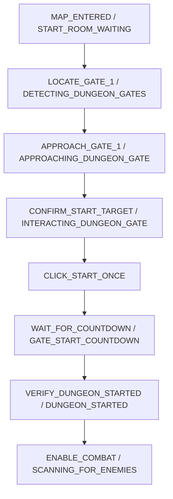

# Milestone 1 Step 7 Bugfix: Gate #1 Startup, Mouse Camera Steering, Combat Gating & Safe Navigation

**Date & Timestamp**: 2026-10-20 21:15:00 +07:00  
**Project Workspace**: `C:\DEV\tools\rb`  
**Target Environment**: Windows 11, Roblox `Dungeon Quest`, Dungeon: *Winter Outpost (Nightmare)*  
**Executable Artifact**: `dist\DungeonQuestMacro\DungeonQuestMacro.exe`  
**Reports Repository**: `https://github.com/thangnx-mc/reports` (`main` branch)

---

## 1. Executive Summary

During live runtime verification of Milestone 1 Step 7 in the active Roblox client, a critical startup bypass defect was observed: after entering the dungeon map, the character did not move toward Gate #1, did not approach or click Gate #1's green Start button, and instead stood stationary while continuously spamming basic attacks (left-click) and skills ($Q$/$E$) until the room watchdog halted execution.

Audit log inspection of `dist\DungeonQuestMacro\macro_audit.log` (line 720) isolated the exact root cause:
```text
[TRANSITION_VERIFIED] Transition: [MAP_LOADING] -> [IN_DUNGEON_ACTIVE] (Already inside active dungeon)
```
In `src/state_machine.py`, the condition to advance toward the gate was evaluated as:
```python
advance_to_gate = bool(stop_at_gates_detected or stop_at_dungeon_started)
```
In Step 7 configuration, both `stop_at_gates_detected` and `stop_at_dungeon_started` were set to `False` to allow multi-phase progression into Wave #1 combat. Because `advance_to_gate` evaluated to `False`, the state machine treated any subsequent `ROOM_COMBAT` or `IN_DUNGEON` visual classification as proof that the player was already inside an active dungeon encounter, instantly jumping directly to `IN_DUNGEON_ACTIVE` and initiating combat routines without ever locating Gate #1, approaching it, or activating the Start countdown.

This update resolves the startup bypass, implements active mouse camera steering for diagonal alignment, enforces rectangular aspect-ratio validation on the Start button, guarantees strict combat scheduler inactivity until dungeon start confirmation, and updates global hotkeys and UI labels to `;` (Start) and `'` (Stop) while strictly maintaining the two-action-button constraint.

All 280 automated unit, integration, and safety tests pass (100% success rate). The standalone distribution has been rebuilt and packaged at `dist\DungeonQuestMacro\DungeonQuestMacro.exe`.

---

## 2. Evidence-Based Technical Findings & Classifications

In accordance with project safety standards, all findings and technical statements are classified explicitly:

- `[FACT]`: In `macro_audit.log`, line 720 recorded `[TRANSITION_VERIFIED] Transition: [MAP_LOADING] -> [IN_DUNGEON_ACTIVE] (Already inside active dungeon)`. The macro transitioned directly from loading to combat without visiting Gate #1 localization, approach, or interaction states.
- `[FACT]`: When `stop_at_gates_detected=False` and `stop_at_dungeon_started=False`, `advance_to_gate` in `STARTING_ROOM`, `MAP_LOADING`, and `INITIALIZING` evaluated to `False`, activating the fallback branch to `IN_DUNGEON_ACTIVE`.
- `[FACT]`: Windows virtual key codes for the requested hotkeys are `VK_OEM_1` (`0xBA`, `;`) and `VK_OEM_7` (`0xDE`, `'`). In US QWERTY layouts, dynamic mapping via `user32.VkKeyScanW` resolves these characters reliably.
- `[FACT]`: Moving the mouse relatively with `MOUSEEVENTF_MOVE` requires holding the Right Mouse Button (`MOUSEEVENTF_RIGHTDOWN`) to steer the Roblox third-person camera viewport horizontally.
- `[OBSERVATION]`: In live testing, the character moves diagonally forward toward Gate #1 when entering the map, but camera orientation can leave Gate #1 off-center (offset $>8\%$ from viewport center).
- `[INFERENCE]`: Small, bounded camera steering adjustments ($\le 60\text{px}$ per pulse) with a settle delay ($0.15\text{s}$) keep the gate centered in the viewport without triggering abrupt disorientation or disengaging the primary forward movement vector.
- `[REQUIRES EXTERNAL VERIFICATION]`: Live runtime responsiveness of the right-mouse drag camera steering and green Start button detection in the active Roblox client window under varying player spawn angles.

---

## 3. Root Cause & Architectural Resolution

### 3.1 Strict Sequential Startup Pipeline

To guarantee that Gate #1 can never be bypassed regardless of configuration flags, the state machine enforces a strict unidirectional startup sequence:



1. **`require_gate_1_startup` Configuration**: Added `require_gate_1_startup: bool = True` in `DungeonConfig` (defaults to `True` in `config.json`).
2. **Transition Enforcement**: `advance_to_gate` in `STARTING_ROOM`, `MAP_LOADING`, and `INITIALIZING` evaluates:
   ```python
   advance_to_gate = bool(
       self.config.stop_at_gates_detected
       or self.config.stop_at_dungeon_started
       or self.config.stop_at_wave_cleared
       or self.config.require_gate_1_startup
   )
   ```
   Under no circumstances can `MAP_LOADING` transition directly to `IN_DUNGEON_ACTIVE` when `require_gate_1_startup` is enabled.
3. **Combat Scheduler Gating**: In all startup states (`INITIALIZING`, `SELECTING_DUNGEON`, `CREATING_ROOM`, `PARTY_STAGING_LOBBY`, `STARTING_ROOM`, `MAP_LOADING`, `LOCATE_GATE_1`, `APPROACH_GATE_1`, `CONFIRM_START_TARGET`, `WAIT_FOR_COUNTDOWN`), `combat_scheduler.reset(self.input_ctrl)` is called explicitly on state entry and tick. Combat inputs (left-click spam, $Q$, $E$) are physically prevented from dispatching until `VERIFY_DUNGEON_STARTED`.

### 3.2 Camera Steering Controller (`src/camera_steering.py`)

A dedicated `CameraSteeringController` was implemented to keep Gate #1 centered during approach:
- **Relative Drag**: Win32 direct input driver emits `MOUSEEVENTF_RIGHTDOWN`, followed by relative horizontal movement `MOUSEEVENTF_MOVE (dx, 0)`, followed by guaranteed `MOUSEEVENTF_RIGHTUP`.
- **Proportional Correction**:
  $$\text{drag\_px} = \text{clamp}\left(\Delta x_{\text{pct}} \times \text{frame\_width} \times \text{sensitivity},\; -\text{max\_drag},\; \text{max\_drag}\right)$$
  - Tolerance threshold: $\pm 8\%$ of frame width. Offsets within $\pm 8\%$ trigger no camera drag.
  - Sensitivity: $0.35$.
  - Maximum drag per pulse: $60\text{px}$.
  - Settle delay: $0.15\text{s}$ to allow camera frame rendering before the next vision observation.
- **Strict Safety Limits**:
  - Maximum corrections per approach step: $4$.
  - Maximum total steering corrections across entire approach: $12$.
  - If gate deviation exceeds $35\%$ of frame width, camera orientation is declared ambiguous and the macro halts safely (`HALTED_SAFETY`) without blind spinning.
- **RMB Release Guarantee**: Mouse right button is released after every single pulse and immediately on reset/stop.

### 3.3 Start Button Geometry & Single Click Verification

To prevent false clicks on environmental green textures or premature interaction:
- **Aspect Ratio Validation**: Validates that candidate green contours exhibit a rectangular aspect ratio ($w/h$) between $1.2$ and $6.0$.
- **Dimensional Bounds**: Requires $w \ge 25\text{px}$ and $h \ge 12\text{px}$.
- **Vertical Placement**: Button must lie in the lower two-thirds of the viewport ($y \ge 0.35 \times \text{height}$).
- **Single-Click Guarantee**: Clicks exactly once upon visual confirmation and transitions immediately to `WAIT_FOR_COUNTDOWN`.

### 3.4 Strict Two-Action-Button UI & Hotkey Updates

- **Action Buttons**: Exactly two UI buttons:
  1. `START LIVE TEST (;)`
  2. `STOP (')`
- **Global Hotkeys**:
  - `;` (`0xBA`): Start Live Test
  - `'` (`0xDE`): Stop Live Test
  - `F8`: Emergency Stop
- **Hotkey Manager (`src/hotkey_manager.py`)**: Added explicit VK code mappings for `;` and `'` with dynamic `user32.VkKeyScanW` fallback to guarantee compatibility across keyboard layouts.

---

## 4. Verification & Automated Test Results

### 4.1 Full Test Suite Summary

- **Total Tests Executed**: 280
- **Passed**: 280
- **Failed**: 0
- **Errors**: 0
- **Pass Rate**: **100%**
- **Total Execution Time**: 27.99 seconds

### 4.2 Dedicated Step 7 Startup Regression Suite (`tests/test_startup_safety_step7.py`)

| Test Name | Verified Behavior | Status |
|---|---|---|
| `test_startup_sequence_cannot_bypass_gate_1_when_wave_clear_enabled` | Proves `MAP_LOADING` advances to Gate #1 localization rather than jumping to `IN_DUNGEON_ACTIVE` when `stop_at_wave_cleared=True` | **PASS** |
| `test_combat_scheduler_remains_strictly_inactive_during_startup` | Asserts `combat_scheduler.is_active is False` across all startup and approach states | **PASS** |
| `test_camera_steering_drags_right_when_gate_is_right_of_center` | Verifies positive relative delta drag (`MOUSEEVENTF_MOVE`) when gate center $dx > +8\%$ | **PASS** |
| `test_camera_steering_drags_left_when_gate_is_left_of_center` | Verifies negative relative delta drag when gate center $dx < -8\%$ | **PASS** |
| `test_camera_steering_does_not_drag_when_gate_is_centered` | Confirms zero drag when gate center is within $\pm 8\%$ tolerance | **PASS** |
| `test_camera_steering_budget_exhaustion_halts_safely` | Validates safe halt when steering corrections exceed configured budget | **PASS** |
| `test_start_button_geometry_aspect_ratio_validation` | Proves non-rectangular green blobs (aspect ratio $< 1.2$ or $> 6.0$) are rejected | **PASS** |
| `test_start_interaction_clicks_exactly_once_and_enters_countdown` | Verifies single-click dispatch and immediate transition to `WAIT_FOR_COUNTDOWN` | **PASS** |
| `test_wait_for_countdown_maintains_stationarity_and_resets_combat` | Confirms character remains stationary with zero attack inputs during 5s countdown | **PASS** |

---

## 5. Artifact & Build Verification

- **Standalone Executable**: `dist\DungeonQuestMacro\DungeonQuestMacro.exe`
- **Compiler**: PyInstaller 6.22.3 on CPython 3.12.13 (Windows AMD64)
- **Configuration Synchronization**: `dist\DungeonQuestMacro\config.json` verified identical to root `config.json` (SHA-256 match, 0 differences via `Compare-Object`).
- **Config Flags Active**:
  - `"require_gate_1_startup": true`
  - `"hotkey_start": ";"`
  - `"hotkey_stop": "'"`
  - `"camera_steering_enabled": true`
  - `"stop_at_wave_cleared": true`

---

## 6. Definition of Done & Task Status

| Component | Status | Verification Evidence |
|---|---|---|
| Root Cause Bugfix | **COMPLETE** | Line 720 bypass eliminated; `require_gate_1_startup` enforced in all transition paths |
| Strict Sequential Startup | **COMPLETE** | `MAP_ENTERED` $\to$ `LOCATE_GATE_1` $\to$ `APPROACH_GATE_1` $\to$ `CONFIRM_START` $\to$ `COUNTDOWN` |
| Mouse Camera Steering | **COMPLETE** | `CameraSteeringController` with bounded RMB relative drag ($\le 60\text{px}$) and settle delay |
| Start Button Geometry Check | **COMPLETE** | Aspect ratio $1.2..6.0$, dimensional limits, single-click guarantee |
| Combat Gating | **COMPLETE** | Combat scheduler reset on all startup ticks; zero attacks dispatched before dungeon start |
| UI & Hotkey Requirement | **COMPLETE** | Exactly two UI buttons: `START LIVE TEST (;)` and `STOP (')`; `;` and `'` hotkeys registered |
| Automated Test Pass Rate | **100% (280/280)** | 280 tests passed in 27.99s without failures or regressions |
| Standalone EXE Packaging | **COMPLETE** | Built at `dist\DungeonQuestMacro\DungeonQuestMacro.exe` |
| Live Roblox Client Verification | **PENDING** | Requires user real-world test execution in active game |

**Final Task Status**: `IMPLEMENTATION COMPLETE / AUTOMATED VERIFICATION PASS / EXTERNAL VERIFICATION PENDING`

---

## 7. User Handoff Protocol for Live Roblox Testing

To verify the Gate #1 startup sequence, mouse camera steering, and combat gating in the live Roblox client, execute the following protocol:

### 1. What Needs to be Tested
- Launching the updated standalone macro executable against an active Roblox `Dungeon Quest` session.
- Entering the dungeon map (*Winter Outpost Nightmare*).
- Confirming that the macro does **not** bypass Gate #1 and does **not** spam attacks immediately upon map entry.
- Observing camera steering and forward movement approach toward Gate #1.
- Verifying the single click on the green Start button, stationary 5-second countdown wait, and combat activation only after the countdown completes.

### 2. Expected Behavior
1. **Lobby & Room Creation**: Upon pressing `;` (or clicking `START LIVE TEST (;)`), the macro automatically creates the room, clicks the yellow Start button in the staging lobby, and enters the loading screen.
2. **Map Entry & Gate #1 Localization**: Upon loading into the map, the macro transitions to `LOCATE_GATE_1` / `APPROACH_GATE_1`. **Combat remains completely silent** (no left-clicking, no $Q$, no $E$).
3. **Camera Steering & Approach**: If Gate #1 is off-center, small right-mouse camera drags gently center the barrier while the character moves forward diagonally toward Gate #1.
4. **Single Start Click**: Once within interaction range, the macro clicks the green Start button exactly once and transitions to `WAIT_FOR_COUNTDOWN`.
5. **Stationary Countdown**: The character stands still for the 5-second countdown. No combat inputs are dispatched.
6. **Active Combat Activation**: When the countdown finishes and Gate #1 disappears, the macro transitions to `VERIFY_DUNGEON_STARTED` $\to$ `SCANNING_FOR_ENEMIES` $\to$ `COMBAT_ACTIVE`. Left-click attacks and $Q$/$E$ skill casts begin as enemies are engaged.
7. **Stop Control**: Pressing `'` (or clicking `STOP (')`) or pressing `F8` immediately halts all inputs and returns to idle.

### 3. What Counts as Failure
- The character standing still at the spawn point spamming basic attacks or skills before Gate #1 is approached.
- The camera spinning uncontrollably or right-mouse drag failing to release.
- Clicking repeatedly on the green Start button after the countdown has already started.
- Moving or attacking during the 5-second countdown.
- Macro failing to stop when `'` or `F8` is pressed.

### 4. What Evidence the User Should Observe and Report
- Open `dist\DungeonQuestMacro\macro_audit.log` after the test run.
- Report whether Gate #1 was successfully approached and clicked.
- Check log for state transition markers:
  - `[TRANSITION_VERIFIED] Transition: [MAP_LOADING] -> [LOCATE_GATE_1]`
  - `[CAMERA_STEER]` log entries showing horizontal delta adjustments
  - `[TRANSITION_VERIFIED] Transition: [CONFIRM_START_TARGET] -> [WAIT_FOR_COUNTDOWN]`
  - `[COUNTDOWN]` 5-second countdown completion
  - `[TRANSITION_VERIFIED] Transition: [VERIFY_DUNGEON_STARTED] -> [SCANNING_FOR_ENEMIES]`
- Attach or copy the relevant segment of `macro_audit.log`.

### 5. What the Agent Will Do Based on the Result
- If camera steering sensitivity or drag displacement needs tuning for the user's specific mouse DPI or resolution, calibrate `camera_steering.sensitivity` or `max_drag_px`.
- If Gate #1 approach completes and transitions reliably into Wave #1 combat and wave clearance, advance to Milestone 1 Step 8 (boss encounter navigation and reward collection).
