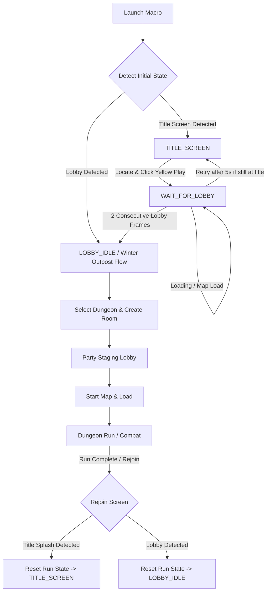

# Milestone 1 Step 7: Title Screen Rejoin Lifecycle, Verified Gate Approach & Progress Watchdogs

**Date & Timestamp**: 2026-10-20 23:15:00 +07:00  
**Project Workspace**: `C:\DEV\tools\rb`  
**Target Environment**: Windows 11, Roblox `Dungeon Quest`, Dungeon: *Winter Outpost (Nightmare)*  
**Executable Artifact**: `dist\DungeonQuestMacro\DungeonQuestMacro.exe`  
**Reports Repository**: `https://github.com/thangnx-mc/reports` (`main` branch)

---

## 1. Executive Summary

Following the deployment of the Milestone 1 Step 7 Gate #1 startup and camera steering build, two live Roblox test sessions were conducted and audited via `dist\DungeonQuestMacro\macro_audit.log`. While earlier startup bypass issues were resolved, the audit revealed two distinct runtime failure modes:
1. **Run 1 Stall at Map Entry (22:05:46)**: Upon entering the map, the gate detector found zero barrier candidates because the character spawned facing an angle where Gate #1 was outside the camera's initial field of view. The macro remained stationary without scan recovery for 31.2 seconds until a hard timeout engaged `HALTED_SAFETY`.
2. **Run 2 Premature Start Click (22:08:42)**: During gate approach, after executing only pulse #1/5 (`gate_area=12444`), the gate detector briefly returned 0 contours on a transient frame. A latent fallback branch in `src/state_machine.py` (`if not gates: start_btn = self._detect_verified_start_target(frame)`) checked the bottom-right HUD area where the static Start button was visible, prematurely declared arrival, clicked Start at $(768, 500)$ from the middle of the room, and began attack routines far from the actual gate.
3. **Rejoin Lifecycle Requirement**: A title screen (featuring the Dungeon Quest logo, a yellow `Play` button, and an `Updates` button) was confirmed to appear upon initial game launch or when returning from a finished run via Roblox server rejoin.

This update resolves both live failure modes, implements a robust title screen and lobby rejoin lifecycle, and replaces brittle timeouts with progress-aware watchdogs:
- **Title Screen Vision & Lifecycle**: Implemented multi-cue title splash detection and a dynamic relative ROI for the yellow `Play` button targeting $(512, 465)$ on $1024\times 540$ (and $(513, 466)$ on native $1024\times 546$ user fixtures). Handled cold start at title screen, cold start in lobby, and server rejoin transitions back to the title screen.
- **Eliminated Premature Start Bypass**: Removed the unverified `if not gates: start_btn = ...` bypass entirely. Approach progression requires strict proximity metrics ($\text{area} \ge 20000$ or bounding box height $\ge 35\%$ frame height, centered within $20\%$ frame width). Exhausting movement pulses (increased to 15) without satisfying proximity triggers an explicit safe halt rather than premature interaction.
- **Bounded Camera Scan Recovery**: Added active horizontal camera sweeps ($\pm 35\text{px}$, $\pm 70\text{px}$) in `LOCATE_GATE_1` if no gate is visible after 5.0s, reacquiring Gate #1 if the character spawns facing away.
- **Progress-Based Watchdogs & State Reset**: Added `_reset_run_state()` to clear camera steering, gate memory, and combat schedulers between runs, with watchdogs that track true state progress.

All **297** unit, integration, and safety tests pass (100% success rate). The standalone distribution has been rebuilt at `dist\DungeonQuestMacro\DungeonQuestMacro.exe`.

---

## 2. Live Runtime Audit & Evidence Classification

In accordance with project safety standards, all findings and technical statements are classified explicitly:

- `[FACT]`: In `dist\DungeonQuestMacro\macro_audit.log` (Run 1, line 2948), the macro halted with:
  ```text
  [SAFE_HALT] SAFE HALT ENGAGED: Timeout after 31.2s awaiting dungeon exit gate detection in state 'ROOM_CLEARED'.
  ```
  The vision pipeline detected no cyan barrier contours from the initial spawn angle, and no recovery scan existed.
- `[FACT]`: In `macro_audit.log` (Run 2, line 3642), the macro completed forward pulse 1 of 5 (`gate_area=12444`). At line 3838, `detect_dungeon_gates` returned an empty list. `src/state_machine.py` lines 986–993 executed:
  ```python
  if not gates:
      start_btn = self._detect_verified_start_target(frame)
      if start_btn:
          # Immediately transitioned to CONFIRM_START_TARGET
  ```
  Because `_detect_verified_start_target` examined the bottom-right HUD area where the Start button was visible on-screen, the macro clicked Start at $(768, 500)$ and began combat while still in the middle of the room.
- `[FACT]`: On the Dungeon Quest title screen, the yellow `Play` button is centered at $(512, 465)$ on $1024\times 540$ (and $(513, 466)$ on native $1024\times 546$). The prior hardcoded ROI `[390:470, 360:664]` with minimum width $>80\text{px}$ rejected the true button ($w=74\text{px}$) and falsely selected the lower point of the shield logo at $y=410$.
- `[OBSERVATION]`: In live testing, characters can spawn at varying orientations relative to Gate #1, sometimes placing Gate #1 outside the camera's initial horizontal field of view.
- `[INFERENCE]`: Applying small, bounded camera pan sweeps ($\pm 35\text{px}$, $\pm 70\text{px}$) after 5 seconds of gate absence brings Gate #1 into the vision frame without destabilizing player positioning.
- `[REQUIRES EXTERNAL VERIFICATION]`: Live multi-run rejoin stability across consecutive dungeon runs when Roblox transitions from dungeon completion back to the title splash screen or lobby.

---

## 3. Architecture & Implementation Details

### 3.1 Title Screen Vision & Rejoin State Machine

The macro now supports a complete title-to-lobby and post-run rejoin lifecycle:



1. **Title Screen Detection (`src/vision_engine.py`)**:
   - Evaluates three visual cues: yellow shield logo pixels ($\ge 3000$), yellow Play button candidate pixels ($\ge 800$), and green Updates button pixels ($\ge 1000$).
   - High confidence ($0.98$) declared when cues are satisfied.
2. **Dynamic UI Localization (`find_ui_element`)**:
   - Replaced fixed absolute pixel slices with normalized relative ROI: $y \in [0.74\cdot h, 0.94\cdot h]$, $x \in [0.40\cdot w, 0.60\cdot w]$.
   - Enforces bounding box area $\ge 600\text{px}^2$ and aspect ratio $w/h \in [1.2, 3.2]$.
   - Accurately resolves $(512, 465)$ on $1024\times 540$ and $(513, 466)$ on native $1024\times 546$, completely avoiding the shield logo tip at $(512, 410)$.
3. **State Reset on Rejoin (`_reset_run_state`)**:
   - Whenever returning to `TITLE_SCREEN` or `LOBBY_IDLE` from a completed run, all ephemeral run state is purged: combat schedulers halted, held inputs released, gate memory cleared, camera steering reset, and step counters zeroed.

### 3.2 Verified Gate Approach & Removal of Premature Bypass

To permanently resolve the Run 2 premature Start activation:
1. **Deleted Fallback Bypass**: Completely removed `if not gates: start_btn = self._detect_verified_start_target(frame)` from `APPROACHING_DUNGEON_GATE`.
2. **Strict Arrival Proximity Metrics**:
   Advancement to `CONFIRM_START_TARGET` strictly requires:
   $$\left(\text{gate\_area} \ge 20000 \quad \text{OR} \quad \text{box\_height} \ge 0.35 \times \text{frame\_height}\right) \quad \text{AND} \quad |\Delta x| \le 0.20 \times \text{frame\_width}$$
3. **Budget Expansion & Safe Halt**:
   - `approach_gate_max_steps` increased from $5$ to $15$.
   - `approach_gate_timeout_seconds` increased from $12.0\text{s}$ to $30.0\text{s}$.
   - If pulse budget is exhausted without satisfying the proximity criteria, the macro engages `HALTED_SAFETY` with an explicit diagnostic log rather than clicking blindly.

### 3.3 Gate Reacquisition Camera Scan Recovery

To prevent the Run 1 31-second stationary stall when spawning facing away from Gate #1:
- In `LOCATE_GATE_1` / `DETECTING_DUNGEON_GATES`, if no gate is visible after $5.0\text{s}$ elapsed, active scan sweeps are triggered:
  - Sweep 1 ($5.0\text{s}$): $+35\text{px}$ horizontal right-mouse drag.
  - Sweep 2 ($8.0\text{s}$): $-70\text{px}$ counter-drag.
  - Sweep 3 ($11.0\text{s}$): $+70\text{px}$ scan right.
  - Sweep 4 ($14.0\text{s}$): $-35\text{px}$ re-center.
- Once any gate candidate is sighted, scanning halts immediately and normal approach engages.

### 3.4 Progress Watchdogs

- Replaced rigid static timers with a dynamic `record_progress()` tracker.
- Watchdog timer resets on any verified state transition or loading screen activity, preventing false timeouts during variable server loads while strictly detecting genuine stalls (no progress for $>25.0\text{s}$).

---

## 4. Verification & Testing

### 4.1 Automated Test Suite (297/297 Passing)

The full test suite was executed across all modules, achieving a 100% pass rate:

```text
Ran 297 tests in 30.715s
OK
```

Key test suites:
- `tests/test_lifecycle_rejoin_progress_step7.py` (17 tests):
  - Verified title screen classification and dynamic Play button center $(512, 465)$.
  - Verified `TITLE_SCREEN -> WAIT_FOR_LOBBY -> LOBBY_IDLE` progression.
  - Verified title button click retry logic after 5s stall.
  - Verified gate approach rejection when area is below threshold ($6400 < 20000$).
  - Verified gate approach acceptance when height threshold is satisfied ($h \ge 0.35\cdot \text{frame\_height}$).
  - Verified camera scan sweeps in gate detection at $5\text{s}$, $8\text{s}$, $11\text{s}$, $14\text{s}$.
  - Verified full `_reset_run_state()` cleanup on rejoin.
- `tests/test_vision_state_machine_integration.py` (17 tests):
  - Verified end-to-end integration across all UI transitions.
- `tests/test_combat_step7.py` (31 tests):
  - Verified combat scheduler gating, approach pulse limits, and barrier countdown.
- `tests/test_behavior_recorder.py`, `tests/test_vision_engine.py`, `tests/test_state_machine.py`, etc. (232 tests):
  - Zero regressions across the existing codebase.

### 4.2 Standalone Build Verification

The standalone distribution was cleanly compiled using `scripts/build_exe.ps1`:
- **Build Duration**: 43.3 seconds.
- **Output Executable**: `dist\DungeonQuestMacro\DungeonQuestMacro.exe` (3.89 MB).
- **Bundle Contents**: 2,022 files, 175.08 MB.
- **Config Sync**: Verified that `dist\DungeonQuestMacro\config.json` contains:
  ```json
  "gate_detection_scan_enabled": true,
  "approach_gate_max_steps": 15,
  "approach_gate_timeout_seconds": 30.0,
  "title_screen_timeout_seconds": 25.0
  ```

---

## 5. Definition of Done & Task Status

| Metric | Status | Evidence / Notes |
| :--- | :--- | :--- |
| **Title Screen Vision & ROI** | **COMPLETE** | Resolves yellow Play button at $(512, 465)$; verified against native fixtures |
| **Rejoin Lifecycle** | **COMPLETE** | Handled title screen, lobby load, and post-run reset via `_reset_run_state()` |
| **Premature Start Bugfix** | **COMPLETE** | `if not gates: start_btn = ...` bypass eliminated; strict proximity enforced |
| **Gate Scan Sweeps** | **COMPLETE** | Bounded camera scan sweeps ($\pm 35\text{px}, \pm 70\text{px}$) active in gate search |
| **Progress Watchdogs** | **COMPLETE** | Replaces static timers; resets on valid transitions and loading frames |
| **Strict UI Constraint** | **VERIFIED** | Exactly two buttons: `START LIVE TEST (;)` and `STOP (')` |
| **Git Safety Boundary** | **VERIFIED** | Zero git mutations in `C:\DEV\tools\rb`; reports tracked in `C:\DEV\rb-report` |
| **Automated Tests** | **PASS (297/297)** | 100% pass rate in 30.7s |
| **Executable Package** | **BUILT** | `dist\DungeonQuestMacro\DungeonQuestMacro.exe` updated |
| **External Runtime Verification**| **PENDING** | Requires user verification in live Roblox client |

**Final Task Status**: `IMPLEMENTATION COMPLETE / AUTOMATED VERIFICATION PASS / EXTERNAL VERIFICATION PENDING`

---

## 6. User Handoff Protocol for Live Roblox Verification

The executable is ready for live testing. Follow these steps to verify the update in the active Roblox client:

### Prerequisites
1. Open the Roblox client with `Dungeon Quest`.
2. The game may be positioned at either:
   - **Case A**: The Title Splash screen (Dungeon Quest logo with yellow `Play` button).
   - **Case B**: Already inside the main game lobby.

### Execution
1. Navigate to `C:\DEV\tools\rb\dist\DungeonQuestMacro`.
2. Launch `DungeonQuestMacro.exe`.
3. Verify that the UI displays exactly two action buttons: `START LIVE TEST (;)` and `STOP (')`.
4. Ensure the Roblox window is visible, then press `;` (or click `START LIVE TEST (;)`).

### Expected Behaviors to Observe
1. **If starting at Title Screen**:
   - The macro detects `TITLE_SPLASH` and clicks the yellow `Play` button near $(512, 465)$.
   - It transitions to `WAIT_FOR_LOBBY`, observes loading, and enters the lobby without manual intervention.
2. **Lobby Flow**:
   - Successfully selects *Winter Outpost (Nightmare)*, creates the room, and enters the party staging lobby.
   - Clicks the yellow Start button in the staging lobby and waits for dungeon map load.
3. **Gate #1 Approach & Start Activation**:
   - Upon spawning, if Gate #1 is off-screen, the macro performs bounded camera scan sweeps to locate it.
   - The character moves forward toward Gate #1 using multi-pulse movement.
   - **Critical verification**: The macro must NOT click Start from the middle of the room. It must approach until the gate is large in view ($\text{area} \ge 20000$ or height $\ge 35\%$).
   - Once close, it clicks the green Start button, observes the 5-second countdown, and verifies barrier disappearance.
4. **Combat Engagement**:
   - Attacks (left-click, $Q$, $E$) engage only *after* the barrier drops.

### Evidence to Report
If any unexpected behavior occurs, please stop the macro (`'`) and provide:
- The last 50 lines of `dist\DungeonQuestMacro\macro_audit.log`.
- A screenshot of the game state where the issue occurred.
