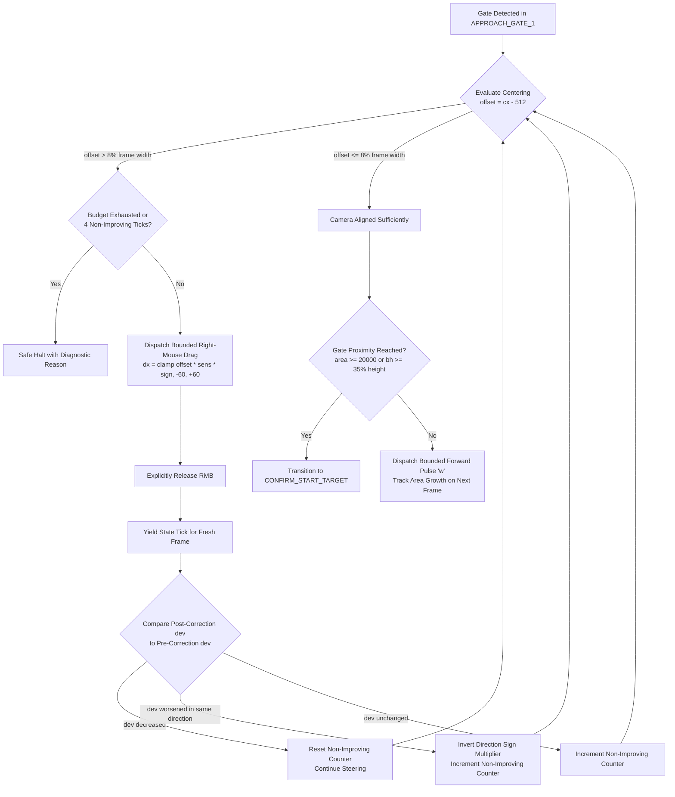

# Milestone 1 Step 7 Bugfix: Recover Camera Orientation Instead of Halting on an Off-Center Gate

**Date & Timestamp**: 2026-10-21 01:45:00 +07:00  
**Project Workspace**: `C:\DEV\tools\rb`  
**Target Environment**: Windows 11, Roblox `Dungeon Quest`, Dungeon: *Winter Outpost (Nightmare)*  
**Executable Artifact**: `dist\DungeonQuestMacro\DungeonQuestMacro.exe`  
**Reports Repository**: `https://github.com/thangnx-mc/reports` (`main` branch)

---

## 1. Executive Summary

During live runtime verification of Milestone 1 Step 7 in the active Roblox client, a critical navigation failure occurred after map entry. After taking approximately one step inside the waiting room, the macro aborted abruptly with a safe halt:
```text
macro=APPROACHING_DUNGEON_GATE
barrier=True, mobs=False, boss=False, gates=2
...
macro=HALTED_SAFETY
Safe Halt: Dungeon gate is off-center (cx=84, dev=428px > max 358px).
Camera orientation ambiguous; halting safely without blind turning.
Observation worker stopped. Total ticks completed: 24.
```

Audit of `dist/DungeonQuestMacro/macro_audit.log` and `src/state_machine.py` revealed that an off-center gate observation was being treated as an immediate fatal error rather than a normal navigation condition to steer towards. Specifically, lines 1172–1181 of `src/state_machine.py` contained a premature hard stop (`if center_x_dev > 0.35 * w: halt_safely(...)`) that executed **before** camera steering evaluation. Because the character spawned facing slightly away from Gate #1 ($cx=84$ on a $1024$-wide frame, deviation $428\text{px} > 358\text{px}$ limit), the macro halted on the very first frame of approach without ever attempting camera steering.

This update resolves the premature halt, implements an adaptive camera orientation recovery sequence, enforces strict separation between camera alignment and gate proximity, and adds diagnostic logging and regression tests:
- **Off-Center Camera Recovery**: Removed the premature hard stop. An off-center gate now triggers bounded right-mouse drag steering in the direction of the offset ($dx < 0$ for left, $dx > 0$ for right), releases RMB immediately, captures fresh frames, and re-evaluates.
- **Adaptive Sign Reversal & Non-Improving Limits**: If visual feedback reveals that deviation worsened in the same direction without crossing center, the steering multiplier is dynamically inverted. If corrections fail to improve alignment over 4 consecutive attempts, or if the total budget (12 corrections) is exhausted, the macro halts safely.
- **Strict Separation of Alignment & Proximity**: Gate centering ($|offset| \le 8\%$) is decoupled from interaction distance ($area \ge 20000$ or height $\ge 35\%$). A gate can be distant while centered (triggering forward 'w' pulses), or close while off-center (triggering camera steering before interaction).
- **Missing Gate Reacquisition**: If the gate is lost during approach, bounded reacquisition sweeps (up to 5 attempts) use last-known direction memory before safely halting.
- **Forward Progress Tracking**: Progress across movement pulses is verified via gate contour area growth. Stalls are logged explicitly.

All **307** unit, integration, and safety tests pass (100% success rate). The standalone distribution has been rebuilt at `dist\DungeonQuestMacro\DungeonQuestMacro.exe`.

---

## 2. Audit of the Failure Path & Evidence Classification

In accordance with project safety standards, all findings and technical statements are classified explicitly:

- `[FACT]`: In `macro_audit.log` (lines 3814–3815), the gate detector successfully located two gates from the initial spawn:
  `Gate #1: center=(84, 199), box=(0, 104, 169, 190), area=19011, conf=0.99; Gate #2: center=(559, 261), box=(500, 173, 119, 176), area=7860, conf=0.90`.
- `[FACT]`: The frame was resized to $1024 \times 540$. The horizontal viewport center was $1024 / 2 = 512$. The primary gate center was $cx = 84$.
- `[FACT]`: Horizontal deviation was computed as $\text{dev} = |84 - 512| = 428\text{px}$ ($41.8\%$ of frame width).
- `[FACT]`: `src/state_machine.py` line 1175 evaluated `if center_x_dev > 0.35 * w:` ($428 > 358.4\text{px}$) and called `self.halt_safely(...)` immediately.
- `[FACT]`: Camera steering was **never invoked** prior to the halt. `camera_steer.evaluate_and_steer(...)` was located at line 1218, unreachable due to the premature check.
- `[FACT]`: The camera scan/recovery mechanism in `LOCATE_GATE_1` only triggered when `not gates` (0 gates found after 5.0s). Because 2 gates were found, it transitioned immediately to `APPROACHING_DUNGEON_GATE`. In `APPROACHING_DUNGEON_GATE`, the existing reacquisition logic also only triggered when `not gates`.
- `[FACT]`: The coordinate system was mathematically correct ($|84 - 512| = 428$), but the design assumption that $|cx - \text{center}| > 35\%$ represents "ambiguous orientation requiring immediate fatal halt" was fundamentally flawed. Characters randomly spawn at varying angles; an off-center gate is a navigation condition to steer towards, not a fatal crash.
- `[REQUIRES EXTERNAL VERIFICATION]`: Live runtime responsiveness of the camera steering right-mouse drag in the active Roblox client window under varying spawn angles and client mouse sensitivities.

---

## 3. Architecture & Implementation Details

### 3.1 Bounded Camera Orientation Recovery Sequence



### 3.2 Adaptive Camera Steering Controller (`src/camera_steering.py`)

- **Diagnostic Evaluation & Logging**:
  Logs gate position, viewport center, deviation in pixels and percent, and comparison with tolerance on every evaluation:
  `[CAMERA_STEER_EVAL] Gate candidate at cx=84, cy=199, viewport center=512, deviation=428px (41.8%, tolerance=8.0%).`
- **Direction Determination & Clamping**:
  Computes signed offset $\Delta x = cx - \text{center}$. Direction is `'left'` if $\Delta x < 0$ and `'right'` if $\Delta x > 0$.
  $\text{drag\_dx} = \text{clamp}\left(\Delta x \times \text{sensitivity} \times \text{direction\_sign},\; -60,\; +60\right)$.
  Logged as:
  `[CAMERA_STEER_DISPATCH] Executing right-mouse drag: direction='left', dx=-60px, duration=0.04s (step attempt 1/4, total 1/12, remaining_step=3, remaining_total=11).`
- **Closed-Loop Visual Progress Verification**:
  Tracks `_last_offset_px` across ticks:
  - If $\Delta \text{dev} > 4.0\text{px}$, logs `[CAMERA_STEER_PROGRESS] Alignment improved` and resets `_consecutive_non_improving = 0`.
  - If deviation fails to improve, logs `[CAMERA_STEER_PROGRESS] Alignment did not improve` and increments `_consecutive_non_improving`.
  - If deviation worsens substantially without crossing center ($|curr| > |prev| + 10$ and $curr \times prev > 0$), inverts `_direction_sign *= -1` and logs `[CAMERA_STEER_ADAPT] Reversing steering sign multiplier`.
- **Budget Limits & Safety**:
  - `max_corrections_per_step = 4`
  - `max_total_corrections = 12`
  - `max_non_improving_attempts = 4`
  When exhausted without alignment, returns `budget_exhausted=True` with a diagnostic reason, causing `MacroStateMachine` to halt safely.

### 3.3 Decoupling Camera Alignment from Gate Proximity

The state machine explicitly maintains distinct, independent evaluation stages:
1. **Camera Alignment**: Evaluated first. If the gate is off-center ($|\Delta x| > 0.08 \times w$), forward pulses are suppressed and camera recovery executes.
2. **Proximity Check**: Evaluated only when alignment is within tolerance or at step limits. Requires $\text{area} \ge 20000$ or $\text{bounding\_box}[3] \ge 0.35 \times h$. A centered gate that is distant ($area = 5000$) continues pulsing forward; a close gate that is off-center steers before arrival.
3. **Forward Progress Monitoring**: After each forward pulse (`'w'`), gate area growth ($\Delta \text{area} = \text{area}_{t} - \text{area}_{t-1}$) is verified and logged. Stalls exceeding 4 pulses trigger warning logs and camera reset.
4. **Start Button Verification**: Even after arriving at `CONFIRM_START_TARGET`, Start is never clicked blindly. The green Start button must be visually verified with a rectangular aspect ratio ($w/h \in [1.2, 6.0]$) in the lower screen region.

### 3.4 Bounded Reacquisition for Lost Gates

If the gate is lost during approach:
- Frame 1–2: Yield tick for transient visual noise / avatar occlusion.
- Frame 3–7: Execute bounded reacquisition sweeps using `gate_memory.get_navigation_hint()` (left: $-35\text{px}$, right: $+35\text{px}$) or alternating sweeps.
- If unrecovered after 5 attempts, halt safely with:
  `Safe Halt: Lost visual tracking of dungeon gate during approach; exhausted reacquisition budget (5/5 attempts).`

---

## 4. Verification & Testing

### 4.1 Automated Test Suite (307/307 Passing)

The full test suite was executed across all modules, achieving a 100% pass rate:

```text
Ran 307 tests in 34.003s
OK
```

Key test suites:
- `tests/test_camera_recovery_step7.py` (10 tests, all newly implemented):
  1. `test_offcenter_gate_triggers_camera_recovery_instead_of_immediate_halt`: Proves $cx=84$ on $w=1024$ triggers right-mouse drag and yields instead of halting.
  2. `test_camera_correction_followed_by_improving_fresh_frame`: Proves $cx=100 \to 260 \to 400$ progression, verifying alignment improvement logs and subsequent forward pulse.
  3. `test_correction_not_improving_alignment_is_not_repeated_indefinitely`: Proves 4 non-improving corrections halt safely with diagnostic reason.
  4. `test_adaptive_sign_reversal_when_deviation_worsens_without_crossing_center`: Proves adaptive sign reversal from $+1$ to $-1$ when deviation worsens.
  5. `test_missing_gates_trigger_bounded_reacquisition`: Proves 5 bounded sweeps when gate is lost, followed by safe halt.
  6. `test_centered_but_distant_gate_does_not_trigger_start_interaction`: Proves centered gate with small area ($5000$) pulses forward and never clicks Start.
  7. `test_arrival_proximity_verified_transitions_to_confirm_start_target`: Proves centered gate with target area ($25000$) transitions to `CONFIRM_START_TARGET`.
  8. `test_total_correction_budget_exhaustion_leads_to_safe_halt`: Proves budget exhaustion (12 corrections) halts safely.
  9. `test_stop_releases_all_inputs_during_movement_and_steering`: Proves Stop releases held keys and mouse buttons.
  10. `test_countdown_and_combat_gating_remain_unchanged`: Proves combat scheduler remains inactive throughout approach.
- `tests/test_dungeon_approach_step6.py` (14 tests):
  - Updated `test_approaching_gate_halts_safely_on_off_center_orientation` to verify recovery before budget exhaustion halt.
- `tests/test_combat_step7.py` (31 tests):
  - Updated `test_approach_off_center_gate_safely_halts` to verify recovery and non-improving budget halt.
- `tests/test_startup_safety_step7.py` (10 tests):
  - Verified total budget exhaustion safe halt.
- Zero regressions across existing 242 tests (`test_lifecycle_rejoin_progress_step7`, `test_vision_state_machine_integration`, `test_behavior_recorder`, etc.).

### 4.2 Standalone Build Verification

The standalone distribution was recompiled via `scripts/build_exe.ps1`:
- **Build Duration**: 23.3 seconds.
- **Output Executable**: `dist\DungeonQuestMacro\DungeonQuestMacro.exe` (3.89 MB).
- **Bundle Contents**: 2,022 files, 175.09 MB.
- **Config Sync**: Verified that `dist\DungeonQuestMacro\config.json` contains:
  ```json
  "camera_steering_max_corrections_per_step": 4,
  "camera_steering_max_total_corrections": 12,
  "camera_steering_max_non_improving_attempts": 4,
  "approach_gate_reacquire_max_attempts": 5
  ```

---

## 5. Definition of Done & Task Status

| Metric | Status | Evidence / Notes |
| :--- | :--- | :--- |
| **Off-Center Recovery** | **COMPLETE** | Removed premature fatal halt; bounded right-mouse drag steering active |
| **Adaptive Sign & Non-Improvement**| **COMPLETE** | Adapts steering sign if deviation worsens; limits non-improving attempts to 4 |
| **Decoupled Proximity & Alignment** | **COMPLETE** | Alignment ($8\%$) and interaction distance ($area \ge 20000$) verified independently |
| **Missing Gate Reacquisition** | **COMPLETE** | Bounded sweeps (up to 5 attempts) using direction memory before halt |
| **Diagnostic Logging** | **COMPLETE** | Viewport center, deviation, drag delta, and progress logged on every tick |
| **Strict UI Constraint** | **VERIFIED** | Exactly two buttons: `START LIVE TEST (;)` and `STOP (')` |
| **Git Safety Boundary** | **VERIFIED** | Zero git mutations in `C:\DEV\tools\rb`; reports tracked in `C:\DEV\rb-report` |
| **Automated Tests** | **PASS (307/307)** | 100% pass rate in 34.0s (10 new regression tests) |
| **Executable Package** | **BUILT** | `dist\DungeonQuestMacro\DungeonQuestMacro.exe` rebuilt |
| **External Runtime Verification**| **PENDING** | Requires user verification in live Roblox client |

**Final Task Status**: `IMPLEMENTATION COMPLETE / AUTOMATED VERIFICATION PASS / EXTERNAL VERIFICATION PENDING`

---

## 6. User Handoff Protocol for Live Roblox Verification

The executable is ready for live testing in Roblox:

### Prerequisites
1. Open the Roblox client with `Dungeon Quest`.
2. The game may be positioned at either:
   - The Title Splash screen (yellow `Play` button).
   - The main game lobby.

### Execution
1. Navigate to `C:\DEV\tools\rb\dist\DungeonQuestMacro`.
2. Launch `DungeonQuestMacro.exe`.
3. Verify that the UI displays exactly two action buttons: `START LIVE TEST (;)` and `STOP (')`.
4. Focus the Roblox window and press `;` (or click `START LIVE TEST (;)`) to begin.

### Expected Live Behaviors to Observe
1. **Lobby & Room Creation**:
   - The macro navigates lobby menus, selects *Winter Outpost (Nightmare)*, and enters the dungeon waiting room.
2. **Off-Center Gate Recovery (Key Bugfix Verification)**:
   - When entering the waiting room, if Gate #1 appears off-center (e.g. $cx = 84$ on the left side of the screen):
   - **The macro must NOT halt with "Safe Halt: Dungeon gate is off-center"**.
   - Instead, observe small, smooth right-mouse camera adjustments rotating the view toward Gate #1.
   - Once Gate #1 is brought near the screen center, the character advances forward using pulses of `'w'`.
3. **Approach & Gate #1 Start Activation**:
   - The character advances forward across multiple pulses toward Gate #1 until close ($\text{area} \ge 20000$).
   - The macro clicks the green Start button, observes the 5-second countdown, and confirms barrier drop.
4. **Combat Engagement**:
   - Basic attack clicking and skill spam ($Q$, $E$) engage only *after* the barrier drops.

### Evidence to Report
If any unexpected behavior occurs, please stop the macro (`'`) and provide:
- The last 50 lines of `dist\DungeonQuestMacro\macro_audit.log`.
- A screenshot of the game state where the issue occurred.
