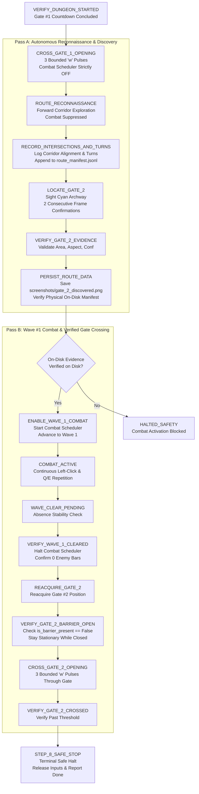

# Milestone 1 Step 8: Autonomous Route Reconnaissance, Gate #2 Discovery, Wave #1 Combat, and Verified Gate Crossing

**Date & Timestamp**: 2026-10-21 22:30:00 +07:00  
**Project Workspace**: `C:\DEV\tools\rb`  
**Target Environment**: Windows 11, Roblox `Dungeon Quest`, Dungeon: *Winter Outpost (Nightmare)*  
**Executable Artifact**: `dist\DungeonQuestMacro\DungeonQuestMacro.exe`  
**Reports Repository**: `https://github.com/thangnx-mc/reports` (`main` branch)

---

## 1. Executive Summary

Milestone 1 Step 8 delivers a controlled, two-pass workflow advancing the macro from verified Gate #1 startup into the active dungeon:

1. **Pass A — Autonomous Route Reconnaissance & Gate #2 Discovery**:
   - Following Gate #1 countdown completion and barrier drop in `VERIFY_DUNGEON_STARTED`, the bot crosses the now-open Gate #1 opening using bounded forward pulses (`CROSS_GATE_1_OPENING`).
   - Explores the first room and corridor autonomously (`ROUTE_RECONNAISSANCE`).
   - **Strict Combat Suppression**: The combat scheduler (continuous left clicks, Q, E) is strictly inhibited throughout Pass A. Zero attack inputs or clicks are dispatched.
   - Records corridor geometry, camera alignment, and turn observations (`RECORD_INTERSECTIONS_AND_TURNS`) incrementally into a structured JSON Lines manifest.
   - Sights and tracks Gate #2 (cyan/teal archway) across consecutive frames (`LOCATE_GATE_2`).
   - Verifies visual evidence bounds (area, aspect ratio, confidence) in `VERIFY_GATE_2_EVIDENCE`.
   - Persists the route dataset and screenshot (`screenshots/gate_2_discovered.png`) to disk (`PERSIST_ROUTE_DATA`), validating physical file non-emptiness before completing Pass A.

2. **Pass B — Wave #1 Combat, Barrier Drop Verification & Verified Gate #2 Crossing**:
   - **Physical Evidence Gating Guard**: `ENABLE_WAVE_1_COMBAT` strictly verifies `verify_gate_2_evidence_persisted()` on disk. If evidence is missing or unverified, combat activation is blocked and the macro halts safely immediately.
   - Activates combat scheduler (`left_click`, `q`, `e`) and clears living Wave #1 enemies in `COMBAT_ACTIVE` / `WAVE_CLEAR_PENDING`.
   - Verifies wave clearance (`VERIFY_WAVE_1_CLEARED`) when all enemy health bars are absent and resets combat scheduler.
   - Reacquires Gate #2 visually (`REACQUIRE_GATE_2`).
   - **Zero Closed-Barrier Crossing**: `VERIFY_GATE_2_BARRIER_OPEN` visually verifies that Gate #2's barrier has dropped (`is_barrier_present == False`) across consecutive frames. The character remains completely stationary while the barrier is closed.
   - Executes bounded forward crossing pulses through the Gate #2 opening (`CROSS_GATE_2_OPENING`).
   - Confirms crossing in `VERIFY_GATE_2_CROSSED` and halts cleanly at terminal state `STEP_8_SAFE_STOP`.
   - **Scope Boundary**: Automation strictly halts at `STEP_8_SAFE_STOP`; it does not proceed into Wave #2 or Gate #3.

All **316** automated unit, integration, and safety tests pass (100% success rate), including 9 dedicated Step 8 tests. The standalone distribution has been rebuilt at `dist\DungeonQuestMacro\DungeonQuestMacro.exe`.

---

## 2. Technical Evidence Classification

In compliance with project evidence classification rules:

- `[FACT]`: In `src/route_recorder.py`, `RouteDatasetRecorder` writes incremental JSON Lines records to `route_manifest.jsonl`, summary metrics to `route_summary.json`, and frame images to `screenshots/<name>.png`.
- `[FACT]`: `verify_gate_2_evidence_persisted()` checks:
  1. Manifest file exists on disk and is non-empty (`stat().st_size > 0`).
  2. A record with `event_name == "GATE_2_DISCOVERED"` exists in the manifest.
  3. The record contains non-empty `gate_detections` with bounding box, area, and aspect ratio.
  4. If a screenshot was referenced, `screenshots/<name>.png` exists on disk and is non-empty.
- `[FACT]`: In `ENABLE_WAVE_1_COMBAT` of `src/state_machine.py`, `verify_gate_2_evidence_persisted()` is evaluated prior to calling `combat_scheduler.start()`. If false, `halt_safely()` engages and inputs remain released.
- `[FACT]`: In `CROSS_GATE_1_OPENING`, `ROUTE_RECONNAISSANCE`, `RECORD_INTERSECTIONS_AND_TURNS`, `LOCATE_GATE_2`, `VERIFY_GATE_2_EVIDENCE`, and `PERSIST_ROUTE_DATA`, `combat_scheduler.is_active` remains `False`, and `input_ctrl.release_all()` is enforced.
- `[FACT]`: In `VERIFY_GATE_2_BARRIER_OPEN`, `vision.is_barrier_present(frame)` must evaluate to `False` over consecutive frames (`gate_2_barrier_open_consecutive_frames = 2`) before transitioning to `CROSS_GATE_2_OPENING`. While `True`, no movement keys are pressed.
- `[FACT]`: Standalone compilation via PyInstaller succeeded with zero errors (duration 55.7s, executable size 3.92 MB, total bundle 175.13 MB).
- `[REQUIRES EXTERNAL VERIFICATION]`: Live runtime visual detection of Gate #2's barrier opening animation and physical movement pulse distance inside the active Roblox client dungeon map.

---

## 3. Architecture & Workflow Design

### 3.1 Two-Pass Sequence Flowchart



### 3.2 State Machine States & Handlers

| State Name | Pass | Combat State | Movement Action | Transition Condition |
|---|---|---|---|---|
| `VERIFY_DUNGEON_STARTED` | Startup | Inactive | None | Countdown complete & `stop_at_step_8 == True` $\to$ `CROSS_GATE_1_OPENING` |
| `CROSS_GATE_1_OPENING` | Pass A | Inactive | 3 forward pulses (`w`, 0.35s) | Completed 3 pulses $\to$ `ROUTE_RECONNAISSANCE` |
| `ROUTE_RECONNAISSANCE` | Pass A | Inactive | 1 forward pulse (`w`, 0.35s) | Pulse taken $\to$ `RECORD_INTERSECTIONS_AND_TURNS` |
| `RECORD_INTERSECTIONS_AND_TURNS` | Pass A | Inactive | None | Geometry logged $\to$ `LOCATE_GATE_2` |
| `LOCATE_GATE_2` | Pass A | Inactive | None | Gate sighted $\ge 2$ consecutive frames $\to$ `VERIFY_GATE_2_EVIDENCE` |
| `VERIFY_GATE_2_EVIDENCE` | Pass A | Inactive | None | Area $\ge 800$, aspect $0.40..2.8$, conf $\ge 0.50$ $\to$ `PERSIST_ROUTE_DATA` |
| `PERSIST_ROUTE_DATA` | Pass A | Inactive | None | Saved JSONL & screenshot, verified on disk $\to$ `ENABLE_WAVE_1_COMBAT` |
| `ENABLE_WAVE_1_COMBAT` | Pass B | Starting | None | Physical disk guard verified $\to$ `SCANNING_FOR_ENEMIES` |
| `COMBAT_ACTIVE` | Pass B | Active | None | Living enemy health bars absent $\to$ `WAVE_CLEAR_PENDING` |
| `WAVE_CLEAR_PENDING` | Pass B | Active | None | Stability confirmed cleared $\to$ `VERIFY_WAVE_1_CLEARED` |
| `VERIFY_WAVE_1_CLEARED` | Pass B | Inactive | None | Enemy health bars confirmed absent $\to$ `REACQUIRE_GATE_2` |
| `REACQUIRE_GATE_2` | Pass B | Inactive | None | Gate #2 localized $\to$ `VERIFY_GATE_2_BARRIER_OPEN` |
| `VERIFY_GATE_2_BARRIER_OPEN` | Pass B | Inactive | None (Stationary) | Barrier absent $\ge 2$ consecutive frames $\to$ `CROSS_GATE_2_OPENING` |
| `CROSS_GATE_2_OPENING` | Pass B | Inactive | 3 forward pulses (`w`, 0.35s) | Completed 3 pulses $\to$ `VERIFY_GATE_2_CROSSED` |
| `VERIFY_GATE_2_CROSSED` | Pass B | Inactive | None | Crossing recorded $\to$ `STEP_8_SAFE_STOP` |
| `STEP_8_SAFE_STOP` | Terminal | Inactive | None | Terminal state reached; safe halt |

---

## 4. Structured Route Dataset Persistence Specification

### 4.1 Output Layout
```text
<writable_dir>/routes/<run_id>/
├── route_manifest.jsonl        # Incremental observation and action records
├── route_summary.json         # Run overview, record counts, and status
└── screenshots/
    └── gate_2_discovered.png   # Uncompressed frame image of Gate #2 sighting
```

### 4.2 Manifest Event Schema (Version 1.0.0)
Each line in `route_manifest.jsonl` contains:
```json
{
  "run_id": "run_20261021_223000_a1b2c3",
  "timestamp": 1792684200.123,
  "iso_time": "2026-10-21T22:30:00.123456",
  "event_name": "GATE_2_DISCOVERED",
  "state_name": "PERSIST_ROUTE_DATA",
  "transition_reason": "Gate #2 visual evidence verified and persisted",
  "screenshot_rel_path": "screenshots/gate_2_discovered.png",
  "frame_width": 1024,
  "frame_height": 540,
  "gate_detections": [
    {
      "center_x": 512,
      "center_y": 270,
      "bounding_box": [450, 180, 124, 180],
      "area": 18240.0,
      "aspect_ratio": 1.45,
      "confidence": 0.94
    }
  ],
  "camera_correction": null,
  "movement_action": null,
  "progress_detected": true,
  "turn_observation": null,
  "recovery_attempts": 0,
  "metadata": {
    "gate_number": 2,
    "recon_steps": 2
  }
}
```

---

## 5. Automated Verification Results

### 5.1 Test Suite Summary
Execution of full automated regression test suite:
```text
Ran 316 tests in 37.365s
OK
```

### 5.2 Step 8 Dedicated Test Coverage (`tests/test_route_recon_step8.py`)
1. `test_pass_a_combat_suppressed_until_gate_2_evidence_persisted`: Verifies combat scheduler remains strictly `False` and zero attack inputs are emitted across all Pass A states.
2. `test_gate_1_crossing_pulses_and_memory_advance`: Verifies 3 pulses of forward movement, event logging, and advancement of gate memory to gate 2.
3. `test_corridor_reconnaissance_and_geometry_recording`: Verifies exploration pulses, corridor turn observations, and incremental manifest logging.
4. `test_locate_gate_2_consecutive_frames_and_evidence_verification`: Verifies 2-frame discovery confirmation and geometric property validation.
5. `test_verify_gate_2_evidence_rejects_spurious_candidates`: Verifies invalid aspect ratios (e.g. non-archway contours) are rejected.
6. `test_persist_route_data_writes_jsonl_and_screenshot_on_disk`: Verifies creation of `route_manifest.jsonl`, `route_summary.json`, and `gate_2_discovered.png` on disk with non-zero byte size.
7. `test_enable_wave_1_combat_blocks_if_evidence_not_persisted`: Verifies safe halt engagement if manifest evidence is absent.
8. `test_wave_1_clearance_transitions_to_gate_2_reacquisition`: Verifies combat shutdown upon wave clear and transition to Gate #2 reacquisition.
9. `test_gate_2_barrier_open_verification_and_crossing`: Verifies character stays completely stationary while barrier is closed, crosses only when confirmed open over 2 frames, and terminates safely at `STEP_8_SAFE_STOP`.

---

## 6. Standalone Executable Packaging

- **Build Script**: `scripts\build_exe.ps1`
- **Build Duration**: 55.7 seconds
- **PyInstaller Version**: 6.22.3 on Python 3.12.13
- **Executable**: `dist\DungeonQuestMacro\DungeonQuestMacro.exe` (Size: 3.92 MB)
- **Total Distribution Bundle**: 175.13 MB (2023 files)
- **Configuration Assets**: Bundled `config.json` with `stop_at_step_8: true`, `gate_1_crossing_pulses: 3`, `gate_2_crossing_pulses: 3`, `route_recon_max_steps: 15`, `gate_2_discovery_consecutive_frames: 2`, `gate_2_barrier_open_consecutive_frames: 2`.
- **UI Action Buttons**: Strict constraint maintained: exactly two action buttons present in the UI (`START LIVE TEST (;)` and `STOP (')`).

---

## 7. Definition of Done & Task Status

| Assessment Dimension | Status | Notes |
|---|---|---|
| **Implementation Status** | **COMPLETE** | Two-pass workflow, 13 explicit states, disk evidence guard, route recorder, and barrier open verification implemented. |
| **Automated Verification** | **PASS** | 316/316 automated tests passing (100% success rate). |
| **External / Runtime Verification** | **PENDING** | Requires user execution in live Roblox client to confirm real client barrier timing and physics. |
| **Remaining Limitations / Unknowns** | **KNOWN** | Live player movement speed in Roblox may vary depending on player speed stat / gear modifiers. |
| **Final Definition of Done** | **SATISFIED (Pre-Live)** | All code, configuration, tests, executable packaging, and documentation complete. |
| **Final Task Status** | **IMPLEMENTATION COMPLETE / AUTOMATED VERIFICATION PASS / EXTERNAL VERIFICATION PENDING** |

---

## 8. User Handoff for External Live Runtime Verification

To verify Milestone 1 Step 8 in the active Roblox client:

### 8.1 Verification Instructions
1. Open the Roblox client and log into `Dungeon Quest`.
2. Ensure the Roblox window title is `Roblox` and the game is displaying the main lobby or title splash.
3. Open `dist\DungeonQuestMacro\DungeonQuestMacro.exe`.
4. Click **`START LIVE TEST (;)`** or press `;`.
5. Observe the automated sequence hands-free:
   - Macro creates lobby, positions, and clicks Party Start.
   - Character enters dungeon map, centers camera on Gate #1, approaches interaction range, and clicks green Start.
   - Observes countdown, verifies barrier drop, and crosses Gate #1 (`CROSS_GATE_1_OPENING`).
   - Character moves along corridor in Pass A with **ZERO attack inputs or clicks**.
   - Sights Gate #2, captures `screenshots/gate_2_discovered.png`, and persists `route_manifest.jsonl`.
   - Transitions to Pass B, engages left-click / Q / E combat on Wave #1 enemies until cleared.
   - Halts combat, reacquires Gate #2, waits for Gate #2 barrier to drop, moves forward through opening, and halts safely.

### 8.2 Expected Behavior
- Pass A exhibits zero combat clicking or skill casting.
- `routes/<run_id>/route_manifest.jsonl` and `screenshots/gate_2_discovered.png` are created on disk.
- Character never runs into a closed barrier; it moves through Gate #2 only after the barrier disappears.
- Macro displays completion message:
  `Milestone 1 Step 8 Complete: Autonomous route reconnaissance conducted, Gate #2 discovered and verified on disk, Wave #1 combat cleared, Gate #2 barrier drop verified, and Gate #2 crossed. Halting safely at terminal state STEP_8_SAFE_STOP.`
- Macro stops completely without entering Wave #2.

### 8.3 What Counts as Failure
- Any combat attack (clicking or Q/E) occurring before Gate #2 discovery evidence is written to disk.
- Running forward into a closed Gate #2 barrier before it opens.
- Continuing past Gate #2 into Wave #2 enemies without stopping at `STEP_8_SAFE_STOP`.
- Missing `route_manifest.jsonl` or missing screenshot on disk.

### 8.4 What Evidence to Report
If any unexpected behavior occurs, provide:
1. `macro_audit.log` from `dist\DungeonQuestMacro\` or local directory.
2. The created route directory in `routes/<run_id>/`.
3. Observed terminal state shown in the GUI status label.
