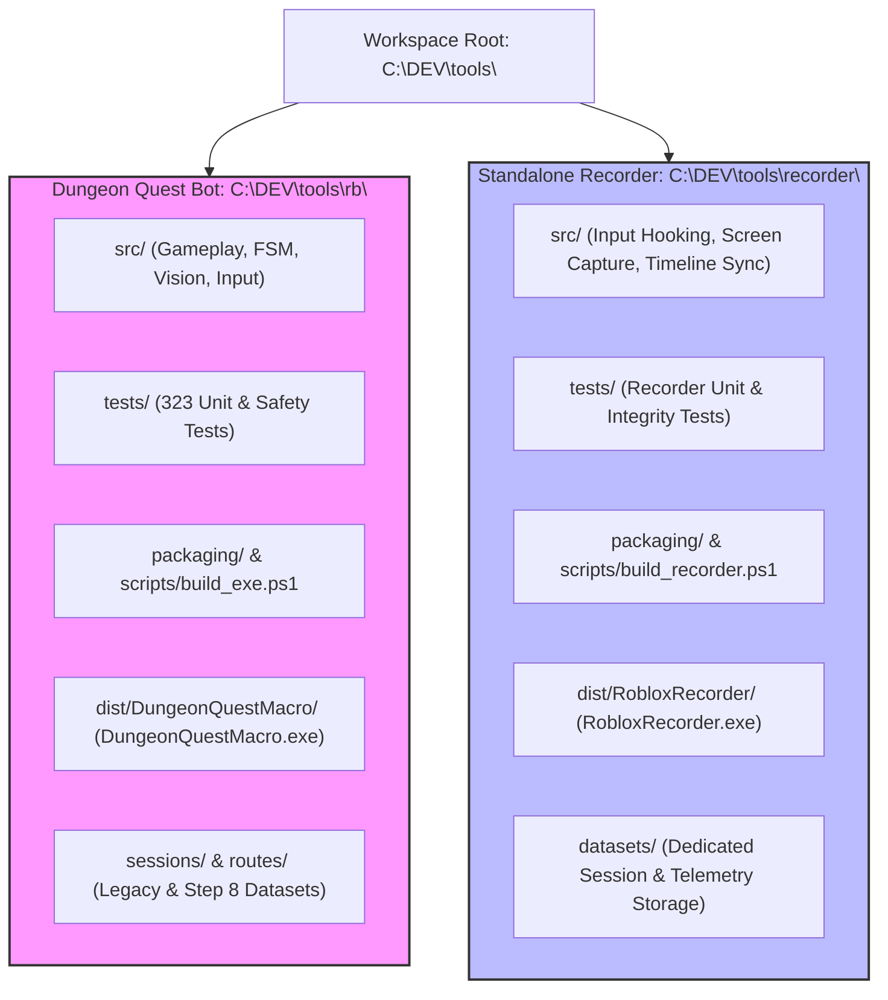
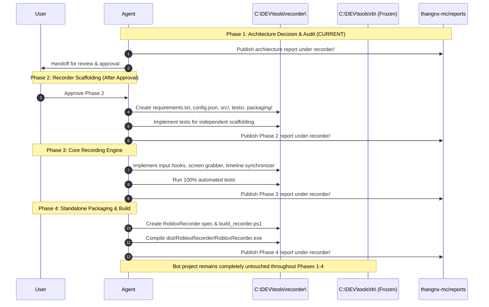

# Architecture Decision: Independent Sibling Projects and Separate Report Areas

**Date & Timestamp**: 2026-10-23 22:30:00 +07:00  
**Workspace Root**: `C:\DEV\tools\`  
**Target Projects**:
- **Dungeon Quest Bot**: `C:\DEV\tools\rb\`
- **Standalone Recorder**: `C:\DEV\tools\recorder\`
**Reports Repository**: `https://github.com/thangnx-mc/reports` (`main` branch)  
**Report Destination**: `recorder/2026-10-23_22-30-00_architecture-decision-independent-projects-reports.md`  
**Classification**: **Architecture Decision & Audit (Planning Only — Zero Code/Build Mutations)**

---

## 1. Executive Summary

This architecture decision establishes strict isolation between two independent sibling projects located under `C:\DEV\tools\`:

1. **`C:\DEV\tools\rb\` — Dungeon Quest Bot**: The existing automation macro, vision pipeline, finite state machine, input controller, and test suite. Its code, tests, and current standalone executable (`dist\DungeonQuestMacro\DungeonQuestMacro.exe`) are **frozen** during Recorder development.
2. **`C:\DEV\tools\recorder\` — Standalone Recorder**: A new, self-contained project dedicated to multi-signal player behavior recording (keyboard, mouse, window viewport observations, and synchronized timestamps) without gameplay or bot dependencies.

In addition, this document establishes the future separation of reports inside `https://github.com/thangnx-mc/reports`:
- `dungeon-quest-bot/` for all future Bot investigations, bugfixes, test results, and builds.
- `recorder/` for all future Recorder architecture decisions, implementation steps, tests, and builds.
- Existing historical reports at the repository root remain completely preserved and unmodified.

Per task instructions, **no application code was modified, moved, renamed, or rebuilt in either project**.

---

## 2. Technical Evidence Classification

In compliance with project evidence classification rules:

- `[FACT]`: `C:\DEV\tools\rb\` exists and contains 25 source files in `src/`, 28 test files in `tests/`, PyInstaller spec in `packaging/`, build script in `scripts/`, standalone distribution in `dist/DungeonQuestMacro/`, 50+ recorded sessions in `sessions/`, and 50+ route logs in `routes/`.
- `[FACT]`: `C:\DEV\tools\recorder\` exists as a sibling directory under `C:\DEV\tools\` and was verified to be completely empty (0 files, 0 subdirectories).
- `[FACT]`: `C:\DEV\tools\rb\src\` contains embedded recording modules (`behavior_recorder.py`, `session_recorder.py`, `session_analyzer.py`, and `route_recorder.py`) that are currently referenced by `src/gui_app.py` and `packaging/DungeonQuestMacro.spec`.
- `[FACT]`: No files in `C:\DEV\tools\rb\` contain hard-coded references to `tools/recorder` or assume a nested directory structure.
- `[FACT]`: The reports repository `C:\DEV\rb-report\` currently contains 23 Markdown reports and `README.md` all situated at the root level, with no existing `dungeon-quest-bot/` or `recorder/` subdirectories.
- `[FACT]`: Git origin for `C:\DEV\rb-report` is `https://github.com/thangnx-mc/reports.git` on branch `main` with active commit and push permissions.
- `[INFERENCE]`: Extracting Recorder functionality into a standalone sibling repository eliminates the coupling between gameplay automation and telemetry collection, avoiding accidental regressions in the bot during recorder iteration.

---

## 3. Current State Audit

### 3.1 Dungeon Quest Bot (`C:\DEV\tools\rb\`)

| Component | Physical Path | Details & Metrics |
| :--- | :--- | :--- |
| **Project Root** | `C:\DEV\tools\rb\` | Contains `config.json`, `requirements.txt`, `README.md`, logs, diagnostic frames. |
| **Source Modules** | `src/` (25 files) | • Gameplay & FSM: `state_machine.py`, `combat_scheduler.py`, `gate_memory.py`, `camera_steering.py`, `stuck_detector.py`, `room_detector.py`<br/>• Vision & Capture: `vision_engine.py`, `screen_capture.py`, `vision_calibration.py`<br/>• Input & Platform: `input_controller.py`, `hotkey_manager.py`, `dpi_utils.py`, `path_utils.py`<br/>• Application & GUI: `gui_app.py`, `macro_app.py`, `config.py`, `logger.py`<br/>• Embedded Telemetry: `behavior_recorder.py`, `session_recorder.py`, `session_analyzer.py`, `route_recorder.py` |
| **Test Suite** | `tests/` (28 files) | 323 passing automated tests covering all vision, state machine, safety watchdogs, camera recovery, and embedded recording integration. |
| **Packaging & Spec** | `packaging/` | `DungeonQuestMacro.spec` (One-Folder build, hidden imports for all 25 `src` modules). |
| **Build Automation** | `scripts/` | `build_exe.ps1` (compiles to `dist/DungeonQuestMacro/DungeonQuestMacro.exe`). |
| **Executable Artifact** | `dist/DungeonQuestMacro/` | `DungeonQuestMacro.exe` (3.92 MB, built 2026-10-22 02:30:34), bundle size 175 MB. |
| **Existing Datasets** | `sessions/` & `routes/` | • `sessions/`: 50+ player behavior datasets (`events.jsonl`, `manifest.json`, `observations.jsonl`).<br/>• `routes/`: 50+ Step 8 route reconnaissance runs (`route_manifest.jsonl`, `screenshots/`). |
| **Dependencies** | `requirements.txt` | `mss==9.0.2`, `opencv-python==4.10.0.84`, `numpy==1.26.4`, `pydirectinput==0.1.7`, `pynput==1.7.7`. |

### 3.2 Standalone Recorder (`C:\DEV\tools\recorder\`)

| Component | Physical Path | Status |
| :--- | :--- | :--- |
| **Project Root** | `C:\DEV\tools\recorder\` | Exists. Verified empty (0 files, 0 bytes). |
| **Source Modules** | `src/` | None. Clean slate to be scaffolded independently. |
| **Test Suite** | `tests/` | None. |
| **Build Scripts** | `packaging/`, `scripts/` | None. |
| **Datasets** | `datasets/` | None. |

---

## 4. Proposed Architecture & Isolation Boundaries

### 4.1 Structural Layout Flowchart



### 4.2 Proposed Directory Structures

```text
C:\DEV\tools\
├── rb\                                # [FROZEN] Dungeon Quest Bot
│   ├── build\                         # PyInstaller intermediate files
│   ├── dist\                          # Build output
│   │   └── DungeonQuestMacro\
│   │       └── DungeonQuestMacro.exe  # Standalone macro executable
│   ├── fixtures\                      # Calibration and test screenshots
│   ├── packaging\
│   │   └── DungeonQuestMacro.spec     # Macro packaging spec
│   ├── routes\                        # Step 8 route reconnaissance datasets
│   ├── scripts\
│   │   └── build_exe.ps1              # Macro build script
│   ├── sessions\                      # Existing player behavior sessions
│   ├── src\                           # Bot source code (frozen)
│   ├── tests\                         # Bot test suite (323 tests)
│   ├── config.json                    # Bot configuration
│   └── requirements.txt               # Bot dependencies
│
└── recorder\                          # [ACTIVE] Standalone Recorder Project
    ├── build\                         # PyInstaller intermediate files
    ├── datasets\                      # Dedicated recorder output directory
    │   ├── sessions\                  # Recorded input & observation sessions
    │   └── exports\                   # Exported datasets (training, replay)
    ├── packaging\
    │   └── RobloxRecorder.spec        # Standalone recorder PyInstaller spec
    ├── scripts\
    │   └── build_recorder.ps1         # Standalone recorder build script
    ├── src\                           # Independent recorder modules
    │   ├── __init__.py
    │   ├── app.py                     # Entrypoint (CLI / Lightweight UI)
    │   ├── capture\                   # Viewport & frame capture
    │   │   ├── __init__.py
    │   │   └── screen_grabber.py
    │   ├── hooks\                     # Win32 low-level input hooks
    │   │   ├── __init__.py
    │   │   └── input_hook.py
    │   ├── sync\                      # Multi-signal monotonic timeline
    │   │   ├── __init__.py
    │   │   └── timeline.py
    │   ├── storage\                   # JSONL / manifest / screenshot storage
    │   │   ├── __init__.py
    │   │   └── writer.py
    │   └── config.py                  # Recorder configuration & policies
    ├── tests\                         # Recorder unit & integration tests
    │   ├── __init__.py
    │   ├── test_input_hooks.py
    │   ├── test_timeline_sync.py
    │   ├── test_storage_writer.py
    │   └── test_screen_grabber.py
    ├── config.json                    # Recorder default configuration
    ├── README.md                      # Recorder documentation
    └── requirements.txt               # Recorder pinned dependencies
```

---

## 5. Dependency, Build, and Runtime Isolation

### 5.1 Import and Runtime Boundaries
1. **Zero Cross-Project Imports**:
   - `recorder` modules must **never** import from `src` of `rb` (e.g. no `import src.state_machine`, `from src.vision_engine import ...`).
   - `rb` must **never** import from `recorder` unless explicitly requested and approved by the user in a future milestone.
   - Neither project will manipulate `sys.path` to point across project root boundaries.
2. **Zero Cross-Project File System Access**:
   - The Recorder executable and scripts must never write logs, temp files, or session data into `C:\DEV\tools\rb\`.
   - The Recorder must not overwrite or modify `C:\DEV\tools\rb\macro_audit.log`, `C:\DEV\tools\rb\config.json`, or any file in `rb/`.
3. **Bot Code Freeze**:
   - The source code in `C:\DEV\tools\rb\src\` and the build configuration in `C:\DEV\tools\rb\packaging\` are treated as strictly **read-only / frozen** during Recorder development.

### 5.2 Dependency Manifests

Each project maintains its own independent `requirements.txt`:

- **`rb/requirements.txt`** (Frozen):
  ```text
  mss==9.0.2
  opencv-python==4.10.0.84
  numpy==1.26.4
  pydirectinput==0.1.7
  pynput==1.7.7
  ```
- **`recorder/requirements.txt`** (Proposed Scaffolding):
  ```text
  mss==9.0.2
  opencv-python==4.10.0.84
  numpy==1.26.4
  pynput==1.7.7
  pyinstaller==6.22.3
  ```
  *(Note: Hardware input injection libraries like `pydirectinput` are omitted from the Recorder because the Recorder only passively observes and hooks user input).*

### 5.3 Independent Build Pipelines

- **Dungeon Quest Bot**:
  - Command: `powershell -ExecutionPolicy Bypass -File C:\DEV\tools\rb\scripts\build_exe.ps1`
  - Output: `C:\DEV\tools\rb\dist\DungeonQuestMacro\DungeonQuestMacro.exe`
- **Standalone Recorder**:
  - Command: `powershell -ExecutionPolicy Bypass -File C:\DEV\tools\recorder\scripts\build_recorder.ps1`
  - Output: `C:\DEV\tools\recorder\dist\RobloxRecorder\RobloxRecorder.exe`
  - Completely separate packaging specs and output directories prevent binary collisions.

---

## 6. Dataset Location Strategy

### 6.1 Existing Datasets (Bot Project)
- Location: `C:\DEV\tools\rb\sessions\` and `C:\DEV\tools\rb\routes\`
- Policy: **Preserved in place**. No existing sessions or routes will be moved, renamed, or deleted without explicit authorization from the user.

### 6.2 New Recorder Datasets
- Default Location: `C:\DEV\tools\recorder\datasets\sessions\`
- Export Location: `C:\DEV\tools\recorder\datasets\exports\`
- **Dynamic Configuration**:
  The Recorder will support configurable storage paths via:
  1. CLI parameter: `--output-dir <path>`
  2. Configuration file: `config.json` (`"datasets_root": "datasets/sessions"`)
  3. Environment variable fallback: `%LOCALAPPDATA%\RobloxRecorder\datasets\` if running from a write-protected directory.

---

## 7. Report Separation Strategy

### 7.1 Reports Repository Layout (`thangnx-mc/reports`)

Repository: `https://github.com/thangnx-mc/reports`  
Branch: `main`

The reports repository structure is partitioned into two distinct functional directories:

```text
thangnx-mc/reports (main)
├── 2026-10-16_...md                   # Legacy root reports (PRESERVED UNCHANGED)
├── 2026-10-22_...md                   # Legacy root reports (PRESERVED UNCHANGED)
├── README.md                          # Repository overview
│
├── dungeon-quest-bot/                 # FOR ALL FUTURE BOT REPORTS
│   └── YYYY-MM-DD_HH-MM-SS_bot-*.md   # Bot investigations, bugfixes, test results, releases
│
└── recorder/                          # FOR ALL FUTURE RECORDER REPORTS
    ├── 2026-10-23_22-30-00_architecture-decision-independent-projects-reports.md  # [THIS REPORT]
    └── YYYY-MM-DD_HH-MM-SS_rec-*.md   # Recorder architecture, implementation, test, and release reports
```

### 7.2 Governance & Push Policies
1. **Old Reports Intact**: Historical reports sitting at repository root must not be moved or renamed.
2. **Strict Markdown-Only Push**: Only Markdown (`.md`) reports and associated diagram assets may be committed and pushed to `thangnx-mc/reports`. Application source code, binaries, or data files must never be committed to the reports repository.
3. **Separate Workspaces for Code vs Reports**:
   - Code development occurs in `C:\DEV\tools\rb` or `C:\DEV\tools\recorder`.
   - Report publishing occurs strictly in `C:\DEV\rb-report`.

---

## 8. Path Conflicts & Migration Risks Analysis

| Conflict / Risk | Severity | Root Cause | Mitigation Strategy |
| :--- | :--- | :--- | :--- |
| **1. Dynamic Path Resolution in `path_utils.py`** | Medium | `get_writable_dir()` uses `sys.executable.parent` or project root. | Recorder will implement its own `path_utils.py` anchored strictly to `recorder` root, avoiding any lookup in `rb`. |
| **2. Port or Window Targeting Contention** | Low | Both tools target `"Roblox"` window. | Recorder uses passive Win32 low-level hooks (`WH_KEYBOARD_LL`, `WH_MOUSE_LL`) and passive `PrintWindow`/MSS grab without sending input. No input collision is possible. |
| **3. Shared Dependencies Version Skew** | Low | Different OpenCV or NumPy versions between projects. | Each project uses its own explicit `requirements.txt`. Standalone PyInstaller compilation bundles exact local dependencies per project. |
| **4. Embedded Recorder Artifacts in `rb`** | Low | `gui_app.py` in `rb` has internal buttons for `SessionRecorder`. | Do not alter `rb` now. The existing embedded recorder inside `rb` remains dormant or unchanged until the user explicitly requests cleanup. |

---

## 9. Safe Implementation Sequence (Phased Roadmap)



### Phase Details:
1. **Phase 1: Architecture Decision & Audit** *(Completed by this report)*:
   - Establish sibling project boundaries, directory layouts, dataset policies, and report separation.
2. **Phase 2: Recorder Project Scaffolding**:
   - Initialize `C:\DEV\tools\recorder\` with `requirements.txt`, `config.json`, `src/`, `tests/`, and `README.md`.
   - Setup unit test runner and verify clean baseline.
3. **Phase 3: Core Recording Engine Implementation**:
   - Implement passive input hook controller, window/screen grabber, and synchronized JSONL dataset writer.
   - Write comprehensive unit tests for high-frequency input capture, timing accuracy, and file rotation.
4. **Phase 4: Standalone Packaging & Verification**:
   - Create PyInstaller specification `RobloxRecorder.spec` and PowerShell build script `build_recorder.ps1`.
   - Compile and verify standalone `dist\RobloxRecorder\RobloxRecorder.exe`.
5. **Phase 5: Live Roblox Telemetry Verification**:
   - Test standalone executable in active Roblox session; verify zero input injection, clean dataset persistence, and reliable exit.

---

## 10. Future Development & Governance Rules

The following rules govern all subsequent tasks:

1. **Strict Project Isolation**:
   - Any work on `recorder` must not modify files in `C:\DEV\tools\rb\`.
   - Any work on `rb` must not modify files in `C:\DEV\tools\recorder\`.
2. **No Unrequested Scope Expansion**:
   - Finding an unrelated issue in the bot or recorder does **not** authorize fixing it. Unrelated findings must be recorded as observations for subsequent user instruction.
3. **Explicit Change Accounting**:
   - Every task response must report all created, modified, or deleted files along with rationale.
4. **Independent Test & Build Validation**:
   - Each project has its own test suite and build script. A task on Recorder requires running Recorder tests; a task on Bot requires running Bot tests.
5. **Two-Tiered Verification Status**:
   - All status reporting must clearly separate:
     - `Implementation Status` (e.g. Complete)
     - `Automated Verification` (e.g. Unit tests passing)
     - `External / Live Verification` (e.g. Real Roblox execution pending)
6. **Git Boundary Protection**:
   - Application source repositories are user-managed. Only Markdown documentation and reports may be committed and pushed to `thangnx-mc/reports`.
