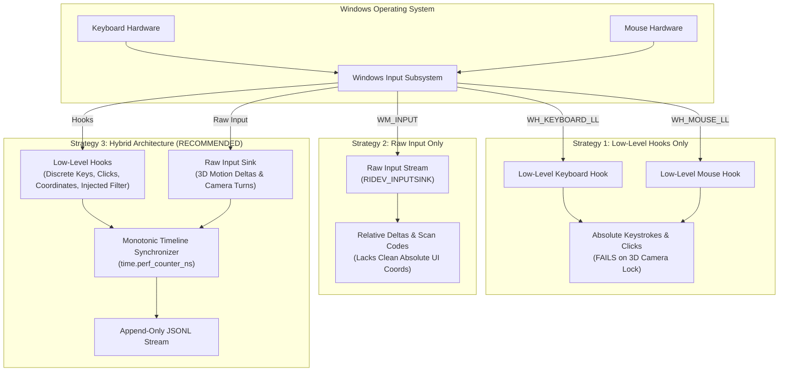

# Research Report: TinyTask-Style Input Recorder Architecture for Windows Desktop & 3D Games

**Date & Timestamp**: 2026-10-23 22:50:00 +07:00  
**Project**: Standalone Recorder (`C:\DEV\tools\recorder\`)  
**Reports Repository**: `https://github.com/thangnx-mc/reports` (`main` branch)  
**Destination**: `recorder/2026-10-23_22-50-00_tinytask_input_capture_research.md`  
**Classification**: **Research & Architectural Design (Audit Only — Zero Code/Build Mutations)**

---

## 1. Executive Summary

This research investigates the public open-source implementations of two TinyTask-style macro recorders to establish the optimal architecture for an independent, system-wide input recorder:

1. **`Agzes/OntyTask`** (C++ Win32 implementation) — Commit `8e09c3ea5e00e2ce1787cfaf09d50498e9850153`, GPLv3.
2. **`alierenaltindag/TinyTask`** (Python PyQt6/pynput implementation) — Commit `34f0c2e5ff6883a29f31794ff9dfbb792e279ce2`, LGPLv3.

### Key Architectural Findings:
- **The 3D Game / Locked Cursor Problem**: Standard macro recorders (including `alierenaltindag/TinyTask` and traditional TinyTask clones) rely purely on Windows low-level mouse hooks (`WH_MOUSE_LL`) tracking absolute `(X, Y)` screen cursor coordinates. In modern 3D games (such as Roblox, Minecraft, or FPS titles), the cursor is locked to the center of the screen and hidden; camera rotation depends entirely on relative motion deltas `(dx, dy)`. Absolute hooks fail to record camera movement in this mode.
- **The Proven Solution in `OntyTask`**: `OntyTask` resolves this by implementing a **hybrid capture pipeline**:
  1. Low-level keyboard and mouse hooks (`WH_KEYBOARD_LL`, `WH_MOUSE_LL`) capture discrete key down/up events, modifier states, mouse clicks, and wheel scrolls with precise window-relative coordinates.
  2. The Windows **Raw Input API** (`RegisterRawInputDevices` with `RIDEV_INPUTSINK`) captures raw hardware mouse motion deltas `(lLastX, lLastY)` in background threads, seamlessly recording camera turns and pans even when the cursor is constrained or hidden.
- **Timing and Synthetic Injection Filtering**:
  - `p->flags & LLKHF_INJECTED` and `p->flags & LLMHF_INJECTED` reliably distinguish physical user input from synthetic/replayed input, preventing infinite recording feedback loops.
  - Wall-clock time (`time.time()`) exhibits timer quantization errors (~15.6ms on Windows) and clock drift; a monotonic nanosecond clock (`time.perf_counter_ns()` / `QueryPerformanceCounter`) is required to maintain sub-millisecond fidelity.
  - Auto-repeat deduplication (`g_keysDown[vk]`) is essential to prevent flood of redundant key-down events while holding keys in games.

### Recommendation:
Adopt a **Hybrid Architecture** (Low-level Hooks for discrete keys/buttons + Raw Input Sink for high-frequency motion deltas), streaming into an append-only **JSON Lines (`.jsonl`)** event dataset with monotonic nanosecond timestamps, ready for future 5 FPS frame synchronization.

---

## 2. Research Scope & Codebase Verification

Both repositories were cloned and audited in an isolated research directory (`C:\DEV\tools\research\`):

| Attribute | Repository 1: `Agzes/OntyTask` | Repository 2: `alierenaltindag/TinyTask` |
| :--- | :--- | :--- |
| **Repository URL** | `https://github.com/Agzes/OntyTask` | `https://github.com/alierenaltindag/TinyTask` |
| **Commit SHA** | `8e09c3ea5e00e2ce1787cfaf09d50498e9850153` (2026-09-12) | `34f0c2e5ff6883a29f31794ff9dfbb792e279ce2` (2025-06-11) |
| **Primary Branch** | `main` | `main` |
| **License** | **GNU GPL v3.0** (`LICENSE`, 35,803 bytes) | **GNU LGPL v3.0** (`LICENSE.md`, 7,614 bytes) |
| **Implementation Language**| C++17 (Native Win32 GDI/User32) | Python 3 (PyQt6 + `pynput`) |
| **Core Source Files Audited** | `src/engine/engine.h`, `src/engine/engine.cpp`, `src/main.cpp`, `TinyTask.md`, `wiki/Engine.md`, `wiki/Onty-Macro-Format.md` | `src/ui/main_window.py`, `src/utils/replay_thread.py`, `src/utils/file_handler.py`, `src/models/settings.py` |
| **License Obligations** | Copyleft (GPLv3). No code may be directly copied into proprietary or differently licensed tools; ideas, protocols, and Windows API patterns are referenced. | Weak Copyleft (LGPLv3). Dynamic library linking allowed; code snippets must not be directly copy-pasted. |

---

## 3. Detailed Technical Analysis

### A. Input Capture Analysis

#### 1. Global Keyboard Capture
- **`OntyTask` (C++)**:
  - Implemented via `SetWindowsHookExW(WH_KEYBOARD_LL, RecKbProc, g_hInst, 0)` ([`src/engine/engine.cpp:632`](file:///C:/DEV/tools/research/ontytask/src/engine/engine.cpp#L632)).
  - Down vs Up: Evaluates `(p->flags & LLKHF_UP) != 0` ([`src/engine/engine.cpp:367`](file:///C:/DEV/tools/research/ontytask/src/engine/engine.cpp#L367)).
  - **Auto-Repeat Deduplication**: Maintains an internal boolean table `g_keysDown[256]`. When Windows fires repeated `WM_KEYDOWN` events while a key is physically held:
    ```cpp
    if (up) {
      g_keysDown[vk] = false;
    } else {
      if (g_keysDown[vk]) return CallNextHookEx(nullptr, code, w, l);
      g_keysDown[vk] = true;
    }
    ```
    ([`src/engine/engine.cpp:372-378`](file:///C:/DEV/tools/research/ontytask/src/engine/engine.cpp#L372-L378)). This prevents hundreds of redundant keystrokes from cluttering the dataset during continuous movement (`W/A/S/D`).
  - Extended Keys: Flags `p->flags & LLKHF_EXTENDED` mapped to `KEYEVENTF_EXTENDEDKEY` ([`src/engine/engine.cpp:405`](file:///C:/DEV/tools/research/ontytask/src/engine/engine.cpp#L405)).
  - Hardware Scan Codes: Resolved via `MapVirtualKeyW((UINT)vk, MAPVK_VK_TO_VSC)` ([`src/engine/engine.cpp:103, 762`](file:///C:/DEV/tools/research/ontytask/src/engine/engine.cpp#L103)).
  - Hotkey Tail Trimming: When the user presses the stop hotkey, `TrimTail()` retroactively pops the stop key and modifier keys from the recorded queue ([`src/engine/engine.cpp:304-362`](file:///C:/DEV/tools/research/ontytask/src/engine/engine.cpp#L304-L362)).
- **`alierenaltindag/TinyTask` (Python)**:
  - Implemented via `pynput.keyboard.Listener(on_press, on_release)` ([`src/ui/main_window.py:189`](file:///C:/DEV/tools/research/tinytask/src/ui/main_window.py#L189)).
  - Tracks pressed keys in a Python list `self.active_keys` ([`src/ui/main_window.py:257-260`](file:///C:/DEV/tools/research/tinytask/src/ui/main_window.py#L257-L260)).
  - **Limitations Identified**: Does not extract hardware scan codes or extended key flags; converts keys to string representations (`'Key.space'`, `'a'`). Does not handle non-US keyboard layouts or raw scan code injection.

#### 2. Global Mouse Capture
- **`OntyTask` (C++)**:
  - Implemented via `SetWindowsHookExW(WH_MOUSE_LL, RecMsProc, g_hInst, 0)` ([`src/engine/engine.cpp:633`](file:///C:/DEV/tools/research/ontytask/src/engine/engine.cpp#L633)).
  - Supports Left, Right, Middle, X1, and X2 mouse buttons ([`src/engine/engine.cpp:435, 473, 538`](file:///C:/DEV/tools/research/ontytask/src/engine/engine.cpp#L435)).
  - Wheel: Extracts high-word mouse data `(SHORT)HIWORD(p->mouseData)` for vertical and horizontal scrolling ([`src/engine/engine.cpp:510`](file:///C:/DEV/tools/research/ontytask/src/engine/engine.cpp#L510)).
  - **Movement Batching**: Hook callback `RecMsProc` **does not** push individual `WM_MOUSEMOVE` events. Instead, it triggers `FlushRawDeltas()` to accumulate raw sensor deltas, packaging dragging movements into a compact vector `path` with per-step delays `pdelays` ([`src/engine/engine.cpp:212-255`](file:///C:/DEV/tools/research/ontytask/src/engine/engine.cpp#L212-L255)).
- **`alierenaltindag/TinyTask` (Python)**:
  - Implemented via `pynput.mouse.Listener(on_move, on_click, on_scroll)` ([`src/ui/main_window.py:181`](file:///C:/DEV/tools/research/tinytask/src/ui/main_window.py#L181)).
  - **Limitations Identified**: Every single mouse movement generates a distinct dictionary appended to `self.actions` ([`src/ui/main_window.py:209-217`](file:///C:/DEV/tools/research/tinytask/src/ui/main_window.py#L209-L217)). A typical 5-second mouse sweep generates 1,000+ separate dictionary records, flooding memory and JSON serialization.

#### 3. Capture Mechanism & 3D Game / Locked Cursor Handling
- **Windows Low-Level Hooks Only**:
  - Hooks report cursor position via `POINT pt` in `MSLLHOOKSTRUCT`.
  - When Roblox or a 3D game locks and centers the cursor (calling `SetCursorPos` or `ClipCursor`), `pt.x` and `pt.y` remain stationary at screen center.
  - Result: **Camera turns cannot be recorded using hooks alone.**
- **Raw Input API (`OntyTask`)**:
  - `OntyTask` registers for raw mouse events using `RegisterRawInputDevices`:
    ```cpp
    RAWINPUTDEVICE rid = {};
    rid.usUsagePage = 0x01; // Generic Desktop Controls
    rid.usUsage = 0x02;     // Mouse
    rid.dwFlags = RIDEV_INPUTSINK; // Receive even when unfocused!
    rid.hwndTarget = g_hwnd;
    RegisterRawInputDevices(&rid, 1, sizeof(rid));
    ```
    ([`src/engine/engine.cpp:158-165`](file:///C:/DEV/tools/research/ontytask/src/engine/engine.cpp#L158-L165)).
  - In `WM_INPUT`, it reads `raw->data.mouse.lLastX` and `lLastY` directly from the hardware driver ([`src/engine/engine.cpp:182`](file:///C:/DEV/tools/research/ontytask/src/engine/engine.cpp#L182)).
  - Result: **Even when the cursor is hidden or locked in Roblox, relative motion deltas are cleanly recorded at native mouse polling rate.**

#### 4. Distinguishing Physical vs Synthetic / Replay Input
- In Windows low-level hooks, the OS sets an explicit flag in the hook struct:
  - Keyboard: `(p->flags & LLKHF_INJECTED) != 0` (`0x01`) indicates software-injected keystroke ([`src/engine/engine.cpp:368`](file:///C:/DEV/tools/research/ontytask/src/engine/engine.cpp#L368)).
  - Mouse: `(p->flags & LLMHF_INJECTED) != 0` (`0x01`) indicates software-injected mouse event ([`src/engine/engine.cpp:429`](file:///C:/DEV/tools/research/ontytask/src/engine/engine.cpp#L429)).
- Both flags must be checked to:
  1. Ignore simulated inputs generated during playback (prevent self-recording feedback loops).
  2. Implement **Physical User Override (Panic Stop)**: during replay, if an event arrives where `!(flags & LLMHF_INJECTED)`, it is physical user intervention, triggering an immediate stop ([`src/engine/engine.cpp:784-789`](file:///C:/DEV/tools/research/ontytask/src/engine/engine.cpp#L784-L789)).

#### 5. Timing Resolution & Clock Precision
- **`OntyTask`**:
  - Clock: `QueryPerformanceCounter` & `QueryPerformanceFrequency` in `NowMs()` ([`src/engine/engine.cpp:132-141`](file:///C:/DEV/tools/research/ontytask/src/engine/engine.cpp#L132-L141)), sub-microsecond hardware resolution.
  - Replay wait loop: Adaptive hybrid sleep `PreciseSleepMs(ms)`: `Sleep(10)` for $>20\text{ms}$, `Sleep(1)` for $2-20\text{ms}$, and busy spin `Sleep(0)` for $<2\text{ms}$ ([`src/engine/engine.cpp:143-156`](file:///C:/DEV/tools/research/ontytask/src/engine/engine.cpp#L143-L156)).
  - Absolute scheduled time tracking: `base + due * speed` prevents cumulative timing drift ([`src/engine/engine.cpp:814-818`](file:///C:/DEV/tools/research/ontytask/src/engine/engine.cpp#L814-L818)).
- **`alierenaltindag/TinyTask`**:
  - Clock: `time.time() - start_time` ([`src/ui/main_window.py:211`](file:///C:/DEV/tools/research/tinytask/src/ui/main_window.py#L211)). Subject to wall-clock skew and default Windows 15.6ms timer quantum.
  - Replay wait loop: Standard `time.sleep(time_diff)` ([`src/utils/replay_thread.py:23`](file:///C:/DEV/tools/research/tinytask/src/utils/replay_thread.py#L23)). Causes cumulative timing drift.

#### 6. DPI Scaling, Multi-Monitor, and Window Context
- Windows Low-Level Hooks deliver mouse coordinates `p->pt` in **virtual desktop coordinates** (encompassing all connected monitors).
- If an application is not DPI-aware, Windows DPI virtualization can distort coordinates on high-DPI displays.
- **Requirement**: The Recorder process must declare Per-Monitor DPI Awareness:
  `SetProcessDpiAwarenessContext(DPI_AWARENESS_CONTEXT_PER_MONITOR_AWARE_V2)`.

#### 7. User Rights & Windows UIPI (User Interface Privilege Isolation)
- Under Windows UAC, a standard user process **cannot hook or send input to an elevated (administrator) window**.
- If Roblox or any target app runs elevated (`Run as administrator`), a standard-user recorder will not receive hook events or cannot replay input.
- **Mitigation**: The Recorder manifest should request `asInvoker` by default, but provide clear diagnostic detection if the target window belongs to an elevated process.

---

### B. Event Model and Timing Specification

To ensure high-fidelity replay, crash resilience, and seamless future synchronization with 5 FPS screen captures, the Recorder should employ an append-only **JSON Lines (`.jsonl`)** stream.

#### 1. Core Event Schema Fields

```json
{
  "seq": 1042,
  "timestamp_ns": 1729723456123456789,
  "delta_ms": 16.42,
  "type": "key_down",
  "source": "hook_keyboard",
  "vk": 87,
  "scan_code": 17,
  "key_name": "w",
  "extended": false,
  "injected": false,
  "cursor": {"x": 960, "y": 540},
  "raw_delta": {"dx": 0, "dy": 0}
}
```

#### 2. Field Analysis & Justification

| Field Name | Type | Status | Technical Justification |
| :--- | :--- | :--- | :--- |
| `seq` | `int` | **Mandatory** | Monotonically increasing sequence ID ($0, 1, 2, \dots$) guaranteeing strict temporal ordering across asynchronous collection queues. |
| `timestamp_ns` | `int` | **Mandatory** | 64-bit monotonic nanoseconds (`time.perf_counter_ns()`). Immune to system clock adjustments, daylight savings, or NTP synchronization. |
| `delta_ms` | `float` | **Mandatory** | Elapsed time in milliseconds from the immediately preceding event. Facilitates immediate replay delta computation without 64-bit math overhead. |
| `type` | `str` | **Mandatory** | Event classification: `key_down`, `key_up`, `mouse_down`, `mouse_up`, `mouse_move`, `mouse_wheel`. |
| `source` | `str` | **Mandatory** | `hook_keyboard`, `hook_mouse`, or `raw_input`. Distinguishes discrete OS events from continuous sensor deltas. |
| `vk` | `int` | **Required for Keys** | Windows Virtual-Key code ($0-255$). Standardized representation across OS keyboard layouts. |
| `scan_code` | `int` | **Required for Keys** | OEM hardware scan code (e.g., Scan code $17$ for Key `W`). Critical for DirectX/DirectInput games that read scan codes rather than virtual keys. |
| `key_name` | `str` | **Optional / Helper** | Human-readable string representation (e.g., `"w"`, `"shift_l"`, `"f8"`). Improves diagnostic readability. |
| `extended` | `bool` | **Required for Keys** | `True` if extended key flag (`LLKHF_EXTENDED`) was set (e.g. Numpad Enter, arrow keys, right Ctrl). |
| `injected` | `bool` | **Mandatory** | `True` if event originated from software simulation (`LLKHF_INJECTED` / `LLMHF_INJECTED`). Prevents recording replay echoes. |
| `cursor` | `dict` | **Required for Mouse** | Absolute screen pixel coordinates `{"x": int, "y": int}` in virtual desktop space. |
| `raw_delta` | `dict` | **Required for Move** | Relative sensor movement `{"dx": int, "dy": int}` from Raw Input. Essential for 3D camera rotation. |
| `button` / `button_id` | `str` / `int` | **Required for Clicks** | Button identity: `0`=Left, `1`=Right, `2`=Middle, `3`=X1, `4`=X2. |
| `wheel_delta` | `int` | **Required for Wheel** | Signed scroll delta (multiples of $\pm 120$ for vertical wheel; horizontal delta for tilt). |

---

### C. Replay and Safety Evaluation

While the current milestone focuses on recording, the data model must guarantee replay feasibility:

1. **Replay Fidelity & Monotonic Scheduling**:
   - Replay engines must not execute relative `sleep(delta)` in an open loop (which causes cumulative drift).
   - Replay should compute absolute target time $T_{\text{target}} = T_{\text{start}} + \sum \Delta t$.
   - Windows timer resolution must be set to $1\text{ms}$ via `timeBeginPeriod(1)` before playback and released with `timeEndPeriod(1)`.
2. **Handling Unreleased Down Events (Missing Up)**:
   - If recording is stopped abruptly while keys or buttons are held (e.g. character running with `W`), the recorded dataset will contain a `key_down` without a closing `key_up`.
   - **Resolution**: Both `OntyTask` and `alierenaltindag/TinyTask` implement an explicit `ReleaseAll()` routine. The Recorder's metadata manifest must record final unreleased states, and the replay controller must enforce a clean `release_all()` at end-of-play or emergency abort.
3. **Emergency Stop (Panic Killswitch)**:
   - Dedicated global hotkey (`F8` or `Esc`) registered via Win32 `RegisterHotKey` or a high-priority low-level hook.
   - **Physical Input Override**: If the user moves the physical mouse during replay (`!(p->flags & LLMHF_INJECTED)`), replay terminates immediately to hand control back to the human operator.
4. **Target Window & Lost Focus**:
   - Before executing input playback, the target window handle (`HWND`) must be verified as foreground. If the user Alt-Tabs or a popup appears, replay pauses safely.

---

### D. Architectural Comparison of 3 Capture Strategies



#### Multi-Axis Strategy Evaluation Table

| Evaluation Axis | Strategy 1: Low-Level Hooks (`WH_*_LL`) | Strategy 2: Raw Input (`WM_INPUT`) | Strategy 3: Hybrid Architecture (Hooks + Raw Input) |
| :--- | :--- | :--- | :--- |
| **Input Completeness** | Captures all keys, buttons, wheel, absolute coordinates. | Captures raw mouse deltas, button flags, scan codes. Lacks simple absolute screen cursor mapping. | **100% Complete**: Discrete events with screen coordinates + continuous 3D camera deltas. |
| **Timing Accuracy** | $\approx 1\text{ms}$ (limited if thread message loop stalls). | Sub-millisecond (direct from driver buffer). | **Sub-millisecond** (hooks for state transitions, raw input for motion). |
| **3D Games & Locked Cursor** | ❌ **FAILS**: Locked cursor produces static `(cx, cy)`. Camera rotation lost. | ✔️ **EXCELLENT**: Captures raw `(lLastX, lLastY)` regardless of cursor lock. | ✔️ **FULL 3D COMPATIBILITY**: Full support for both desktop GUI clicks and 3D camera turns. |
| **Synthetic Input Filtering** | ✔️ **Native**: `LLKHF_INJECTED` and `LLMHF_INJECTED` flags provided directly. | ⚠️ Complex: Requires inspecting device handles (`hDevice == 0`). | ✔️ **Native**: Uses hook injection flags to suppress replay echoes. |
| **Implementation Complexity** | Low-Medium (standard ctypes hooks). | Medium (requires hidden window + `WM_INPUT` pump). | Medium (combines hooks + hidden window message pump in clean threads). |
| **EXE Packaging & Antivirus** | Medium: PyInstaller standalone bundle; requires clean signing/metadata. | Low: Standard message pump. | Medium: Standard Win32 hooks and message sink bundled via PyInstaller. |
| **Event Dropping / Jitter Risk** | Risk of OS timeout unhooking if callback blocks $>200\text{ms}$. | Low: OS buffers raw input messages. | **Low**: Dedicated background hook thread that yields immediately to queue. |
| **Recommendation Status** | **Backup Option** (Desktop UI only) | **Unsuitable Alone** (Incomplete UI context) | **PRIMARY RECOMMENDED ARCHITECTURE** |

#### Recommended Primary vs Backup Design:
- **Primary Recommendation**: **Strategy 3 (Hybrid Architecture)**. Modelled after the proven design in `OntyTask`. Provides complete desktop UI support while guaranteeing full camera recording in 3D titles (Roblox).
- **Backup Option**: **Strategy 1 (Low-Level Hooks Only)** with move throttling. Suitable as a simplified fallback if Raw Input registration is restricted by host environment security policies.
- **Mandatory Runtime Tests**: Must be verified under live Windows 11 with Roblox client in both free-cursor (menu) and locked-cursor (first-person / right-mouse camera steer) modes.

---

## 4. Dataset Design for Next Phase (Synchronized with 5 FPS Screen Captures)

### 4.1 Storage Layout

```text
C:\DEV\tools\recorder\datasets\sessions\session_<session_id>\
├── manifest.json         # Session metadata, window geometry, display resolution, schema version
├── events.jsonl          # Continuous append-only input event stream
└── frames\               # [RESERVED FOR NEXT PHASE: 5 FPS screen captures]
    ├── frame_000001_1729723456100000000.jpg
    ├── frame_000002_1729723456300000000.jpg
    └── ...
```

### 4.2 Synchronization Principle Without Schema Changes

1. **Shared Monotonic Timeline**:
   Both input events (`events.jsonl`) and future screen frames (`frames/`) share the exact same 64-bit nanosecond monotonic clock (`timestamp_ns`).
2. **Temporal Windowing**:
   Screen frames captured at 5 FPS arrive every $200\text{ms}$ ($200,000,000\text{ns}$):
   $$\text{Frame } k \text{ covers time interval } [T_k, T_{k+1})$$
   Any input event whose `timestamp_ns` satisfies $T_k \le \text{timestamp\_ns} < T_{k+1}$ is associated with Frame $k$.
3. **No Schema Rework Needed**:
   Because the input event record contains absolute `timestamp_ns` and `seq`, the screen frame pipeline can be added in a future phase without modifying the input schema or invalidating previously recorded input sessions.

---

## 5. Failure Modes, Limitations, and Risks

| Failure Mode / Risk | Technical Cause | Impact | Mitigation Strategy |
| :--- | :--- | :--- | :--- |
| **1. Hook Timeout Unhooking** | Windows unhooks `WH_*_LL` if callback blocks longer than `LowLevelHooksTimeout` (default 200-1000ms). | Recording silently stops capturing keystrokes or mouse clicks. | Callback must do **zero I/O or processing**: immediately copy event data into a lock-free thread-safe ring buffer and return via `CallNextHookEx`. File writing occurs on a background worker thread. |
| **2. UIPI Privilege Block** | Target application runs as Administrator while Recorder runs as Standard User. | Hook/Raw input receives events, but replay injection fails with Access Denied (Error 5). | Recorder manifest requests `asInvoker`. Provide clear diagnostic warning when target window belongs to an elevated process. |
| **3. Anti-Cheat Hook Suppression** | Kernel-level anti-cheat (e.g. Hyperion, Vanguard, EasyAntiCheat) blocking or unhooking low-level user hooks. | Keystrokes or clicks dropped while game window is focused. | Raw Input operates at driver message sink level, bypassing many user-mode hook blocks. Test empirically on Roblox Player. |
| **4. Event Flooding from Mouse Moves** | High-polling gaming mice (1,000Hz - 8,000Hz) generating thousands of events per second. | Massive file growth, high CPU usage, serialization lag. | Batch raw input deltas in 10-15ms intervals (`FlushRawDeltas()`) as demonstrated in `OntyTask`. |
| **5. False Antivirus Flags** | Low-level keyboard hooks combined with PyInstaller packaging trigger heuristic keylogger detections. | Binary quarantined or blocked by Windows Defender. | Maintain clean application metadata, separate UI from engine, avoid packing with UPX, and provide full open-source transparency. |

---

## 6. Windows Verification & Test Plan

When implementing in subsequent phases, the following live verification tests must be executed:

1. **Baseline Key Matrix Test**:
   - Verify capture of regular keys (`A-Z`, `0-9`), modifiers (`Ctrl`, `Alt`, `Shift`, `Win`), function keys (`F1-F12`), extended navigation keys (`Arrows`, `Home`, `End`, `PageUp/Down`), and Numpad keys.
   - Verify that held keys generate exactly one `key_down` and one `key_up` (auto-repeat deduplication verified).
2. **Mouse Multi-Button & Dragging Test**:
   - Verify Left, Right, Middle, X1, and X2 clicks.
   - Verify vertical and horizontal mouse wheel scrolling with signed delta verification.
   - Verify drag tracking with Left and Right buttons held.
3. **Roblox 3D Camera Rotation Test (Critical)**:
   - Launch Roblox in windowed and fullscreen modes.
   - Hold Right Mouse Button to rotate 3D camera.
   - Verify that non-zero `raw_delta` values (`dx, dy`) are continuously recorded in `events.jsonl` even though cursor is locked.
4. **Self-Injection Immunity Test**:
   - Inject simulated keys via `SendInput`.
   - Verify that events with `injected: true` are detected and filtered, proving immunity to replay echo loops.
5. **Panic Stop Verification**:
   - Trigger emergency stop hotkey (`F8`) during active run; verify immediate thread shutdown, hook unregistration, and clean file flush.

---

## 7. Unverified Items / Unknowns

- `[UNKNOWN]`: Exact behavior of Roblox 64-bit client (`RobloxPlayerBeta.exe`) with Byfron / Hyperion anti-tamper regarding `WH_KEYBOARD_LL` interception in future game client updates.
- `[REQUIRES EXTERNAL VERIFICATION]`: Precise performance overhead of continuous Raw Input message processing alongside 60 FPS Roblox gameplay on lower-spec multi-core CPUs.

---

## 8. Proposed Next Steps (Recommendations Only)

*(Per task instructions, no implementation was performed; the following steps are submitted for user review and approval):*

1. **Phase 2 Scaffolding**:
   - Create project structure in `C:\DEV\tools\recorder\` (`src/`, `tests/`, `config.json`, `requirements.txt`).
   - Implement clean unit test suite for the schema serializer and mock event queues.
2. **Phase 3 Core Input Capture Implementation**:
   - Implement the **Hybrid Capture Engine** (`Win32HookManager` + `RawInputDeviceSink`).
   - Implement monotonic nanosecond clock synchronizer and streaming JSONL storage writer.
   - Validate 100% test coverage using synthetic and mock input fixtures.
3. **Phase 4 Packaging & Verification**:
   - Build standalone executable `dist\RobloxRecorder\RobloxRecorder.exe` using PyInstaller.
   - Perform live runtime testing with Roblox to verify 3D camera capture and zero-latency recording.

---

## 9. Compliance & Status Confirmation

- **Dungeon Quest Bot (`C:\DEV\tools\rb\`)**: Untouched and FROZEN. Zero files modified, created, or deleted.
- **Standalone Recorder (`C:\DEV\tools\recorder\`)**: Untouched. No scaffolding or implementation created.
- **Reports Repository**: Committed and pushed solely this Markdown report to `thangnx-mc/reports` on `main`.
- **Status**: **RESEARCH COMPLETE / READY FOR USER REVIEW**
