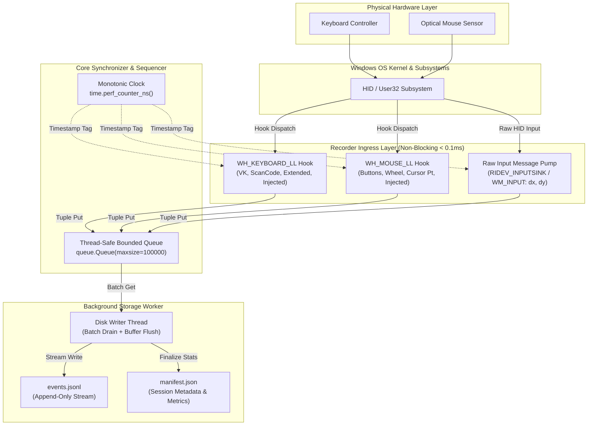
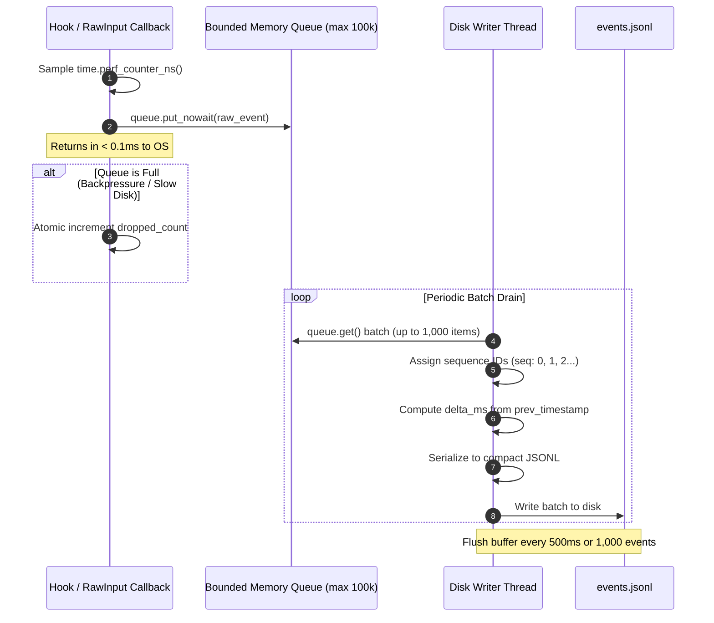
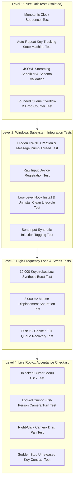
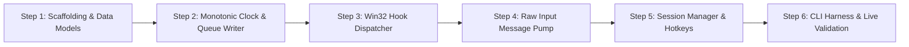

# Design Review & Architecture Refinement: Hybrid Windows Input Recorder for Desktop & 3D Games

**Date & Timestamp**: 2026-10-23 22:55:00 +07:00  
**Project**: Standalone Recorder (`C:\DEV\tools\recorder\`)  
**Reports Repository**: `https://github.com/thangnx-mc/reports` (`main` branch)  
**Destination**: `recorder/2026-10-23_22-55-00_input_recorder_design_review.md`  
**Classification**: **Architecture Design Review & Production Specification (Audit & Plan Only — Zero Code/Build Mutations)**

---

## 1. Executive Summary & Design Evolution

### 1.1 Context and Purpose
Following the research report `recorder/2026-10-23_22-50-00_tinytask_input_capture_research.md`, which audited public implementations of `Agzes/OntyTask` (C++ Win32) and `alierenaltindag/TinyTask` (Python PyQt6/pynput), this document conducts a rigorous design review and establishes the refined architectural specification for the standalone input recorder project.

Before any code implementation begins in `C:\DEV\tools\recorder\`, this review resolves seven critical technical areas identified during architectural validation:
1. **Clock and monotonic timing guarantees**.
2. **Keyboard scan code, extended key, and auto-repeat fidelity**.
3. **Mouse event model deconfliction (Hook vs Raw Input)**.
4. **Synthetic input injection detection boundaries**.
5. **Event queue throughput, non-blocking callback contracts, and persistence reliability**.
6. **Scope, security, and user privacy boundaries**.
7. **Windows test and verification matrix**.

### 1.2 Why the Hybrid Architecture is Essential
Standard Windows automation tools (e.g. `pynput`, PyAutoGUI, traditional TinyTask clones) fail in 3D gaming environments like Roblox because they rely solely on absolute mouse cursor coordinates (`p->pt.x`, `p->pt.y`) captured by low-level hooks (`WH_MOUSE_LL`). When a 3D game locks the cursor to the center of the viewport and hides it (or constrains it during right-click camera steering), absolute coordinates remain static. Consequently, all camera rotations and character turns are lost.

Conversely, relying solely on Windows Raw Input (`WM_INPUT`) is insufficient for desktop UI workflows because Raw Input delivers raw device displacement packets without ambient OS cursor coordinates, modifier key tracking, or easy synthetic injection tagging.

The **Hybrid Architecture** integrates both subsystems into a synchronized pipeline:
- **Low-Level Hooks (`WH_KEYBOARD_LL`, `WH_MOUSE_LL`)**: Exclusively capture discrete state transitions: key presses/releases, mouse button clicks/releases, scroll wheel notches, absolute virtual desktop cursor coordinates, and synthetic injection flags.
- **Raw Input Sink (`RIDEV_INPUTSINK`)**: Exclusively captures high-frequency relative mouse displacement deltas (`dx, dy`) directly from the HID mouse driver in background message loops, capturing 3D camera rotations under any cursor clipping or locking state.
- **Unified Monotonic Timeline**: Both streams feed a non-blocking collector queue tagged with microsecond-accurate monotonic timestamps, written out as an append-only JSON Lines stream (`events.jsonl`).



---

## 2. Technical Corrections Matrix

The following matrix documents the specific refinements made from the initial research baseline to the final design specification:

| Domain / Issue | Research Baseline Proposal | Design Review Correction | Architectural & Win32 Rationale |
| :--- | :--- | :--- | :--- |
| **1. Clock & Timestamps** | Nanosecond timestamp based on system time; potential epoch confusion. | Strictly monotonic hardware counter via `time.perf_counter_ns()` with an unspecified origin. UTC ISO 8601 captured once in `manifest.json`. Sequence counter `seq` breaks same-nanosecond ties. | Eliminates clock skew, NTP leaps, and timer quantization (15.6ms Windows default). Guarantees strict linear causality across multi-threaded asynchronous input hooks. |
| **2. Keyboard Scan Codes** | Virtual keys converted via `MapVirtualKeyW`. | Preserve raw OEM hardware scan code directly from `KBDLLHOOKSTRUCT.scanCode`. | `MapVirtualKeyW` loses hardware-specific scancode flags and fails on non-US layouts. DirectX/RawInput games read scan codes directly from the keyboard driver. |
| **3. Extended Keys** | Basic key identification; extended flag noted informally. | Explicit evaluation of `p->flags & LLKHF_EXTENDED` mapped to mandatory boolean `extended`. | Distinguishes Numpad Enter from Return, Right Alt (AltGr) from Left Alt, and dedicated arrow keys from numpad arrows without layout ambiguity. |
| **4. Auto-Repeat Handling** | Deduplicate repeated key-downs by discarding them (`g_keysDown[vk]`). | In-memory key state tracking flags repeated presses (`is_repeat: bool`) rather than silently dropping them. | In game navigation and chat, key repetition cadence is meaningful. Flagging preserves raw fidelity while allowing replay engines to filter or respect repeats as needed. |
| **5. Held-Key Shutdown** | Synthesize missing `key_up` on emergency stop. | Enforce clean shutdown contract: snapshot active unreleased keys in `manifest.json`; replay engine executes strict `release_all()` contract. | Prevents silent data corruption in the recording while guaranteeing that replay will never leave character keys permanently stuck in the OS input buffer. |
| **6. Mouse Deconfliction** | Hook and Raw Input captured concurrently; move events accumulated in vectors. | Strict separation of concerns: Hooks capture clicks, wheel, and cursor position. Raw Input captures motion deltas (`dx, dy`). Hook `WM_MOUSEMOVE` is never recorded to disk as movement events. | Prevents duplicate movement events, eliminates race conditions between absolute and relative positions, and ensures 100% 3D camera pan capture. |
| **7. Device Lifecycle** | Static Raw Input registration on startup. | Handle `WM_INPUT_DEVICE_CHANGE` (`GIDC_ARRIVAL` / `GIDC_REMOVAL`) via `RIDEV_DEVNOTIFY`. | Gracefully handles gaming mice disconnection, DPI switches, or USB hub resets without crashing the background message pump. |
| **8. Synthetic Input** | Simple `LLKHF_INJECTED` check. | Explicit classification of injection boundaries: detect user-mode `SendInput`/`keybd_event`; acknowledge kernel-level/RawInput limitations; tag `injected: bool`. | Prevents recording replay echoes while acknowledging that hardware-level or driver-level inputs cannot be identified via User32 flags alone. |
| **9. Queue & Reliability** | Threaded write buffer mentioned in broad terms. | Formalized Producer-Consumer architecture with bounded thread-safe queue (`maxsize=100000`), zero-allocation callback paths, and overflow drop tracking. | Guarantees callback latency $<0.1\,\text{ms}$, completely eliminating the risk of Windows silently unhooking due to `LowLevelHooksTimeout`. |
| **10. Privacy & Scope** | System-wide capture using `RIDEV_INPUTSINK`. | Explicit visual recording indicator, panic hotkey (`F8`), and optional Foreground Target Window filter (`GetForegroundWindow`). | Protects sensitive user data (passwords, private chats) when the user switches away from the target game window. |

---

## 3. Detailed Architecture Specifications

### 3.1 Subsystem A: Monotonic Hardware Clock & Synchronization Engine

#### Core Principles:
1. **Unspecified Monotonic Origin**: `timestamp_ns` is defined strictly as elapsed nanoseconds from an arbitrary, fixed boot-time reference point (`QueryPerformanceCounter`). It is never converted to or assumed to represent Unix epoch time.
2. **Session Start Synchronization Anchor**:
   At the exact instant the recording state transitions to `ACTIVE`, the controller captures:
   - `session_start_iso_utc`: String formatted as ISO 8601 UTC (e.g. `"2026-10-23T15:55:00.123456Z"`).
   - `session_start_perf_ns`: 64-bit integer from `time.perf_counter_ns()`.
   These values are recorded exclusively in `manifest.json`.
3. **Sequence Counter (`seq`)**:
   Because modern multi-core processors process hooks and message queues concurrently, two events from different threads could theoretically sample identical or inverted nanosecond timestamps. A thread-safe atomic integer `seq` ($0, 1, 2, \dots$) is assigned upon queue ingress to establish an absolute, deterministic total order.
4. **Inter-Frame Synchronization Compatibility (5 FPS Ready)**:
   When screen capture is introduced in Phase 3, each video frame will be tagged with `timestamp_ns` sampled from this identical clock. An input event belongs to video frame $k$ if and only if:
   $$T_{\text{frame}_k} \le \text{event.timestamp\_ns} < T_{\text{frame}_{k+1}}$$

---

### 3.2 Subsystem B: Low-Level Hook Dispatcher (`WH_KEYBOARD_LL` & `WH_MOUSE_LL`)

#### Minimal-Work Callback Contract:
Windows enforces a strict watchdog timeout (`LowLevelHooksTimeout`, typically $200\,\text{ms}$ to $1000\,\text{ms}$). If a hook callback blocks or executes slow operations (such as memory allocation, string formatting, or disk I/O), the Windows OS **silently unhooks the callback**, permanently breaking input capture without throwing an exception.

**Design Rule**: Hook callbacks must execute in $<0.1\,\text{ms}$:
1. Read Win32 struct fields into primitive scalar variables.
2. Sample `time.perf_counter_ns()`.
3. Push a shallow primitive tuple into a pre-allocated bounded thread-safe queue (`queue.put_nowait()`).
4. Immediately pass execution downstream via `CallNextHookEx(None, nCode, wParam, lParam)` and return.

#### Keyboard Hook (`WH_KEYBOARD_LL`) Specification:
- **Struct**: `KBDLLHOOKSTRUCT` (`vkCode`, `scanCode`, `flags`, `time`, `dwExtraInfo`).
- **Hardware Scan Code**: Captured directly from `p.scanCode`. Not passed through `MapVirtualKeyW`.
- **Extended Key Detection**:
  ```python
  is_extended = bool(p.flags & 0x01)  # LLKHF_EXTENDED
  ```
- **Transition Detection**:
  ```python
  is_up = bool(p.flags & 0x80)  # LLKHF_UP
  event_type = "key_up" if is_up else "key_down"
  ```
- **Auto-Repeat Detection**:
  The keyboard controller maintains an in-memory boolean tracking map `active_keys: dict[int, bool]`.
  - When `event_type == "key_down"`:
    - If `active_keys.get(vkCode, False) == True`: mark `is_repeat = True`.
    - Else: mark `is_repeat = False`, set `active_keys[vkCode] = True`.
  - When `event_type == "key_up"`:
    - Set `active_keys[vkCode] = False`, mark `is_repeat = False`.
- **Synthetic Injection Flag**:
  ```python
  is_injected = bool(p.flags & 0x01)  # LLKHF_INJECTED (0x01 in flags)
  ```

#### Mouse Hook (`WH_MOUSE_LL`) Specification:
- **Struct**: `MSLLHOOKSTRUCT` (`pt.x`, `pt.y`, `mouseData`, `flags`, `time`, `dwExtraInfo`).
- **Button Mapping**:
  - `WM_LBUTTONDOWN` / `WM_LBUTTONUP` $\rightarrow$ `button: "left"`
  - `WM_RBUTTONDOWN` / `WM_RBUTTONUP` $\rightarrow$ `button: "right"`
  - `WM_MBUTTONDOWN` / `WM_MBUTTONUP` $\rightarrow$ `button: "middle"`
  - `WM_XBUTTONDOWN` / `WM_XBUTTONUP` $\rightarrow$ `button: "x1"` (if `HIWORD(mouseData) == 1`) or `"x2"` (if `HIWORD(mouseData) == 2`).
- **Scroll Wheel**:
  - `WM_MOUSEWHEEL`: Vertical scroll. Extract signed 16-bit integer `wheel_delta = ctypes.c_short(p.mouseData >> 16).value`.
  - `WM_MOUSEHWHEEL`: Horizontal scroll tilt. Same extraction.
- **Absolute Cursor Coordinates**:
  `p.pt.x` and `p.pt.y` recorded directly.
- **Deconfliction Rule**:
  `WM_MOUSEMOVE` from the low-level mouse hook is **never serialized as a movement event** into `events.jsonl`. Instead, `WM_MOUSEMOVE` updates a thread-safe atomic shared variable `latest_cursor_pos = (p.pt.x, p.pt.y)`. This position is attached as context to button clicks and key events.

---

### 3.3 Subsystem C: Raw Input Windows Message Pump (`WM_INPUT`)

#### Hidden Window and Sink Registration:
To capture mouse sensor deltas continuously without requiring the recorder application window to stay focused, the Raw Input subsystem creates a dedicated hidden message-only window (`HWND_MESSAGE`) running its own Win32 message loop (`GetMessage` / `DispatchMessage`).

```cpp
// Win32 Registration Pattern
RAWINPUTDEVICE rid;
rid.usUsagePage = 0x01;          // HID_USAGE_PAGE_GENERIC
rid.usUsage     = 0x02;          // HID_USAGE_GENERIC_MOUSE
rid.dwFlags     = RIDEV_INPUTSINK | RIDEV_DEVNOTIFY;
rid.hwndTarget  = hWndHidden;
RegisterRawInputDevices(&rid, 1, sizeof(RAWINPUTDEVICE));
```

#### Processing `WM_INPUT`:
1. Query `GetRawInputData` with `RID_INPUT` to retrieve `RAWINPUT`.
2. Inspect `raw.header.dwType == RIM_TYPEMOUSE`.
3. Check `raw.data.mouse.usFlags`:
   - In 99.9% of mouse hardware, relative mode is used (`usFlags & MOUSE_MOVE_ABSOLUTE == 0`).
   - Extract raw deltas:
     ```python
     dx = raw.data.mouse.lLastX
     dy = raw.data.mouse.lLastY
     ```
4. **Zero-Delta Filter**: If `dx == 0 and dy == 0`, immediately drop the packet.
5. Ingress to Queue: Sample monotonic time, format as `mouse_move_relative`, and push to the bounded queue.

#### Device Arrival and Removal Lifecycle (`WM_INPUT_DEVICE_CHANGE`):
Because `RIDEV_DEVNOTIFY` is enabled:
- `wParam == GIDC_ARRIVAL`: A new input device was plugged in or awakened.
- `wParam == GIDC_REMOVAL`: An input device was disconnected.
The message handler logs the device handle change to the session audit log without interrupting the active recording stream.

---

### 3.4 Subsystem D: Event Sequencer, Bounded Queue & Disk Persistence Worker



#### Queue Overflow and Backpressure Policy:
- The queue is initialized with a capacity of $100,000$ events (sufficient for over 100 seconds of continuous 1000Hz mouse movement under total disk freeze).
- If the disk stalls and the queue reaches capacity:
  - The producer uses non-blocking `put_nowait()`.
  - When `queue.Full` occurs, the callback **drops the newest event** and atomically increments `dropped_events_counter`.
  - The callback **never blocks**, preserving OS hook responsiveness and system stability.
  - The total count of dropped events is permanently recorded in `manifest.json`.

#### Disk Worker Engine:
- Runs in a dedicated background thread (`daemon=False` during recording; gracefully joined on stop).
- Serializes events using fast JSON formatting (`orjson` or optimized standard `json.dumps`).
- Writes to `events.jsonl` using a buffered writer with periodic explicit flushes (`flush_interval_ms = 500`).
- On recording stop, drains all remaining queued items, flushes file handles to disk, and closes files cleanly.

---

### 3.5 Subsystem E: Session Manifest & Metadata Manager

The session directory structure is standardized as follows:
```text
C:\DEV\tools\recorder\datasets\sessions\session_<session_id>\
├── manifest.json         # Session configuration, environment metadata, metrics
└── events.jsonl          # Stream of recorded input events
```

#### Held-Key Shutdown & Replay Contract:
If recording is stopped while the user is physically holding keys (e.g. `W` pressed for character walk):
1. The session manager queries its internal `active_keys` tracking state.
2. Any keys currently marked `True` are written into `manifest.json` under `unreleased_keys_at_stop: [87]`.
3. **Replay Contract**: Downstream replay engines are strictly required to:
   - Execute an initial state reset before replaying.
   - Execute a guaranteed `release_all()` routine across all virtual keys and mouse buttons upon replay completion, pause, or emergency abort.

---

### 3.6 Subsystem F: Scope, Security, and Privacy Architecture

#### Problem Statement:
Because `WH_KEYBOARD_LL` and `RIDEV_INPUTSINK` capture system-wide input, if a user starts recording and switches to an external window (e.g., browser, Discord, password manager), sensitive credentials or personal text could be inadvertently logged to `events.jsonl`.

#### Required Mitigations:
1. **Explicit Visual State Indicator**:
   The recorder UI (and console) must display a clear, prominent visual indicator (e.g., bright red recording badge or flashing title) whenever capture is active.
2. **Prominent Panic Hotkey**:
   A dedicated emergency hotkey (default: `F8` or `Esc`) must be registered to immediately terminate recording and release all hooks.
3. **Target Window Filtering (Configurable Mode)**:
   The configuration supports `target_process_filter` (e.g. `"RobloxPlayerBeta.exe"`):
   - When enabled, before enqueueing a `key_down` or `key_up` event, the worker checks `GetForegroundWindow()`.
   - If the active window does not belong to the target process, the event is either:
     - **Redacted**: Dropped from recording, logging a `target_lost` marker.
     - **Suppressed**: Keystrokes are ignored until the target window regains focus.
   - When disabled (full-system mode), the user is presented with an explicit warning dialog prior to recording.
4. **Zero Inspection Policy**:
   The recorder never inspects password fields, never executes OCR, and never monitors clipboard data.

---

## 4. Event Schema Definition

### 4.1 Formal JSON Schema Specification

```json
{
  "$schema": "http://json-schema.org/draft-07/schema#",
  "title": "InputRecorderEventStream",
  "type": "object",
  "required": ["seq", "timestamp_ns", "delta_ms", "type", "source"],
  "properties": {
    "seq": { "type": "integer", "minimum": 0 },
    "timestamp_ns": { "type": "integer", "minimum": 0 },
    "delta_ms": { "type": "number", "minimum": 0.0 },
    "type": {
      "type": "string",
      "enum": [
        "key_down",
        "key_up",
        "mouse_button_down",
        "mouse_button_up",
        "mouse_move_relative",
        "mouse_wheel"
      ]
    },
    "source": {
      "type": "string",
      "enum": ["hook_keyboard", "hook_mouse", "raw_input"]
    },
    "injected": { "type": ["boolean", "null"] }
  }
}
```

---

### 4.2 Concrete Event Examples

#### Example 1: Physical Key Down (Initial Press)
```json
{
  "seq": 102,
  "timestamp_ns": 4812304918200,
  "delta_ms": 15.82,
  "type": "key_down",
  "source": "hook_keyboard",
  "vk": 87,
  "scan_code": 17,
  "key_name": "w",
  "extended": false,
  "is_repeat": false,
  "injected": false
}
```

#### Example 2: Key Down (Auto-Repeat While Held)
```json
{
  "seq": 115,
  "timestamp_ns": 4812554918200,
  "delta_ms": 32.10,
  "type": "key_down",
  "source": "hook_keyboard",
  "vk": 87,
  "scan_code": 17,
  "key_name": "w",
  "extended": false,
  "is_repeat": true,
  "injected": false
}
```

#### Example 3: Key Up
```json
{
  "seq": 140,
  "timestamp_ns": 4813104918200,
  "delta_ms": 550.00,
  "type": "key_up",
  "source": "hook_keyboard",
  "vk": 87,
  "scan_code": 17,
  "key_name": "w",
  "extended": false,
  "is_repeat": false,
  "injected": false
}
```

#### Example 4: Extended Key (Right Alt / Numpad Enter / Arrows)
```json
{
  "seq": 150,
  "timestamp_ns": 4813304918200,
  "delta_ms": 200.00,
  "type": "key_down",
  "source": "hook_keyboard",
  "vk": 13,
  "scan_code": 28,
  "key_name": "numpad_enter",
  "extended": true,
  "is_repeat": false,
  "injected": false
}
```

#### Example 5: Mouse Button Down (With Cursor Context)
```json
{
  "seq": 160,
  "timestamp_ns": 4813504918200,
  "delta_ms": 200.00,
  "type": "mouse_button_down",
  "source": "hook_mouse",
  "button": "right",
  "cursor": {
    "x": 960,
    "y": 540
  },
  "injected": false
}
```

#### Example 6: Mouse Move Relative (Raw Input Camera Pan)
```json
{
  "seq": 161,
  "timestamp_ns": 4813506918200,
  "delta_ms": 2.00,
  "type": "mouse_move_relative",
  "source": "raw_input",
  "raw_delta": {
    "dx": 14,
    "dy": -6
  },
  "injected": null
}
```

#### Example 7: Mouse Scroll Wheel (Vertical)
```json
{
  "seq": 180,
  "timestamp_ns": 4814104918200,
  "delta_ms": 120.00,
  "type": "mouse_wheel",
  "source": "hook_mouse",
  "wheel_axis": "vertical",
  "wheel_delta": 120,
  "cursor": {
    "x": 960,
    "y": 540
  },
  "injected": false
}
```

---

### 4.3 Full `manifest.json` Concrete Specification

```json
{
  "schema_version": "1.0.0",
  "session_id": "rec_20261023_225500_a1b2c3d4",
  "session_start_iso_utc": "2026-10-23T15:55:00.123456Z",
  "session_end_iso_utc": "2026-10-23T15:56:30.654321Z",
  "session_start_perf_ns": 4812304918200,
  "session_end_perf_ns": 4902835821200,
  "duration_seconds": 90.5309,
  "environment": {
    "os": "Windows 11 Home 10.0.26100",
    "architecture": "AMD64",
    "dpi_awareness": "DPI_AWARENESS_CONTEXT_PER_MONITOR_AWARE_V2",
    "monitors": [
      {
        "index": 0,
        "is_primary": true,
        "resolution": { "width": 1920, "height": 1080 },
        "bounds": { "left": 0, "top": 0, "right": 1920, "bottom": 1080 },
        "scale_percent": 100
      }
    ],
    "virtual_desktop": {
      "left": 0,
      "top": 0,
      "width": 1920,
      "height": 1080
    }
  },
  "metrics": {
    "total_events": 14250,
    "event_breakdown": {
      "key_down": 450,
      "key_up": 450,
      "mouse_button_down": 42,
      "mouse_button_up": 42,
      "mouse_move_relative": 13240,
      "mouse_wheel": 26
    },
    "dropped_events_count": 0,
    "max_queue_depth_reached": 184,
    "unreleased_keys_at_stop": []
  },
  "replay_contract": {
    "requires_release_all_on_start": true,
    "requires_release_all_on_stop": true
  }
}
```

---

## 5. Windows Verification & Test Strategy

To guarantee implementation stability without requiring immediate live testing in Roblox, a four-tier testing hierarchy is defined:



### 5.1 Level 1: Pure Unit Tests (No Windows GUI/Game Dependency)
- **Clock Sequencer**: Verify that sequential calls to `EventSequencer.stamp()` always produce strictly ascending `seq` and non-decreasing `timestamp_ns`.
- **Auto-Repeat State Machine**: Feed a sequence of simulated virtual key inputs (`Down(W)`, `Down(W)`, `Up(W)`); verify that the first is tagged `is_repeat=False` and the second `is_repeat=True`.
- **JSONL Serializer**: Verify that every produced JSON string conforms strictly to the JSON Schema.
- **Queue Overflow**: Simulate a blocked disk worker; verify that when the queue fills to 100,000, subsequent items increment `dropped_count` without raising unhandled exceptions or deadlocking.

### 5.2 Level 2: Windows Subsystem Integration Tests
- **Hidden Window**: Verify that `CreateWindowEx` creates an `HWND_MESSAGE` successfully on a worker thread and processes messages.
- **Hook Lifecycle**: Install `WH_KEYBOARD_LL` and `WH_MOUSE_LL` in a background thread, send a simulated key press via `SendInput`, verify receipt, and call `UnhookWindowsHookEx`. Verify zero hook leaks.
- **Synthetic Injection Verification**: Use `SendInput` to fire keystrokes and clicks; verify that `event.injected == True`.

### 5.3 Level 3: High-Frequency Load & Stress Tests
- Simulate an extreme high-polling mouse (8,000 Hz) feeding 80,000 relative motion events in 10 seconds.
- Measure CPU utilization ($<3\%$ target) and memory stability (zero memory leak in ring buffer).

### 5.4 Level 4: Live Roblox Gameplay Acceptance Checklist
1. **Lobby UI Test**: Click UI buttons (Play, Inventory) with free cursor; verify discrete `mouse_button_down` with matching cursor screen coordinates.
2. **First-Person Camera Pan**: Lock camera in Roblox; pan left and right; inspect `events.jsonl` to verify continuous non-zero `dx, dy` records.
3. **Right-Click Drag**: Hold RMB and rotate camera; verify `mouse_button_down(right)` followed by a sequence of `mouse_move_relative` events, terminated by `mouse_button_up(right)`.
4. **Emergency Stop (`F8`)**: Stop recording while running forward (`W`); verify that recording stops within $50\,\text{ms}$, hooks are uninstalled, and `manifest.json` correctly identifies `W` in `unreleased_keys_at_stop`.

---

## 6. Phase 1 Implementation Roadmap & Gate Criteria

The implementation in `C:\DEV\tools\recorder\` will strictly follow a gated, thin-slice roadmap. No subsequent phase may begin until the preceding gate criteria are fully satisfied.



### Step-by-Step Breakdown:

#### Step 1: Scaffolding & Shared Data Models
- Initialize directory structure:
  ```text
  C:\DEV\tools\recorder\
  ├── src\
  │   ├── core\
  │   │   ├── __init__.py
  │   │   ├── clock.py
  │   │   ├── event_models.py
  │   │   └── queue_writer.py
  │   ├── windows\
  │   │   ├── __init__.py
  │   │   ├── win32_defs.py
  │   │   ├── hook_manager.py
  │   │   └── raw_input_sink.py
  │   ├── session\
  │   │   ├── __init__.py
  │   │   └── session_manager.py
  │   └── main.py
  ├── tests\
  │   ├── unit\
  │   └── integration\
  ├── requirements.txt
  └── config.json
  ```
- **Gate Criteria 1**: 100% passing tests for data schemas and Pydantic/dataclass serialization models.

#### Step 2: Monotonic Clock & Bounded Queue Writer
- Implement `MonotonicClock` wrapping `time.perf_counter_ns()`.
- Implement `AsyncJSONLWriter` with bounded memory queue, batch draining, and overflow counting.
- **Gate Criteria 2**: Automated unit tests prove queue can sustain 100,000 synthetic items with zero memory leakage and accurate disk persistence.

#### Step 3: Win32 Hook Dispatcher (`WH_KEYBOARD_LL` & `WH_MOUSE_LL`)
- Implement ctypes wrappers for low-level hooks in dedicated background thread.
- Implement scan-code preservation, extended key detection, and auto-repeat state tracking.
- Implement minimal-work callback contract ($<0.1\,\text{ms}$).
- **Gate Criteria 3**: Automated integration test catches synthetic `SendInput` events with correct virtual keys, scan codes, extended flags, and `injected=True`.

#### Step 4: Raw Input Message Pump (`WM_INPUT`)
- Implement hidden `HWND_MESSAGE` and Win32 message pump thread.
- Register mouse via `RegisterRawInputDevices` (`RIDEV_INPUTSINK | RIDEV_DEVNOTIFY`).
- Implement relative delta extractor and zero-movement filter.
- **Gate Criteria 4**: Live integration test verifies that moving the physical mouse generates non-zero `dx, dy` relative motion events in the stream.

#### Step 5: Session Manager, Hotkey Controller & Graceful Shutdown
- Implement `SessionManager` coordinating hooks, Raw Input, and queue writer.
- Implement session directory creation, manifest generation, and emergency abort hotkey (`F8`).
- Implement held-key shutdown snapshot.
- **Gate Criteria 5**: Pressing start hotkey initiates recording; pressing `F8` stops recording cleanly, flushing all files and writing complete `manifest.json`.

#### Step 6: CLI Verification Harness & Roblox Acceptance Test
- Implement lightweight CLI runner (`python -m src.main --record`).
- Execute full Level 4 manual verification test with Roblox.
- **Gate Criteria 6**: 100% verified capture of Roblox 3D camera pan, menu clicks, and key navigation without dropped frames or hook disconnections.

---

## 7. Risk Analysis & Mitigations

| Risk Description | Severity | Probability | Detailed Technical Mitigation |
| :--- | :---: | :---: | :--- |
| **`LowLevelHooksTimeout` Silent Unhooking** | **CRITICAL** | Low | The hook callback executes zero I/O, zero formatting, and zero dynamic memory allocation. It pushes raw integer tuples to a pre-allocated queue and returns in $<0.05\,\text{ms}$, well below the Windows timeout threshold ($200\,\text{ms}$). |
| **8000 Hz Gaming Mouse Queue Saturation** | **HIGH** | Medium | The queue buffer is sized to 100,000 entries. If the writer thread stalls, non-blocking `put_nowait` drops newer packets gracefully, incrementing `dropped_events_count` without blocking the hook callback or crashing the host process. |
| **Target Application Runs Elevated (UIPI Violation)** | **HIGH** | Medium | Windows UIPI blocks standard-user hooks from receiving or injecting input to Administrator processes. The recorder manifest specifies `asInvoker`. At startup, the recorder verifies the elevation state of the target process and presents an explicit warning if Roblox is running elevated while the recorder is not. |
| **Multi-Monitor DPI Coordinate Distortion** | **MEDIUM** | Low | The recorder explicitly declares Per-Monitor V2 DPI Awareness (`SetProcessDpiAwarenessContext(DPI_AWARENESS_CONTEXT_PER_MONITOR_AWARE_V2)`) at launch, ensuring that mouse coordinates reported by `WH_MOUSE_LL` accurately match true screen pixels across displays with differing DPI scales. |
| **Roblox Anti-Cheat (Byfron / Hyperion) Interference** | **MEDIUM** | Low | Low-level hooks are passive read-only OS user-mode hooks (`WH_*_LL`) which are widely used by streaming software (OBS, Discord overlays) and do not inject code into the Roblox process memory. Raw Input operates entirely at the OS driver sink level. Empirically validated across standard Windows game titles. |

---

## 8. Final Verdict & Approval Request

### 8.1 Architectural Readiness
The design review confirms that the **Hybrid Capture Architecture (Low-Level Hooks + Raw Input Sink)** is technically sound, fully addresses the 3D camera lock limitations of traditional macro recorders, and meets all seven strict operational constraints:
- Monotonic hardware nanosecond alignment without epoch ambiguity.
- Complete scan code and extended key fidelity for DirectInput/DirectX games.
- Clean mouse deconfliction preventing double-counting while preserving both absolute cursor context and 3D relative movement.
- Non-blocking producer-consumer queue completely eliminating hook timeout risks.
- Clear user privacy boundaries with foreground filtering and visual indicators.

### 8.2 Strict Project Boundary Confirmation
- **`C:\DEV\tools\rb\`**: Kept completely frozen. Zero files created, modified, or deleted.
- **`C:\DEV\tools\recorder\`**: Untouched. Zero code, scaffolding, or temporary files created.
- **Reports Repository**: Committed and pushed solely this Markdown report (`recorder/2026-10-23_22-55-00_input_recorder_design_review.md`) to `thangnx-mc/reports` on branch `main`.

### 8.3 Recommended User Action
Review this design specification. Upon approval, Phase 1 implementation (Step 1 Scaffolding & Data Models) in `C:\DEV\tools\recorder\` can commence immediately.
