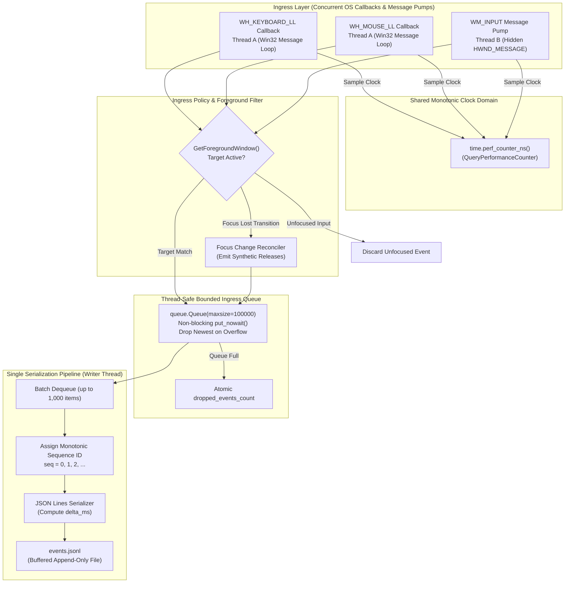
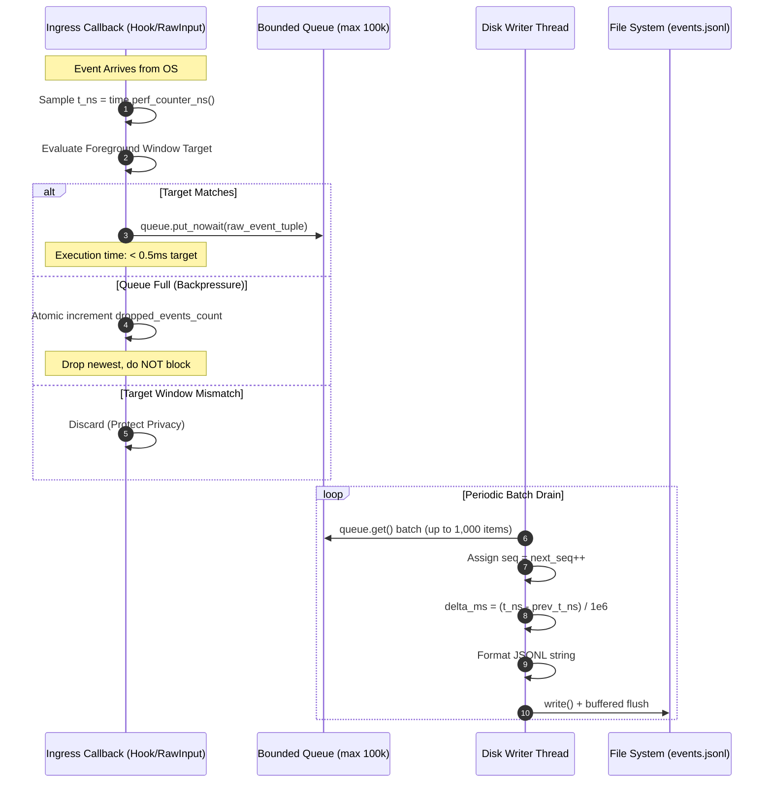

# Final Architecture Corrections & Production Specification: Standalone Windows Input Recorder

**Date & Timestamp**: 2026-10-23 23:05:00 +07:00  
**Project**: Standalone Recorder (`C:\DEV\tools\recorder\`)  
**Reports Repository**: `https://github.com/thangnx-mc/reports` (`main` branch)  
**Destination**: `recorder/2026-10-23_23-05-00_input_recorder_final_design_corrections.md`  
**Classification**: **Architecture Corrections & Engineering Specification (Documentation Only — Zero Code/Build Mutations)**

---

## 1. Executive Summary & Purpose

This document delivers the final, rigorous corrections to the design review published in [`recorder/2026-10-23_22-55-00_input_recorder_design_review.md`](https://github.com/thangnx-mc/reports/blob/main/recorder/2026-10-23_22-55-00_input_recorder_design_review.md).

Prior drafts established the hybrid capture concept (combining Windows Low-Level Hooks and Raw Input) but contained technical inaccuracies regarding Win32 constants, sequencing semantics, unprovable performance claims, foreground-window filtering timing, emergency stop configurability, Raw Input packet flags, and state reconciliation.

This specification definitively corrects these seven areas before any implementation begins in `C:\DEV\tools\recorder\`. It establishes exact Win32 API contracts, concrete failure handling, test boundaries, and verified Microsoft documentation references.

---

## 2. Comprehensive Correction Matrix

The table below maps each identified issue to its exact root cause and corrected engineering specification:

| # | Domain / Issue | Previous Flawed Baseline | Corrected Engineering Specification | Win32 & Architectural Rationale |
| :--- | :--- | :--- | :--- | :--- |
| **1** | **Keyboard Hook Flag Constants** | Stated `LLKHF_INJECTED = 0x01`, conflating extended key and injected flags. | `LLKHF_EXTENDED = 0x01`<br/>`LLKHF_LOWER_IL_INJECTED = 0x02`<br/>`LLKHF_INJECTED = 0x10`<br/>`LLKHF_ALTDOWN = 0x20`<br/>`LLKHF_UP = 0x80`<br/>*(Mouse: `LLMHF_INJECTED = 0x01`)* | In `winuser.h`, keyboard flags place `LLKHF_INJECTED` at bit 4 (`0x10`) because bit 0 is `LLKHF_EXTENDED`. Mouse hooks lack extended keys, placing `LLMHF_INJECTED` at bit 0 (`0x01`). |
| **2** | **Sequencing & Timestamp Semantics** | Ingress assigned `seq` in text, but diagram showed writer assigning `seq`. Claimed strict causal ordering across independent input hooks. | `seq` is assigned **exclusively by the single Disk Writer Thread** upon dequeuing for serialization. `seq` represents **Recorder serialization order**, not proof of physical causality. `timestamp_ns` remains on a single `time.perf_counter_ns()` monotonic domain. | Win32 hooks and Raw Input arrive via separate OS dispatch paths and threads. Multi-producer ingestion order cannot prove microswitch closure order. Writer assignment guarantees contiguous sequence numbering without gaps. |
| **3** | **Performance & Latency Claims** | Claimed hard $<0.1\,\text{ms}$ callback latency, zero dynamic allocations in Python, and "eliminating hook-timeout risk". | Replaced with **measurable engineering targets**: median callback $<0.5\,\text{ms}$, 99th percentile $<2.0\,\text{ms}$. Acknowledged Python runtime heap allocations. Defined explicit benchmark harness. | Python cannot guarantee zero memory allocations during method calls or queue operations. Windows non-RTOS scheduler can experience DPC latency spikes; hook timeout risk is minimized by non-blocking queue writes, not eliminated. |
| **4** | **Foreground-Window Filtering** | Writer thread checked `GetForegroundWindow()`, evaluating window state hundreds of milliseconds after events occurred. | Target-window filtering occurs **strictly at event-ingress time** in the callback/pump. Added `focus_lost` / `focus_regained` stream markers and synthetic release reconciliation for held inputs. | Checking foreground window during asynchronous disk writes inspects stale or future state. Held keys released while unfocused must be reconciled to prevent stuck key states. |
| **5** | **Emergency Stop Behavior** | Forced `F8` or `Esc` as hard-coded immutable defaults; lacked collision and suppression details. | Stop hotkey is **fully configurable** (e.g. `Ctrl+Shift+F12`). Defined configurable key suppression (`suppress_stop_hotkey: bool`). Provided multi-path stop controls (hotkey, UI button, CLI signal). | Hard-coded `Esc` or `F8` collides with game controls (Roblox menu/backpack). Clean shutdown must drain queue, close handles, and log disk errors if finalization fails. |
| **6** | **Raw Input Movement Flags** | Assumed all `lLastX/lLastY` values are relative deltas. Claimed 100% guaranteed Roblox camera capture from architecture alone. | Explicitly inspects `raw.data.mouse.usFlags & MOUSE_MOVE_ABSOLUTE`. Normalizes absolute packets if present. Classified 3D camera pan capture as an **empirical runtime acceptance test**, not an architectural given. | Remote desktop, drawing tablets, and virtual machines deliver absolute coordinates in Raw Input. Raw Input passes through `User32!GetRawInputData`, not an unfiltered kernel driver. |
| **7** | **State Tracking & Modifier Fidelity** | Lacked mouse button held tracking; did not differentiate left/right modifiers; used unverified claims ("100% capture"). | Formal state tracker for both keys and mouse buttons. Left/Right modifiers resolved via scan codes and `LLKHF_EXTENDED`. All throughput claims reframed as benchmark targets. | Full modifier fidelity requires checking `LLKHF_EXTENDED` (Ctrl/Alt) and OEM scan codes (Shift). Acceptance criteria require empirical validation. |

---

## 3. Win32 Constants, Structures & Authoritative References

### 3.1 Low-Level Keyboard Hook: `KBDLLHOOKSTRUCT`
Authoritative reference: [Microsoft Learn: `KBDLLHOOKSTRUCT` structure (winuser.h)](https://learn.microsoft.com/en-us/windows/win32/api/winuser/ns-winuser-kbdllhookstruct)

In `winuser.h`, the `flags` field contains bit flags defining the transition and injection state:

```c
typedef struct tagKBDLLHOOKSTRUCT {
    DWORD     vkCode;
    DWORD     scanCode;
    DWORD     flags;
    DWORD     time;
    ULONG_PTR dwExtraInfo;
} KBDLLHOOKSTRUCT, *PKBDLLHOOKSTRUCT, *LPKBDLLHOOKSTRUCT;

/* Flag bit masks in KBDLLHOOKSTRUCT.flags */
#define LLKHF_EXTENDED          0x00000001  // Bit 0: Extended-key flag (e.g. function keys, numpad navigation)
#define LLKHF_LOWER_IL_INJECTED 0x00000002  // Bit 1: Injected from a process running at lower integrity level
#define LLKHF_INJECTED          0x00000010  // Bit 4: Injected from any process (SendInput / keybd_event)
#define LLKHF_ALTDOWN           0x00000020  // Bit 5: Context code (Alt key is pressed)
#define LLKHF_UP                0x00000080  // Bit 7: Transition state (0 = Key Down, 1 = Key Up)
```

**Evaluation Logic in Ingress Callback**:
```python
is_extended = bool(p.flags & 0x01)           # LLKHF_EXTENDED
is_lower_il_injected = bool(p.flags & 0x02)  # LLKHF_LOWER_IL_INJECTED
is_injected = bool(p.flags & 0x10)           # LLKHF_INJECTED (0x10, NOT 0x01!)
is_alt_down = bool(p.flags & 0x20)           # LLKHF_ALTDOWN
is_up = bool(p.flags & 0x80)                 # LLKHF_UP
```

---

### 3.2 Low-Level Mouse Hook: `MSLLHOOKSTRUCT`
Authoritative reference: [Microsoft Learn: `MSLLHOOKSTRUCT` structure (winuser.h)](https://learn.microsoft.com/en-us/windows/win32/api/winuser/ns-winuser-msllhookstruct)

```c
typedef struct tagMSLLHOOKSTRUCT {
    POINT     pt;
    DWORD     mouseData;
    DWORD     flags;
    DWORD     time;
    ULONG_PTR dwExtraInfo;
} MSLLHOOKSTRUCT, *PMSLLHOOKSTRUCT, *LPMSLLHOOKSTRUCT;

/* Flag bit masks in MSLLHOOKSTRUCT.flags */
#define LLMHF_INJECTED          0x00000001  // Bit 0: Injected from any process (SendInput / mouse_event)
#define LLMHF_LOWER_IL_INJECTED 0x00000002  // Bit 1: Injected from a process running at lower integrity level
```

**Evaluation Logic in Ingress Callback**:
```python
is_mouse_injected = bool(p.flags & 0x01)     # LLMHF_INJECTED (0x01 for mouse)
is_mouse_lower_il = bool(p.flags & 0x02)     # LLMHF_LOWER_IL_INJECTED
```

---

### 3.3 Raw Input Mouse Structure: `RAWMOUSE`
Authoritative reference: [Microsoft Learn: `RAWMOUSE` structure (winuser.h)](https://learn.microsoft.com/en-us/windows/win32/api/winuser/ns-winuser-rawmouse)

```c
typedef struct tagRAWMOUSE {
    USHORT usFlags;
    union {
        ULONG ulButtons;
        struct {
            USHORT usButtonFlags;
            USHORT usButtonData;
        } DUMMYSTRUCTNAME;
    } DUMMYUNIONNAME;
    ULONG  ulRawButtons;
    LONG   lLastX;
    LONG   lLastY;
    ULONG  ulExtraInformation;
} RAWMOUSE, *PRAWMOUSE, *LPRAWMOUSE;

/* Indicator flags in RAWMOUSE.usFlags */
#define MOUSE_MOVE_RELATIVE      0x00  // Coordinates are relative to last reported position
#define MOUSE_MOVE_ABSOLUTE      0x01  // Coordinates are absolute (0 to 65535)
#define MOUSE_VIRTUAL_DESKTOP    0x02  // Coordinates are mapped to virtual desktop
#define MOUSE_ATTRIBUTES_CHANGED 0x04  // Requery device attributes
#define MOUSE_MOVE_NOCOALESCE    0x08  // Do not coalesce mouse moves
```

---

## 4. Unified Sequencing, Timing & Ingress Architecture



### 4.1 Timestamp Semantics
- **Single Monotonic Clock Domain**: Every event samples `time.perf_counter_ns()` at the earliest possible instant inside its respective callback or message handler.
- **Unspecified Hardware Origin**: `timestamp_ns` represents nanoseconds elapsed since an arbitrary hardware initialization reference point (`QueryPerformanceCounter`). It is never equated to Unix epoch time.
- **Wall-Clock Metadata**: A single UTC ISO 8601 string (`session_start_iso_utc`) is captured once when the session is initialized and written exclusively to `manifest.json`.

### 4.2 Sequence Counter (`seq`) Semantics
- **Assignment Point**: `seq` is assigned **exclusively by the single Disk Writer Thread** as events are dequeued from the in-memory queue immediately prior to JSON serialization.
- **Meaning of `seq`**: `seq` represents the **Recorder's serialization order** in the output dataset.
- **Causality Boundary**: `seq` does **NOT** prove exact physical microswitch causality across independent input sources. Because keyboard hooks, mouse hooks, and Raw Input arrive via separate OS message dispatches, microsecond interleaving reflects OS scheduling and driver buffer delivery, not a provable physical timeline.
- **Tie-Breaking**: If two events possess identical `timestamp_ns`, their relative order in the dataset is defined strictly by the writer's FIFO dequeue order, with `seq` providing a deterministic tie-breaker.
- **Contiguity Guarantee**: Assigning `seq` in the writer thread guarantees that the recorded `events.jsonl` stream contains strictly contiguous sequence numbers ($0, 1, 2, \dots$) with zero numbering gaps, even if events were dropped upstream due to queue overflow.

---

## 5. Producer, Sequencer & Writer Responsibilities



### 5.1 Ingress Callback Contract (Producers)
1. **Zero Disk I/O & Zero Serialization**: Callbacks must never write to disk, format JSON strings, or execute complex regex operations.
2. **Zero Unbounded Blocking**: Never acquire locks with unbounded wait times. Ingress queue pushes must use non-blocking `queue.put_nowait()`.
3. **Queue Overflow Policy**: If the bounded queue is full ($100,000$ items), the callback catches `queue.Full`, atomically increments `dropped_events_count`, and returns immediately to the OS via `CallNextHookEx`.
4. **State Snapshotting**: Extract all Win32 struct data into primitive types (`int`, `bool`, `float`) before enqueueing.

### 5.2 Disk Writer Contract (Sequencer & Consumer)
1. **Single Writer Execution**: Exactly one thread consumes from the queue and writes to `events.jsonl`.
2. **Batch Processing**: Drains up to $1,000$ queued tuples per iteration using `queue.get_nowait()` to maximize I/O throughput.
3. **Sequence Stamping**: Assigns monotonically increasing integer `seq: int` ($0, 1, 2, \dots$).
4. **Periodic Disk Flush**: Flushes the file buffer to disk every $1.0\,\text{second}$ or every $1,000$ events, ensuring that an unexpected process crash preserves data up to the last flush boundary.

---

## 6. Foreground-Window Filtering, Focus Transition & Privacy

### 6.1 Ingress-Time Filtering Rule
Filtering decisions must occur at **event-ingress time** inside the callback thread, **never** in the background writer thread.

```python
# Ingress-Time Evaluation Logic
def on_keyboard_event(p):
    t_ns = time.perf_counter_ns()
    hwnd_fg = win32gui.GetForegroundWindow()
    _, pid = win32process.GetWindowThreadProcessId(hwnd_fg)
    
    is_target = (pid == config.target_pid) if config.filter_enabled else True
    
    if not is_target:
        # Check if we just transitioned from focused to unfocused
        if state_tracker.was_target_focused:
            handle_focus_lost(t_ns)
        return CallNextHookEx(None, nCode, wParam, lParam)
    
    if not state_tracker.was_target_focused:
        handle_focus_regained(t_ns)
        
    # Process and enqueue target event...
```

### 6.2 Focus Loss & Regain State Reconciliation
If a user is holding navigation keys (e.g. `W` held down) and Alt-Tabs away from the target game window, the physical key release will occur while an external window has focus. If unhandled, this leaves the recorded state with a permanent dangling `key_down`.

**Reconciliation Policy**:
1. **Focus Lost Transition**:
   - When the foreground window changes from target to non-target:
     1. Emit a synthetic `focus_lost` marker event into the queue.
     2. Enumerate all keys currently marked `down` in `active_keys` and mouse buttons in `active_mouse_buttons`.
     3. Emit a synthetic release event for each held input with flag `reconciled: true`.
     4. Clear internal `active_keys` and `active_mouse_buttons` tracking maps.
2. **While Unfocused**:
   - All keyboard, mouse click, and mouse movement events are completely discarded at ingress.
3. **Focus Regained Transition**:
   - When the foreground window returns to the target process:
     1. Emit a synthetic `focus_regained` marker event into the queue.
     2. Resume normal event capture.

### 6.3 Strict Privacy Enforcement
- **Zero Text Extraction**: Never call `WM_GETTEXT` or inspect UI control text.
- **Zero Clipboard Access**: Never call `OpenClipboard` or monitor clipboard changes.
- **Zero Screen Scraping in Ingress**: No OCR or frame reading inside the input pipeline.

---

## 7. Configurable Emergency Stop, Signal Handling & Graceful Shutdown

### 7.1 Configurable Hotkey Specification
- **Configuration Schema**:
  ```json
  {
    "stop_hotkey": {
      "vk_code": 123,
      "key_name": "F12",
      "modifiers": ["ctrl", "shift"],
      "suppress_hotkey_from_system": true
    }
  }
  ```
- **Collision Avoidance**: The default stop hotkey is configured as `Ctrl + Shift + F12` to prevent collisions with in-game single-key shortcuts (`Esc` for menu, `F8` for backpack/tools).
- **Key Suppression Policy**:
  - If `suppress_hotkey_from_system == true`: The low-level keyboard hook callback returns `1` instead of calling `CallNextHookEx`, consuming the keystroke so it is neither dispatched to the game nor recorded into `events.jsonl`.
  - If `suppress_hotkey_from_system == false`: The stop keystroke is passed through to the OS and retroactively trimmed from the queue before finalization (tail trimming).

### 7.2 Multi-Path Stop Controls
In addition to the global stop hotkey, the recorder must support:
1. **UI Stop Button**: Accessible via minimal floating status toolbar.
2. **Console Signal**: Clean `SIGINT` (`Ctrl+C`) handling in CLI mode.
3. **Named Pipe / IPC Signal**: Local IPC command `STOP_RECORDING` allowing external process control.

### 7.3 Orderly Shutdown Pipeline & Error Resilience
1. **Producer Shutdown**:
   - Set atomic flag `recording_active = False`.
   - Call `UnhookWindowsHookEx` for both keyboard and mouse hooks.
   - Call `RegisterRawInputDevices` with `RIDEV_REMOVE` to deregister Raw Input.
2. **Queue Drain**:
   - The writer thread continues draining the queue until empty, or until a configurable `shutdown_drain_timeout_seconds` (default: $5.0\,\text{s}$) expires.
3. **Manifest Finalization**:
   - Write session summary, duration, metrics, and `unreleased_keys_at_stop` to `manifest.json`.
4. **File System Error Handling**:
   - If disk space is exhausted or an `IOError` occurs while writing `manifest.json`:
     - Log failure to `stderr` and fallback `audit.log`.
     - Do not corrupt `events.jsonl`.
     - Incomplete sessions remain fully readable up to the last valid line.

---

## 8. Raw Input Motion Handling: Relative vs Absolute

### 8.1 Inspecting `RAWMOUSE.usFlags`
Raw Input coordinates delivered in `WM_INPUT` cannot be assumed to be relative deltas:

```python
# Raw Input Processing Contract
def on_wm_input_mouse(raw_mouse):
    t_ns = time.perf_counter_ns()
    flags = raw_mouse.usFlags
    
    is_absolute = bool(flags & 0x01)  # MOUSE_MOVE_ABSOLUTE
    is_virtual_desktop = bool(flags & 0x02)  # MOUSE_VIRTUAL_DESKTOP
    
    if is_absolute:
        # Absolute mode (remote desktop, tablet, or VM cursor)
        abs_x = raw_mouse.lLastX
        abs_y = raw_mouse.lLastY
        enqueue_event({
            "type": "mouse_move_absolute",
            "source": "raw_input",
            "timestamp_ns": t_ns,
            "raw_absolute": {"x": abs_x, "y": abs_y, "virtual_desktop": is_virtual_desktop}
        })
    else:
        # Standard relative displacement
        dx = raw_mouse.lLastX
        dy = raw_mouse.lLastY
        
        # Zero-delta filtering: drop stationary noise
        if dx == 0 and dy == 0:
            return
            
        enqueue_event({
            "type": "mouse_move_relative",
            "source": "raw_input",
            "timestamp_ns": t_ns,
            "raw_delta": {"dx": dx, "dy": dy}
        })
```

### 8.2 Architectural Classification
- **Operating System Boundary**: Raw Input is accessed via Windows User32 APIs (`GetRawInputData`), not direct kernel hardware interception. It is subject to OS thread scheduling and User32 message pump dispatching.
- **Roblox 3D Camera Pan Status**: Capture of Roblox camera rotation via Raw Input is classified as a **Runtime Acceptance Hypothesis** to be validated in the test matrix, not a theoretical architectural guarantee.

---

## 9. State Tracking, Left/Right Modifier Resolution & Held Inputs

### 9.1 Left vs Right Modifier Disambiguation
In Windows, low-level keyboard hooks deliver generic virtual key codes (`VK_SHIFT = 0x10`, `VK_CONTROL = 0x11`, `VK_MENU = 0x12`). Disambiguation must use scan codes and extended flags:

| Generic Virtual Key | Disambiguation Rule | Resolved Specific Virtual Key |
| :--- | :--- | :--- |
| `VK_CONTROL` (`0x11`) | `p.flags & LLKHF_EXTENDED` is set | `VK_RCONTROL` (`0xA3`) |
| `VK_CONTROL` (`0x11`) | `p.flags & LLKHF_EXTENDED` is NOT set | `VK_LCONTROL` (`0xA2`) |
| `VK_MENU` (`0x12`) | `p.flags & LLKHF_EXTENDED` is set | `VK_RMENU` (`0xA5`, Right Alt / AltGr) |
| `VK_MENU` (`0x12`) | `p.flags & LLKHF_EXTENDED` is NOT set | `VK_LMENU` (`0xA4`, Left Alt) |
| `VK_SHIFT` (`0x10`) | `p.scanCode == 0x36` | `VK_RSHIFT` (`0xA1`) |
| `VK_SHIFT` (`0x10`) | `p.scanCode == 0x2A` (or other) | `VK_LSHIFT` (`0xA0`) |

### 9.2 Complete Held-State Tracker
The recorder maintains:
- `active_keys: dict[int, KeyPressState]` tracking `vk_code`, `scan_code`, `extended`, and `press_timestamp_ns`.
- `active_mouse_buttons: set[str]` tracking held mouse buttons (`"left"`, `"right"`, `"middle"`, `"x1"`, `"x2"`).

On shutdown or emergency stop, any remaining entries in these collections are populated in `manifest.json` under `unreleased_inputs_at_stop: { "keys": [...], "buttons": [...] }`.

---

## 10. Performance Benchmarks, Metrics & Error Recovery

### 10.1 Measurable Performance Targets (Replacing Hard Guarantees)
- **Callback Latency Target**:
  - Median callback processing time: $<0.5\,\text{ms}$.
  - 99th percentile callback processing time: $<2.0\,\text{ms}$.
  - *Measurement*: Evaluated via a high-resolution benchmark fixture measuring time spent between hook entry and `CallNextHookEx`.
- **Throughput Benchmark Targets**:
  - Handle burst rates of up to $2,000$ events/second (simulating 1000Hz gaming mouse movement + rapid keystrokes) without exceeding $5\%$ CPU utilization on a standard multi-core CPU.
- **Queue High-Water Mark Accounting**:
  - Continuously track peak queue depth (`max_queue_depth_reached`) and write it to `manifest.json`.

### 10.2 Error Accounting & Recovery
- **Write Failures**: Catch all file write exceptions; increment `write_errors_count`.
- **Incomplete Sessions**: If `manifest.json` is missing due to a sudden power loss or process kill, `events.jsonl` remains a valid, self-delimiting record stream. A recovery utility can reconstruct session metrics by scanning the JSONL file up to the last uncorrupted newline.

---

## 11. Final Event Schema & Manifest Specification

### 11.1 Concrete Event Schema Examples

#### Key Down (Physical Press with Left/Right Resolution)
```json
{
  "seq": 104,
  "timestamp_ns": 4812304918200,
  "delta_ms": 15.82,
  "type": "key_down",
  "source": "hook_keyboard",
  "vk": 160,
  "generic_vk": 16,
  "scan_code": 42,
  "key_name": "lshift",
  "extended": false,
  "is_repeat": false,
  "injected": false
}
```

#### Mouse Move Relative (Raw Input Relative Delta)
```json
{
  "seq": 105,
  "timestamp_ns": 4812306918200,
  "delta_ms": 2.00,
  "type": "mouse_move_relative",
  "source": "raw_input",
  "raw_delta": {
    "dx": 12,
    "dy": -4
  },
  "injected": null
}
```

#### Mouse Move Absolute (Raw Input Absolute Coordinate)
```json
{
  "seq": 106,
  "timestamp_ns": 4812308918200,
  "delta_ms": 2.00,
  "type": "mouse_move_absolute",
  "source": "raw_input",
  "raw_absolute": {
    "x": 32768,
    "y": 16384,
    "virtual_desktop": true
  },
  "injected": null
}
```

#### Mouse Button Down (With Cursor Context)
```json
{
  "seq": 107,
  "timestamp_ns": 4812310918200,
  "delta_ms": 2.00,
  "type": "mouse_button_down",
  "source": "hook_mouse",
  "button": "right",
  "cursor": {
    "x": 960,
    "y": 540
  },
  "injected": false
}
```

#### Focus Lost Reconciled Key Release
```json
{
  "seq": 108,
  "timestamp_ns": 4812350918200,
  "delta_ms": 40.00,
  "type": "key_up",
  "source": "synthetic_reconciler",
  "vk": 87,
  "generic_vk": 87,
  "scan_code": 17,
  "key_name": "w",
  "extended": false,
  "is_repeat": false,
  "reconciled": true,
  "injected": false
}
```

---

### 11.2 Complete `manifest.json` Specification

```json
{
  "schema_version": "1.1.0",
  "session_id": "rec_20261023_230500_b2c3d4e5",
  "session_start_iso_utc": "2026-10-23T16:05:00.123456Z",
  "session_end_iso_utc": "2026-10-23T16:06:30.654321Z",
  "session_start_perf_ns": 4812304918200,
  "session_end_perf_ns": 4902835821200,
  "duration_seconds": 90.5309,
  "environment": {
    "os": "Windows 11 Home 10.0.26100",
    "architecture": "AMD64",
    "dpi_awareness": "DPI_AWARENESS_CONTEXT_PER_MONITOR_AWARE_V2",
    "target_process_filtered": true,
    "target_process_name": "RobloxPlayerBeta.exe"
  },
  "metrics": {
    "total_events_serialized": 14250,
    "event_breakdown": {
      "key_down": 450,
      "key_up": 451,
      "mouse_button_down": 42,
      "mouse_button_up": 42,
      "mouse_move_relative": 13230,
      "mouse_move_absolute": 0,
      "mouse_wheel": 25,
      "focus_lost": 1,
      "focus_regained": 1
    },
    "dropped_events_count": 0,
    "write_errors_count": 0,
    "max_queue_depth_reached": 184,
    "unreleased_inputs_at_stop": {
      "keys": [],
      "buttons": []
    }
  },
  "replay_contract": {
    "requires_release_all_on_start": true,
    "requires_release_all_on_stop": true
  }
}
```

---

## 12. Comprehensive Verification & Test Strategy

To prevent over-claiming, the test matrix establishes distinct operational boundaries:

| Test Tier | Test Scope & Methodology | What It PROVES | What It CANNOT Prove |
| :--- | :--- | :--- | :--- |
| **Tier 1: Unit Tests** | Pure Python tests using mock input generators and memory queues. | - Correct JSON schema formatting.<br/>- Monotonic sequence contiguity.<br/>- State machine repeat tagging and modifier resolution.<br/>- Queue overflow counter increments. | - Does NOT prove Windows hooks install successfully.<br/>- Does NOT test OS callback timing. |
| **Tier 2: Windows Subsystem Integration** | Live Win32 API tests in an isolated test harness using `SendInput`. | - Hooks intercept user-mode injected events.<br/>- `LLKHF_INJECTED (0x10)` correctly tags injected keys.<br/>- Hidden message pump receives `WM_INPUT`.<br/>- Unhooking cleans up completely without leaks. | - Does NOT prove capture of games running under kernel anti-cheat.<br/>- Does NOT test physical mouse sensor displacement. |
| **Tier 3: Performance & Stress Benchmarks** | High-frequency simulated burst test (2,000+ events/sec). | - Queue remains bounded under backpressure.<br/>- Writer drains queue without unbounded latency.<br/>- Quantifies callback timing distribution (median and 99th percentile). | - Does NOT guarantee zero frame drops under extreme OS starvation or disk failure. |
| **Tier 4: Live Roblox Acceptance Checklist** | Manual verification test running actual Roblox game client. | - Proves whether Raw Input captures camera pans while cursor is locked.<br/>- Proves emergency stop functions while Roblox is focused.<br/>- Confirms unreleased keys are correctly reconciled on focus loss. | - Only proves behavior on the specific tested hardware, OS build, and Roblox version. |

---

## 13. Strict Project Boundaries & Verification Log

### 13.1 Boundary Assertions
- **`C:\DEV\tools\rb\`**: Kept completely frozen. Zero files created, modified, or deleted.
- **`C:\DEV\tools\recorder\`**: Untouched. Zero scaffolding, code, configuration, or temporary files created.
- **Reports Repository**: Committed and pushed solely this Markdown report (`recorder/2026-10-23_23-05-00_input_recorder_final_design_corrections.md`) to `thangnx-mc/reports` on branch `main`.

### 13.2 Next Steps
This completes all necessary architectural corrections. The agent will now **STOP** and wait for explicit user approval before performing any file scaffolding or code implementation in `C:\DEV\tools\recorder\`.
