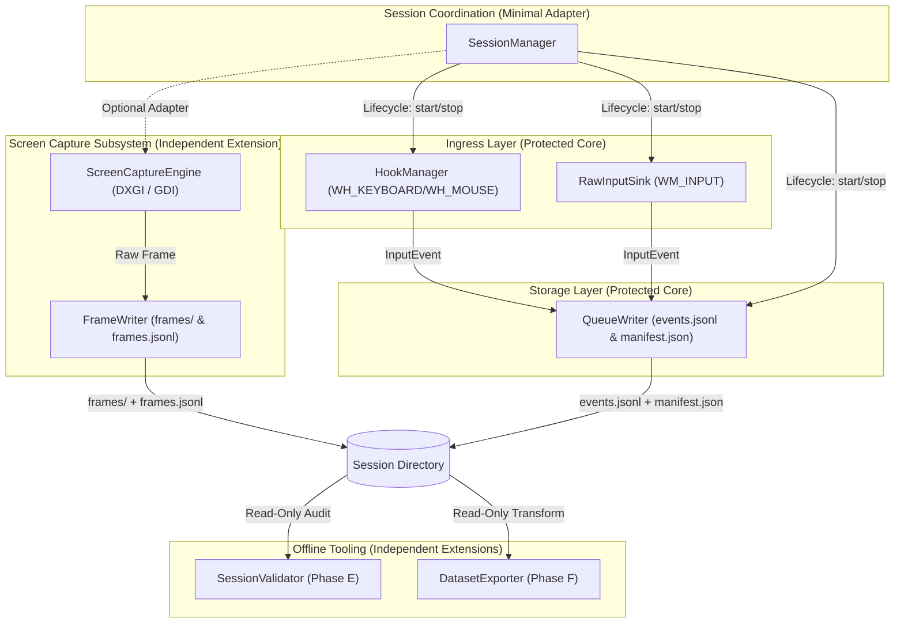

# Recorder Project — Master Development Plan
**Version:** 1.0  
**Phase:** A — Read-Only Architecture & Dataset Readiness Audit  
**Date:** 2026-10-25 03:15:00 UTC+7  
**Project Root:** `C:\DEV\tools\recorder\`  
**Protected Project:** `C:\DEV\tools\rb\` (FROZEN)  
**Reports Repository:** `https://github.com/thangnx-mc/reports`, branch `main`  

---

## 1. Executive Summary & Readiness Assessment

`[FACT]` The standalone Windows Input Recorder at `C:\DEV\tools\recorder\` possesses a verified, working Record and Replay foundation. User testing on 2026-10-24 confirmed that keystroke capture, mouse button clicks, relative mouse movements, and absolute physical cursor tracking under Windows Per-Monitor V2 DPI awareness function reliably.

`[FACT]` The application operates as a standalone Python 3.12 desktop utility, with zero third-party runtime dependencies. All hardware hooks (`WH_KEYBOARD_LL`, `WH_MOUSE_LL`), Raw Input message pumps (`WM_INPUT`), and synthetic input injection (`SendInput`, `SetCursorPos`) are implemented directly via standard library `ctypes` calling User32 and Kernel32 APIs.

`[FACT]` **Zero screen capture capability currently exists** in the standalone Recorder codebase. There are no imaging libraries installed, no capture threads, and no screenshot data serialized in existing session folders.

`[INFERENCE]` While the current input pipeline serializes nanosecond-monotonic timestamps (`time.perf_counter_ns()`) and microsecond delta times, the project is currently an **input-only recorder**. Transforming it into an imitation-learning data engine requires extending the architecture with an isolated, asynchronous visual capture subsystem, an explicit timeline synchronization contract, an offline session validator, and an export pipeline.

`[RECOMMENDATION]` Follow the phased roadmap outlined in Section 10. Specifically, treat the existing Record and Replay core as **protected and frozen**, implementing visual capture (Phase C) behind isolated interfaces to guarantee that screenshot processing can never compromise input capture integrity.

---

## 2. Confirmed Project Structure & Module Responsibility Map

`[FACT]` Inspection of `C:\DEV\tools\recorder\` reveals the following layout:

```text
C:\DEV\tools\recorder\
├── .venv\                     # Python 3.12.13 virtual environment (uv-managed)
├── build\recorder\            # PyInstaller build artifacts cache
├── datasets\                  # Base directory for recorded sessions
├── dist\recorder\             # Compiled standalone distribution (recorder.exe, config.json)
│   └── datasets\sessions\     # Live user-recorded sessions (session_20261024_152634_4338, etc.)
├── src\                       # Application source packages
│   ├── __init__.py
│   ├── main.py                # Entry point, CLI parsing, early Per-Monitor V2 DPI awareness activation
│   ├── core\                  # Core primitives (timestamps, data models, queue writer, state tracking)
│   │   ├── __init__.py
│   │   ├── clock.py           # Nanosecond monotonic perf_counter and UTC ISO-8601 formatting
│   │   ├── event_models.py    # Dataclasses: InputEvent, CursorPos, RawDelta, SessionManifest
│   │   ├── queue_writer.py    # Thread-safe bounded queue writer with fsync flush and drop metrics
│   │   └── state_tracker.py   # Deduplication, auto-repeat disambiguation, unreleased key tracking
│   ├── replay\                # Replay subsystem
│   │   ├── __init__.py
│   │   ├── input_injector.py  # Win32 SendInput synthesis, virtual desktop clamping, safety release_all
│   │   ├── replay_engine.py   # Threaded worker, hybrid sleep slicing, event routing, cancellation
│   │   └── session_selector.py# Quality gate validating session integrity, drops, and manifest status
│   ├── session\               # Session lifecycle coordination
│   │   ├── __init__.py
│   │   └── session_manager.py # State machine, mutual exclusivity, ingress connection, manifest metadata
│   ├── ui\                    # User interface
│   │   ├── __init__.py
│   │   └── app.py             # Tkinter dark-theme GUI, non-repeat telemetry aggregation, real-time metrics
│   └── windows\               # Win32 hardware ingress and definitions
│       ├── __init__.py
│       ├── hook_manager.py    # Low-level WH_KEYBOARD_LL & WH_MOUSE_LL hooks, hotkey suppression, echo filter
│       ├── raw_input_sink.py  # Hidden message-only window processing WM_INPUT raw mouse mickeys & cursor coords
│       └── win32_defs.py      # Win32 ctypes structures, User32/Kernel32 bindings, DPI awareness helper
├── tests\                     # Comprehensive pytest test suite (10 test modules, 37 passing test cases)
├── config.json                # Runtime configuration (hotkeys, storage queue limits, replay options)
├── recorder.spec              # PyInstaller spec configuration
└── requirements.txt           # Build and test dependencies (pytest>=9.0.0, pyinstaller>=6.0.0)
```

### Module Responsibility & Classification Table

| Module | Primary Responsibility | Classification |
| :--- | :--- | :--- |
| `src/main.py` | Entry point, CLI arguments (`--cli`, `--replay`, `--speed`), early DPI awareness. | **Protected Core** |
| `src/core/clock.py` | Monotonic time (`perf_counter_ns`), ISO UTC strings, delta calculation. | **Protected Core** |
| `src/core/event_models.py` | Data contracts (`InputEvent`, `SessionManifest`, `CursorPos`, `RawDelta`). | **Potential Integration Point** |
| `src/core/queue_writer.py` | Bounded queue, JSONL streaming, drop policy, manifest writing. | **Protected Core** |
| `src/core/state_tracker.py` | Deduplication, auto-repeat tracking, unreleased input snapshots. | **Protected Core** |
| `src/windows/win32_defs.py` | Win32 structs, User32/Kernel32 bindings, DPI awareness helper. | **Protected Core** |
| `src/windows/hook_manager.py` | Low-level hooks, hotkey suppression (`;`, `'`, `K`), injected filter. | **Protected Core** |
| `src/windows/raw_input_sink.py` | Raw mouse mickeys (`WM_INPUT`), physical cursor position sampling. | **Protected Core** |
| `src/session/session_manager.py` | State machine, start/stop lifecycle, manifest environment metadata. | **Potential Integration Point** |
| `src/replay/session_selector.py`| Validates manifest completion, integrity, zero drops, non-empty events. | **Protected Core** |
| `src/replay/input_injector.py` | `SendInput`, `SetCursorPos`, virtual desktop clamping, `release_all()`. | **Protected Core** |
| `src/replay/replay_engine.py` | Replay thread, precise hybrid sleep, speed multiplier, cancellation. | **Protected Core** |
| `src/ui/app.py` | Tkinter dark GUI, telemetry breakdown, polling metrics, action buttons. | **Protected Core** |
| `src/capture/*` *(Future)* | Screen capture engine and asynchronous frame writer. | **Independent Extension Point** |
| `src/validation/*` *(Future)* | Offline session validator and dataset quality gate. | **Independent Extension Point** |
| `src/export/*` *(Future)* | Offline dataset exporter for imitation learning formats. | **Independent Extension Point** |

---

## 3. Record and Replay Architecture & Protected Modules

### 3.1 Input Capture Architecture
`[FACT]` The input ingress uses a two-tier hardware capture architecture:
1. **Low-Level Hooks (`src/windows/hook_manager.py`)**:
   - `WH_KEYBOARD_LL` (13) and `WH_MOUSE_LL` (14) installed via `SetWindowsHookExW` in a dedicated thread (`HookManagerThread`) with an active Win32 message loop (`GetMessageW`).
   - Captures discrete transitions: `key_down`, `key_up`, `mouse_button_down`, `mouse_button_up`, `mouse_wheel`.
   - **Hotkey Interception**: Intercepts `;` (Record), `'` (Stop), and `K` (Replay toggle). Symmetrical suppression returns `1` to prevent hotkeys from leaking to target applications.
   - **Echo Filtering**: Drops synthetic events (`LLKHF_INJECTED = 0x10` or `LLMHF_INJECTED = 0x01`) during recording so that Replay outputs are never re-recorded.
2. **Raw Input Message Sink (`src/windows/raw_input_sink.py`)**:
   - Registers a hidden message-only window (`HWND_MESSAGE`) receiving `WM_INPUT` with `RIDEV_INPUTSINK` on mouse usage page `1`, usage `2`.
   - Captures unaccelerated hardware displacement mickeys (`raw_mouse.lLastX`, `raw_mouse.lLastY`).
   - Simultaneously queries physical cursor coordinates via `user32.GetCursorPos()` (taking ~0.6 microseconds) and attaches `cursor: CursorPos(x, y)` to `mouse_move_relative` events alongside `raw_delta: RawDelta(dx, dy)`.

### 3.2 Mouse Coordinate System & DPI Awareness
`[FACT]` `src/windows/win32_defs.py` executes `enable_dpi_awareness()` on module load, setting `DPI_AWARENESS_CONTEXT_PER_MONITOR_AWARE_V2` (-4).
- On a 1080p monitor scaled at 125% DPI, `GetSystemMetrics(0)` returns the true physical resolution `(1920, 1080)`.
- Physical cursor coordinates captured by `WH_MOUSE_LL` and `GetCursorPos()` match `SetCursorPos()` 1:1 without operating system virtualization, coordinate scaling distortion, or right-edge clamping.

### 3.3 Replay Engine Architecture
`[FACT]` The replay subsystem (`src/replay/replay_engine.py` and `src/replay/input_injector.py`) operates as follows:
- **Quality Gate**: `session_selector.is_session_valid_and_complete()` requires `status == 'complete'`, `integrity_status == 'VALID'`, `flush_confirmed == True`, zero dropped events, zero write errors, and a non-empty `events.jsonl`.
- **Timing Reproduction**: Replay executes on `ReplayWorkerThread`. Inter-event delay is computed as `(delta_ms / 1000.0) / playback_speed`. `_precise_sleep()` slices delays into 5ms intervals polling a cancellation event, then spin-waits the final 2ms for sub-millisecond precision.
- **Routing**:
  - `cursor_pos`: Places the cursor at recorded physical coordinates at session start.
  - `mouse_move_relative`: If Right Mouse Button is held (3D camera rotation mode), injects relative displacement via `SendInput(MOUSEEVENTF_MOVE, dx, dy)`. If RMB is not held and `cursor` is present (desktop UI mode), places the cursor via `set_cursor_position(cx, cy)`.
  - `mouse_button_down` / `mouse_button_up`: Positions cursor with `set_cursor_position()`, then fires button input.
  - `key_down` / `key_up`: Injects virtual key code and hardware scan code.
- **Virtual Desktop Clamping**: `set_cursor_position()` clamps coordinates to $[vx, vx + vw - 1]$ and $[vy, vy + vh - 1]$, supporting multi-monitor configurations with negative origins.
- **Mandatory Safety Contract**: `InputInjector` tracks active held keys and buttons. Upon session completion, user cancellation (pressing `K`), or unexpected exception, `release_all()` synthesizes release events, preventing stuck inputs in the operating system.

---

## 4. Existing Session Schema & Representative Examples

`[FACT]` Inspection of verified user test sessions in `dist/recorder/datasets/sessions/` (`session_20261024_152634_4338` and `session_20261024_152713_3799`) documents the current data schema.

### 4.1 Manifest Schema (`manifest.json`)
```json
{
  "schema_version": "1.1.0",
  "session_id": "session_20261024_152634_4338",
  "status": "complete",
  "session_start_iso_utc": "2026-10-24T15:26:34.440172Z",
  "session_end_iso_utc": "2026-10-24T15:26:48.558272Z",
  "session_start_perf_ns": 1329564052600,
  "session_end_perf_ns": 1343682152600,
  "duration_seconds": 14.1181,
  "environment": {
    "os": "Windows 11 10.0.26200",
    "architecture": "AMD64",
    "python_version": "3.12.13",
    "keyboard_layout_tested": "US QWERTY",
    "target_process_filtered": false,
    "target_process_name": "RobloxPlayerBeta.exe",
    "dpi_awareness": "PerMonitorV2",
    "initial_cursor": {
      "x": 307,
      "y": 437
    },
    "primary_screen": {
      "width": 1920,
      "height": 1080
    },
    "virtual_desktop": {
      "left": 0,
      "top": 0,
      "width": 1920,
      "height": 1080
    }
  },
  "metrics": {
    "total_events_serialized": 490,
    "event_breakdown": {
      "cursor_pos": 1,
      "mouse_move_relative": 475,
      "mouse_button_down": 7,
      "mouse_button_up": 7
    },
    "dropped_events_count": 0,
    "write_errors_count": 0,
    "max_queue_depth_reached": 1,
    "unreleased_inputs_at_stop": {
      "keys": [],
      "buttons": []
    }
  },
  "integrity": {
    "flush_confirmed": true,
    "hook_failures": 0,
    "clean_shutdown": true,
    "integrity_status": "VALID"
  },
  "replay_contract": {
    "requires_release_all_on_start": true,
    "requires_release_all_on_stop": true
  }
}
```

### 4.2 Event Stream Schema (`events.jsonl`)
Events are serialized as newline-delimited JSON records.

#### Example 1: Initial Cursor Baseline (`cursor_pos`)
```json
{"seq":0,"timestamp_ns":1329564052600,"delta_ms":0.0,"type":"cursor_pos","source":"session_start","injected":null,"cursor":{"x":307,"y":437}}
```

#### Example 2: Synchronized Mouse Motion (`mouse_move_relative`)
```json
{"seq":1,"timestamp_ns":1329611404400,"delta_ms":47.3518,"type":"mouse_move_relative","source":"raw_input","injected":null,"cursor":{"x":307,"y":437},"raw_delta":{"dx":14,"dy":1}}
```

#### Example 3: Discrete Click Event (`mouse_button_down`)
```json
{"seq":249,"timestamp_ns":1335028405000,"delta_ms":12.4501,"type":"mouse_button_down","source":"hook_mouse","injected":false,"button":"left","cursor":{"x":1162,"y":173}}
```

### 4.3 Schema Integrity Analysis
- **Monotonicity**: `timestamp_ns` is strictly monotonically increasing ($t_{i} \ge t_{i-1}$) across all lines.
- **Sequencing**: Atomic sequence counter `seq` strictly increments ($0, 1, 2, \dots$).
- **Interrupted Session Detection**: If an application crashes or power is lost before graceful stop, `manifest.json` will either be absent or have `status: "incomplete"` and `integrity.clean_shutdown: false`. `session_selector` rejects these sessions.
- **Legacy Compatibility**: Sessions recorded prior to coordinate fidelity patches lack `initial_cursor` in manifest and `cursor` in `mouse_move_relative`. Replay handles these safely by preserving relative injection and positioning clicks accurately via DPI-aware coordinates.

---

## 5. Screen-Capture Capability Assessment

`[FACT]` **Zero screen-capture implementation exists** in `C:\DEV\tools\recorder\`.
- No image capture packages (e.g. `PIL`, `cv2`, `mss`, `d3dshot`) are installed in `.venv`.
- No image files (`.png`, `.jpg`, `.webp`) exist within session datasets.
- No frame writer, buffer pool, or image capture thread is present.

### Technical Evaluation of Capture Architectures for Windows

| Capture Mechanism | Technology | Capture Latency (1080p) | CPU/GPU Overhead | Window vs Desktop | Yellow Border | Recommended for Recorder |
| :--- | :--- | :--- | :--- | :--- | :--- | :--- |
| **GDI BitBlt** | `gdi32.dll` / `BitBlt` | 15–25 ms | High (CPU-bound framebuffer readback) | Both (Desktop or HWND via `PrintWindow`) | None | **Fallback Only** (High latency at 30 FPS) |
| **DXGI Desktop Duplication** | Direct3D 11 / DXGI | 1–3 ms | Very Low (Hardware GPU texture copy) | Desktop Output (Monitor) | None | **Primary Desktop Capture** (Low latency, high throughput) |
| **Windows Graphics Capture (WGC)** | WinRT / `Windows.Graphics.Capture` | 2–5 ms | Low (GPU compositor buffer) | Specific Window (`HWND`) or Monitor | Can be disabled on Win11 | **Primary Windowed Game Capture** (Captures game even if occluded) |

`[RECOMMENDATION]`
1. For Phase C, implement an isolated `ScreenCaptureEngine` supporting DXGI Desktop Duplication as the primary high-performance desktop capture path, with a GDI `BitBlt` fallback.
2. Structure capture behind a clean interface: `capture_frame() -> Tuple[bytes, int, float]` returning raw pixels/encoded bytes, capture timestamp (`perf_counter_ns`), and capture duration latency.
3. Ensure the capture thread is decoupled from the input queue via a separate, bounded image buffer pool.

---

## 6. Input / Image Temporal Synchronization Analysis

`[FACT]` The recorder's input ingress samples `time.perf_counter_ns()` upon event receipt:
- Low-level hook events receive timestamps in the hook callback thread.
- Raw Input packets receive timestamps in the message-pump thread.

### 6.1 Synchronization Model & Latency Representation
`[INFERENCE]` Input events and video frames operate on fundamentally different temporal models:
- **Input events** are **discrete, asynchronous impulses** occurring at irregular intervals (e.g. a click takes 0.1ms, followed by 500ms of inactivity).
- **Video frames** are **continuous, periodic area samples** acquired at fixed intervals (e.g. 10 FPS, 20 FPS, 30 FPS).

`[RECOMMENDATION]` Do not attempt to force a 1:1 pairing between input events and image files in `events.jsonl`. Instead, establish a **dual-timeline reference model**:
1. **Shared Monotonic Timeline**: Both input events and frame captures must sample the same monotonic clock: `time.perf_counter_ns()`.
2. **Explicit Frame Sampling Boundaries**:
   For every captured frame $k$, record:
   - `capture_start_ns`: Monotonic timestamp when frame acquisition was triggered.
   - `capture_complete_ns`: Monotonic timestamp when the GPU/CPU buffer transfer finished.
   - `capture_latency_ms`: Measured hardware acquisition overhead:
     $$\text{latency\_ms} = \frac{\text{capture\_complete\_ns} - \text{capture\_start\_ns}}{10^6}$$
3. **Decoupled Serialization**:
   - Write inputs to `events.jsonl` as done today.
   - Write image metadata to a dedicated `frames.jsonl` (or save frames with strictly ordered monotonic filenames: `frame_000001_1329564052600.jpg`).
   - Associate each frame with the latest input event sequence number (`latest_input_seq`) at capture time without claiming false microsecond synchronization.

### 6.2 Error Bounds & Jitter Transparency
- `[FACT]` Windows timer resolution defaults to ~15.6ms unless set to 1ms via `timeBeginPeriod(1)`.
- `[INFERENCE]` Real-world frame capture latency will fluctuate between 1ms and 15ms depending on GPU load.
- `[RECOMMENDATION]` Store `capture_latency_ms` for every frame so dataset consumers and training pipelines can filter or account for frame jitter rather than assuming zero-latency capture.

---

## 7. Dataset-Readiness Gap Analysis for Imitation Learning

Imitation learning (Behavior Cloning / Policy Training) requires learning a policy $\pi_\theta(a_t \mid s_t)$, mapping visual observation $s_t$ (frame) and ambient state to action $a_t$ (keyboard/mouse command).

| Evaluation Dimension | Current State | Requirement for Imitation Learning | Severity / Gap |
| :--- | :--- | :--- | :--- |
| **Visual Observations ($s_t$)** | None | Continuous synchronized screen captures (10–30 FPS). | **BLOCKER (Phase C/D)** |
| **Input Actions ($a_t$)** | Keystrokes, mouse buttons, coordinates, relative deltas serialized with timestamps. | Clean action discretization / continuous vector mapping. | **READY (Phase A/B)** |
| **Spatial Grounding** | Physical cursor coordinates recorded on every move and click. | Normalized viewport coordinates ($x/W, y/H \in [0, 1]$). | **MINOR GAP (Phase F Export)** |
| **3D Camera Context** | Relative mouse displacement mickeys captured via Raw Input. | Disambiguate free-cursor UI clicks from 3D camera pan rotation. | **READY (Achieved via held RMB check)** |
| **Task / Goal Labels** | None (only session timestamp and system metadata). | Episode task annotations (e.g. "Create Lobby", "Equip Weapon", "Defeat Boss"). | **GAP (Phase G)** |
| **Outcome Metadata** | Only integrity status (`VALID` / `COMPROMISED`). | Episode outcome: Success, Failure, Aborted. | **GAP (Phase G)** |
| **Privacy Safeguards** | None (desktop capture would record all open windows). | Target window bounding / background occlusion exclusion. | **HIGH RISK (Phase C/F)** |
| **Storage & Retention** | ~50 KB per minute for JSONL input stream. | ~60–100 MB per minute for JPEG frames at 10 FPS. | **INFRASTRUCTURE REQUIREMENT** |

---

## 8. Risks, Constraints & Unresolved Questions

### 8.1 Technical Risks
1. **Performance Contention**:
   - *Risk*: A synchronous or blocking screen-capture loop could starve the low-level Windows hooks, triggering the Windows 200ms hook timeout (`LowLevelHooksTimeout`) and causing the OS to silently unhook the recorder.
   - *Mitigation*: Screen capture must run on a completely separate thread and write to its own bounded buffer pool, never touching the input hook thread or input queue writer.
2. **GPU Mode Changes / Access Loss**:
   - *Risk*: Direct3D 11 Desktop Duplication returns `DXGI_ERROR_ACCESS_LOST` when a game changes display modes, enters exclusive fullscreen, or a UAC prompt appears.
   - *Mitigation*: The capture engine must implement automatic reconnection logic and record a `frame_drop` marker in `frames.jsonl` rather than crashing the session.
3. **Storage Explosion**:
   - *Risk*: A 30-minute recording session at 30 FPS uncompressed 1080p would produce >300 GB of data.
   - *Mitigation*: Use JPEG or WebP compression with configurable quality (e.g. quality 80), configurable frame rate (default 10 FPS), and optional downscaling (e.g. 720p or 640x360 for model input).

### 8.2 Unresolved Questions
1. `[UNKNOWN]` Does Roblox execute in exclusive fullscreen or borderless windowed mode on the user's primary machine? (DXGI Desktop Duplication captures borderless/windowed reliably; exclusive fullscreen can require window-specific capture).
2. `[UNKNOWN]` What is the target model architecture and input resolution? (e.g. 224x224, 384x384, or native 720p/1080p).
3. `[UNKNOWN]` Will episodes be annotated manually after recording or via UI hotkey markers during recording?

---

## 9. Proposed Architecture with Minimal Integration Points

To strictly satisfy the **Non-Negotiable Failure Isolation Rule (2.4)** and **Minimal-Diff Rule (2.3)**, the screen capture and dataset processing pipelines must be built as **isolated sibling packages**:



### Explicit Integration Points
Only two existing files will ever need modification during future phases:
1. `src/core/event_models.py`: To add optional frame reference definitions (`FrameReference`).
2. `src/session/session_manager.py`: To trigger `start_capture()` and `stop_capture()` in `start_recording()` and `stop_recording()`.

All other capture, validation, and export logic will reside in completely new packages (`src/capture/`, `src/validation/`, `src/export/`).

---

## 10. Proposed Phased Development Roadmap

```mermaid
flowchart LR
    A["Phase A: Audit<br/>(Complete)"] --> B["Phase B: Dataset Contract<br/>& Architecture Approval"]
    B --> C["Phase C: Isolated Screen<br/>Capture Capability"]
    C --> D["Phase D: Input/Image<br/>Temporal Sync"]
    D --> E["Phase E: Offline Session<br/>Validator"]
    E --> F["Phase F: Dataset Export<br/>& Normalization"]
    F --> G["Phase G: Labeling &<br/>Episode Splits"]
    G --> H["Phase H: Training<br/>Experiments"]
```



### Phase B — Dataset Contract & Architecture Approval (Documentation & Schema Only)
- Define formal `manifest.json` schema v1.2.0 including visual capture metadata.
- Define `frames.jsonl` schema and directory convention (`frames/frame_000001.jpg`).
- Establish storage quota limits, compression defaults (JPEG Q80, 10 FPS), and privacy policies.
- Output: Formal Schema Specification. Zero application code changes until approved.

### Phase C — Isolated Screen-Capture Capability
- Create `src/capture/screen_capture.py` (DXGI Desktop Duplication with GDI BitBlt fallback).
- Create `src/capture/frame_writer.py` (Dedicated background encoder thread).
- Unit tests verifying frame capture rate, latency measurement, and graceful fallback.
- Manual verification script capturing a 5-second test video to verify image clarity.

### Phase D — Input / Image Temporal Synchronization
- Wire capture lifecycle into `SessionManager` via explicit adapter.
- Synchronize capture triggers with `time.perf_counter_ns()`.
- Record `capture_latency_ms` and `latest_input_seq` per frame.
- Verify through automated tests that screenshot capture delays or frame drops NEVER affect `events.jsonl`.

### Phase E — Offline Session Validator
- Create `src/validation/session_validator.py`.
- Read-only verification of completed sessions: validates JSONL integrity, timestamp monotonicity, image file presence, zero corrupt frames, and produces a dataset health report.

### Phase F — Dataset Export Pipeline
- Create `src/export/dataset_exporter.py`.
- Transforms raw session recordings into ML-ready tensor formats (HDF5 or WebDataset/Parquet).
- Normalizes mouse coordinates to $[0.0, 1.0]$, discretizes keyboard actions, and generates state-action observation pairs.

### Phase G — Labeling & Episode Splits
- Define task outcome tagging (Success/Failure) and train/val/eval episode partitioning.

### Phase H — Model Training Experiments
- Behavior cloning experiments on validated, exported datasets.

---

## 11. Test and Regression Strategy

### 11.1 Test Layering
1. **Unit Tests (Fast, In-Memory, <1s)**:
   - Clock monotonicity, timestamp calculations, serialization dataclasses, state tracking deduplication.
2. **Component Integration Tests (Mocked OS, ~1s)**:
   - Queue writer overflow and drop policy, replay engine event sequencing, virtual desktop clamping, session selector validation.
3. **Hardware / Win32 Integration Tests (~1s)**:
   - Hook callback structures, physical coordinate extraction, hotkey suppression, injected event filtering.
4. **Visual Capture Tests (New for Phase C/D)**:
   - Hardware capture availability, frame format, timestamp validation, capture loop cancellation.

### 11.2 Regression Safeguard Contract
- Before any future change is merged:
  1. Run full existing test suite: `pytest tests -v` (must maintain 37/37 passing tests).
  2. Run new focused tests covering added functionality.
  3. Rebuild standalone binary and verify via `--cli` test run.

---

## 12. Proposed File Modifications and Untouched Baseline

### Proposed Future File Additions
- `src/capture/__init__.py`
- `src/capture/screen_capture.py` (Isolated capture engine)
- `src/capture/frame_writer.py` (Asynchronous frame encoding and file writing)
- `src/capture/capture_models.py` (Frame dataclasses and metadata contracts)
- `tests/test_screen_capture.py` (Unit tests for capture subsystem)
- `src/validation/__init__.py`
- `src/validation/session_validator.py` (Phase E offline validator)
- `src/export/__init__.py`
- `src/export/dataset_exporter.py` (Phase F offline exporter)

### Existing Files Permitted for Minimal Modification (With Concrete Reasons)
1. `src/core/event_models.py`:
   - *Reason*: Add optional `FrameReference` dataclass to data model definitions.
2. `src/session/session_manager.py`:
   - *Reason*: Instantiate and trigger `ScreenCaptureEngine` start/stop during session lifecycle.
3. `config.json`:
   - *Reason*: Add optional `capture` section (`fps: 10`, `quality: 80`, `enabled: true`).

### Files That Must Remain Strictly Untouched
- `src/windows/hook_manager.py` (Protected core input ingress)
- `src/windows/raw_input_sink.py` (Protected core raw mouse ingress)
- `src/windows/win32_defs.py` (Protected core Win32 definitions and DPI awareness)
- `src/replay/*` (All replay engine, injector, and selector modules)
- `src/core/clock.py` (Protected monotonic clock)
- `src/core/state_tracker.py` (Protected state disambiguation)
- `src/core/queue_writer.py` (Protected input queue writer)
- `src/ui/app.py` (Protected GUI telemetry and button layout)
- `C:\DEV\tools\rb\*` (Completely frozen Dungeon Quest bot)

---

## 13. Evidence Index & Important Claims

- `[FACT]` **Record and Replay verified**: User verified real-world test sessions in `dist/recorder/datasets/sessions/` (`session_20261024_152634_4338` with 490 events, `session_20261024_152713_3799` with 510 events).
- `[FACT]` **DPI awareness verified**: `src/windows/win32_defs.py` activates `PerMonitorV2`; manifest logs `primary_screen: {width: 1920, height: 1080}`.
- `[FACT]` **All existing tests pass**: 37 of 37 automated tests pass in 1.32s via `pytest tests -v`.
- `[FACT]` **Zero screen capture in current code**: Confirmed via codebase scan across `src/` and `requirements.txt`.
- `[FACT]` **Clean reports repository**: Working tree clean on `main` in `C:\DEV\rb-report\`.
- `[FACT]` **Protected bot frozen**: Zero modifications in `C:\DEV\tools\rb\`.
